# Review request: `bible-3`

- Team member: bible
- Branch: `feat/bible/mount-reference-form`
- Depends on merged bible-2; rebased onto local `main`.
- Base and reviewed head: recorded in the member report after rebase.
- Related brief: `docs/briefs/tools.md`; October 26 four-field input decision.

## What changed and why

진행 퀵 실행 and 준비 항목 추가 성경 구절 now mount the same four-field Bible
form. 진행 previews the current valid reference and Enter outputs it. 준비 opens
the existing small dialog component, reads the opening's defaults, and inserts a
passage with Enter or 추가. Invalid or pending references cannot insert;
cancelling forgets pending replies and reopening reads fresh defaults. No output
command comes from the 준비 dialog.

Recent passages retain their original reference, including whole chapters and
cross-chapter ranges. Choosing one clears the manual fields and previews the
stored passage before Enter outputs it. Editing any field starts a fresh manual
reference. Translation changes cannot reuse a stale passage. The dialog's 추가
button follows the form's current ready passage, including equivalent normalized
input, rather than retaining the last successful lookup after invalid edits.

The former single-field tests move to the shared form's interaction tests;
wrapper tests retain recent-range, translation, dismissal, and focus coverage.
Show workspace and quick-panel tests exercise selection cancellation and output
with the new fields. Selecting a recent also clears a previous blocked-field
error, with a regression test proving the old failure. Prep integration covers
shared completion, invalid fields, clamped insertion through both actions and
fresh defaults. Conflict resolution retains main's removal of legacy slot
insertion paths and tests. Spec 04 now agrees with spec 02 and the October 26
decision, addressing the bible-1 review nit.

## Changes outside my paths

- `src/renderer/src/prep/service/QuickAdd.tsx` and its tests connect the shared
  form to the existing item insertion and insertion-position rules.
- `BibleQuickAdd.tsx` supplies the existing small dialog; `useBibleLookup.ts`
  becomes `useBibleDefaults.ts`, removing the duplicate passage reader because
  the shared form owns lookups.
- `docs/spec/04-show.md` replaces obsolete single-field and eight-book rules.
- `docs/reviews/bible-3/` contains screenshots and measured counters using only
  the repository's original invented QA sentences, explicitly not Scripture.

## Checks run

- `npm run typecheck`: passed.
- Scoped Vitest: 75 tests across six renderer files passed.
- Scoped ESLint and formatting: final results in the member report.
- `npm run build`: passed; the actual built app was exercised below.
- CI pending. The dispatcher checks the exact head before merge; members do not
  poll CI under the October 27 rule.
- No full local verify, dependency changes, Bible text, or crawl output.

## Checked in the app

Built with `LLP_DEV_PORT=5193`, launched with `LLP_TEST_WINDOWS=offscreen` and
the isolated Bible member app-data folder. Every launch script and the built
main entry passed `node --check` before Electron started. The sample was copied
from the repository and locally converted to the chapter container. The driver
uses real CDP mouse, keyboard, and text input, without mocking IPC or changing
React state. The app exited normally after the checks. The isolated fixture was
reused, so screenshots include passages inserted by earlier checks.

- Ambiguous 책 has no initial highlight. Tab stays; two ArrowDown presses and
  Tab choose 베드로전서 and advance to 장. Hover alone cannot authorize Tab.
  Exact 요, English John, and IME-off dy complete to 요한복음. After
  asynchronous default loading in 준비, John was typed directly without clicking
  the input.
- A valid 3, 16, 18 reference previews without changing live state. Enter sends
  the passage. Invalid chapter 22 blocks Tab with the field reason. End 99
  blocks Tab, looks up through verse 36, and normalizes to 36 on Enter. Changing
  the start clears the end.
- Switched from a service song to the Bible preview and back for 20 cycles.
  Checked the four fields at 1280 by 720 and the normal 1600 by 900 viewport.
- In 준비, opened and closed the form twice, then repeated start/end changes for
  20 cycles. Reversed end 15 blocks Tab, Enter, and 추가. End 99 inserts
  요한복음 3:16-36, adding exactly one service item while live output remains
  unchanged. Opened and closed twice again after insertion to check cleanup.

Measured after forced GC, with 20 warmup cycles before each measured loop;
[raw counters](bible-3/check.json) record the baseline, 10-cycle and 20-cycle
samples:

| Flow                             | Elements        | Listeners       | Used JS heap, bytes               |
| -------------------------------- | --------------- | --------------- | --------------------------------- |
| Show selection cycles            | 508 / 508 / 508 | 857 / 857 / 857 | 6,762,520 / 6,873,540 / 6,917,544 |
| Prep field changes               | 225 / 225 / 225 | 641 / 641 / 641 | 5,770,000 / 5,804,308 / 5,848,596 |
| Settled Prep after closing twice | 208 / 208       | 776 / 776       | 5,852,180 / 5,875,528             |

Show heap changes 2.3%, Prep 1.4%. The initial Show loop before the extra warmup
grew 6.8%; those startup samples are retained separately in the raw counters.
Prep's total DOM-node counter grows from 420 to 460 during repeated native text
editing, while elements and listeners remain constant; after dialog unmount and
cleanup it falls to 342 and remains 342 across both subsequent closes. These are
short repeated-flow observations, not a long-duration soak or a physical monitor
check.

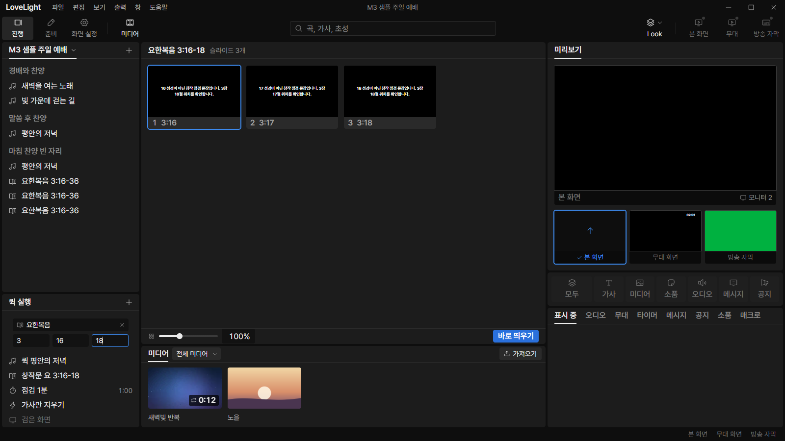

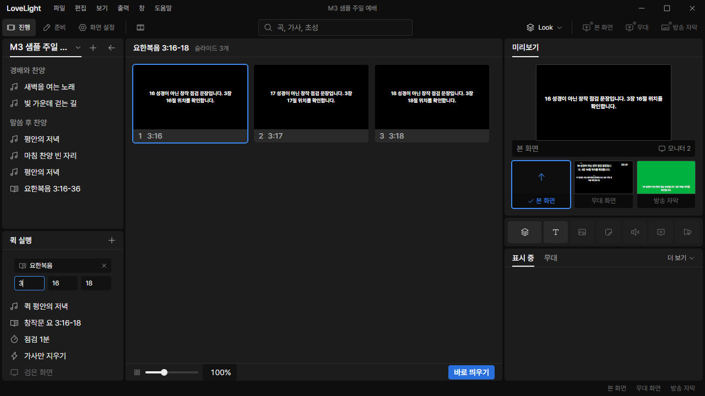

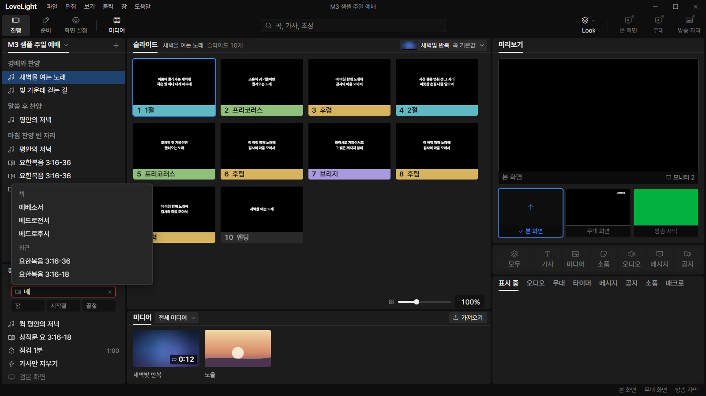

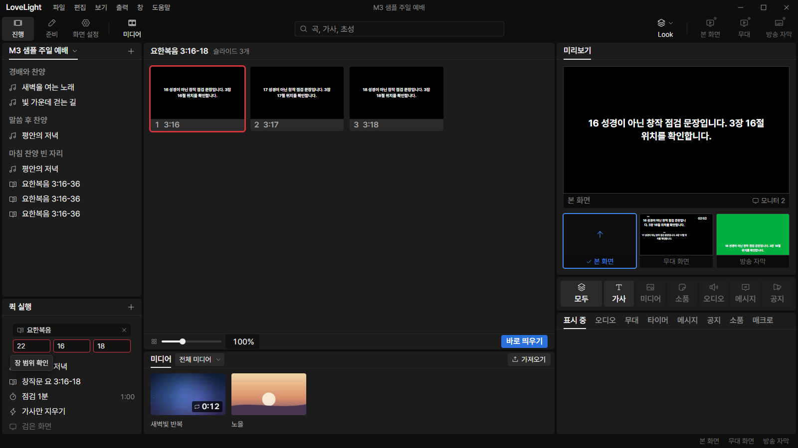

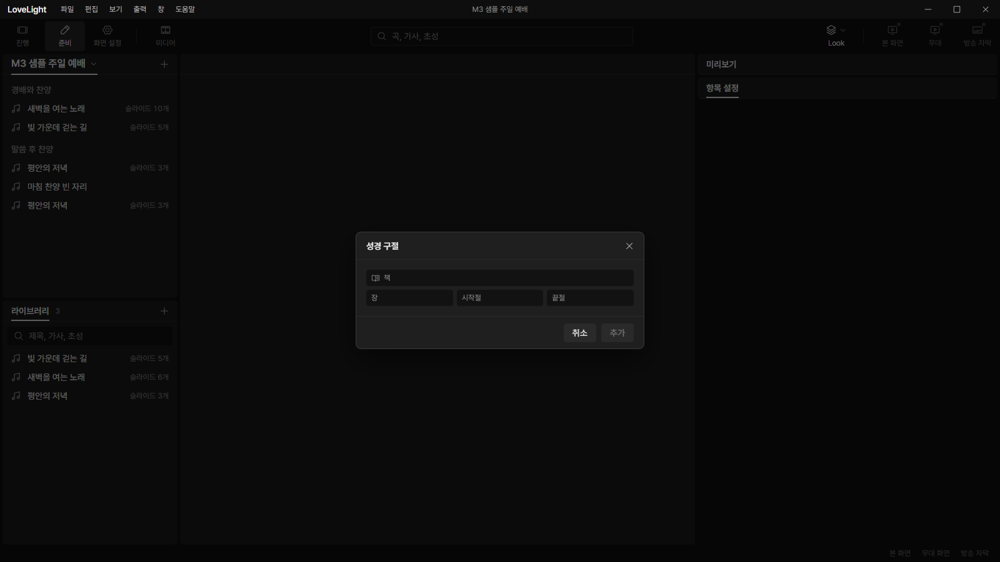

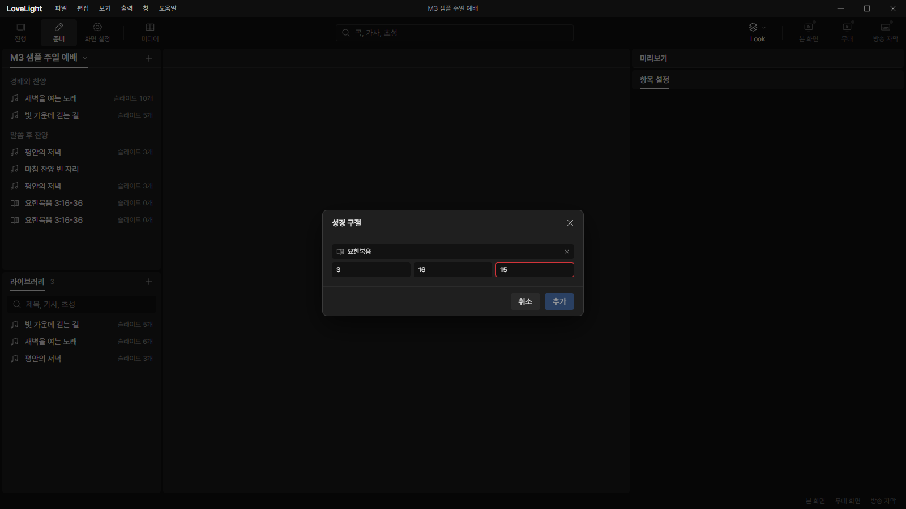

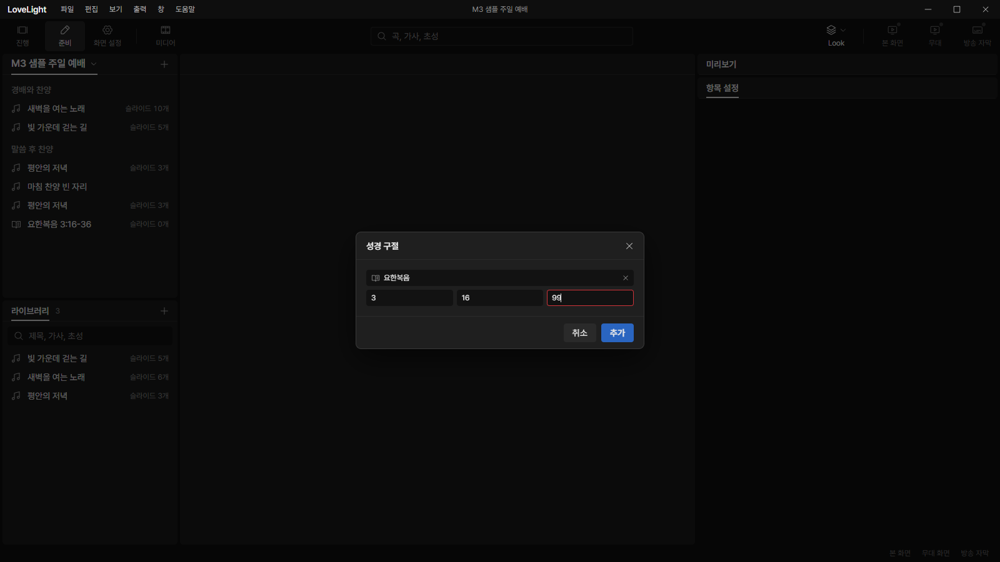

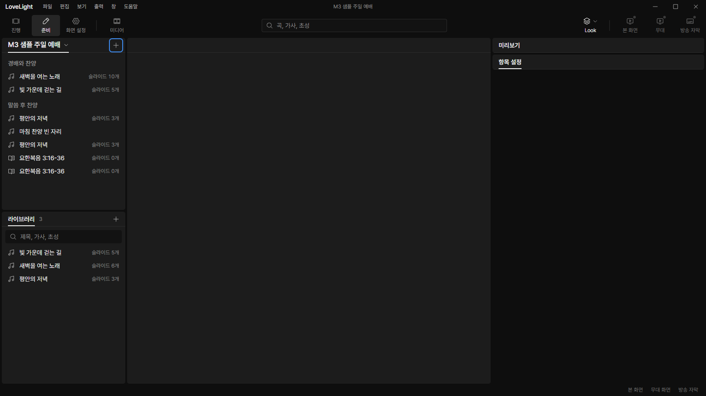

### Unavailable-book regression after bible-2 round 2

Restacked this branch on the corrected bible-2, rebuilt, and drove both mounted
forms in the offscreen app. The invented installed translation has John and no
Psalms. For 20 measured cycles after 20 warmup cycles in each form, 요 advances
to 장, while 시, after its unavailable result arrives, remains in 책 on Tab with
the original input and the 역본에 없는 책 tooltip. The Show popup and Prep
dialog each close twice. Live output and the service item count do not change.
Pending-lookup completion is covered by the deferred-reply unit test.

[Regression counters](bible-3/unavailable-check.json): Show elements remain 513
and listeners 858 across all samples, with heap 6,832,844 to 6,856,776 (+0.4%).
Prep elements remain 227 and listeners 784, with heap 6,733,816 to 6,808,996
(+1.1%). The app exited normally after the check.

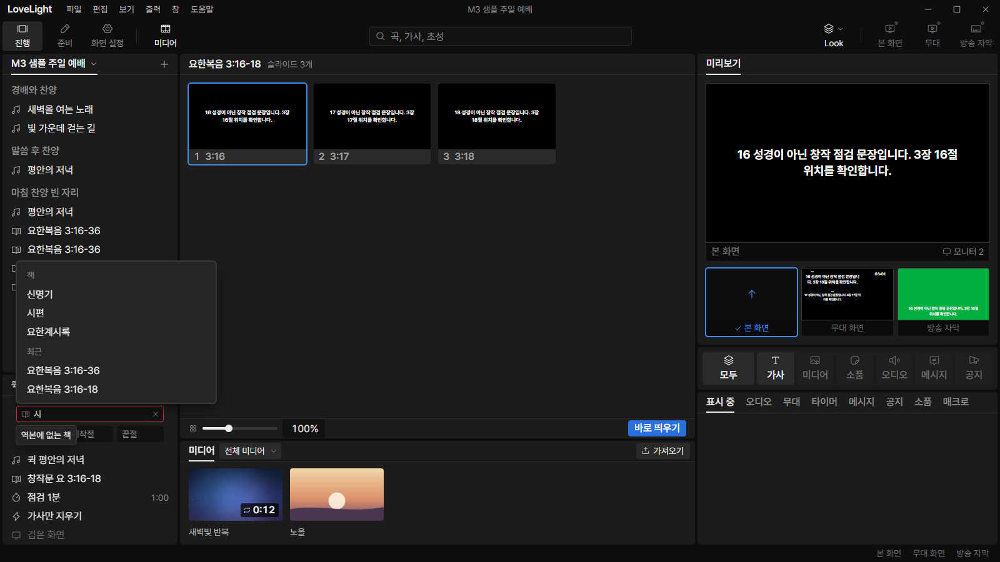

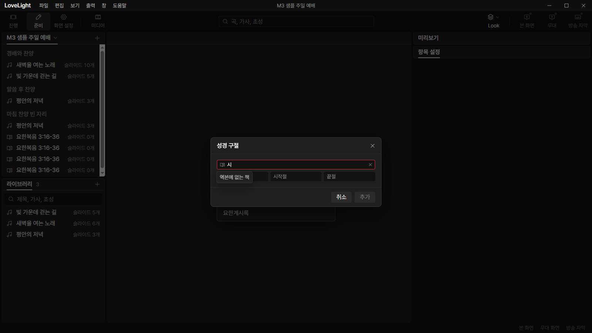

### Recovering from a manual error through a recent passage

A blocked invalid book could leave its error marker on the now-empty manual
fields after a valid recent was chosen. Clearing the blocked-field state on
recent selection fixes it; the new regression test failed before the fix and
passes afterward.

Rebuilt and exercised this transition in the real offscreen app for 20 measured
cycles after 20 warmup cycles. Each invalid book blocks Tab, then choosing
요한복음 3:16-36 clears the manual fields and the previous error. No output
changes until Enter; Enter outputs the selected original range. The suggestion
popup opens and closes twice. The service item count does not change.

[Recovery counters](bible-3/recent-recovery-check.json): elements remain 617 and
listeners 572 across all samples; used heap is 5,808,672 / 5,916,628 / 5,939,660
bytes (+2.3%). The app exited normally after the check.

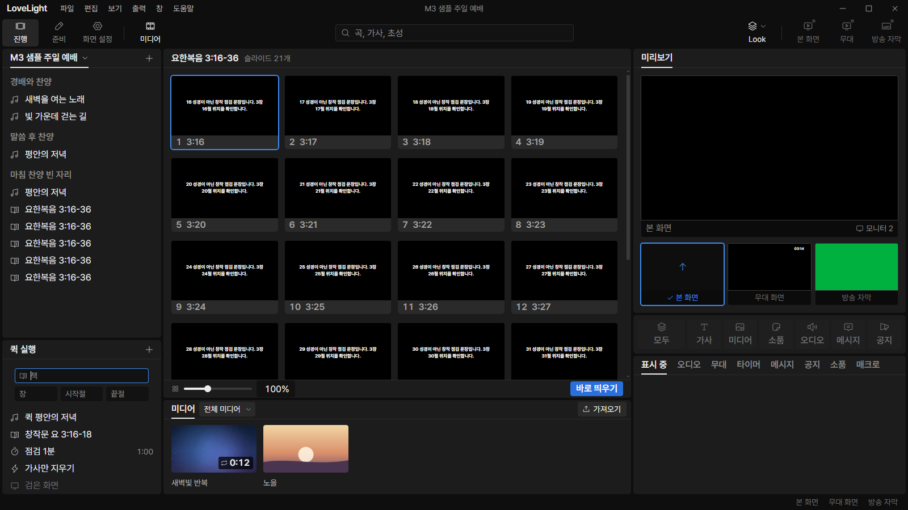

### Round 2: pointer selection above the Prep dialog

Rebased onto local main `8aeed6b5b7a890a69fac62f2a84c49dce4949a01`, rebuilt, and
checked the actual app offscreen on dev port 5193. The earlier
`prep-unavailable-book.png` captures the pre-fix layering bug. The screenshots
below supersede it for suggestion visibility.

The CDP driver types 요, checks that each target option owns its center point
with `document.elementFromPoint`, and dispatches real mouse move, press, and
release events. It alternates 요한일서 and 요한복음 for 20 measured round trips
after 20 warmup round trips. Each choice completes the book and closes the
popup. The popup's computed z-index is 301, above the scrim's 300. Two
subsequent dialog open, pointer choice, and close cycles return to the same
element and listener counts. Both later closes have 341 nodes. Live output and
service item count stay unchanged. The app exits normally afterward.

[Round 2 CDP counters](bible-3/modal-suggestions-check.json):

| Flow                                            | Elements        | Listeners       | Used JS heap, bytes               |
| ----------------------------------------------- | --------------- | --------------- | --------------------------------- |
| Pointer selection, baseline / 10 / 20 cycles    | 230 / 230 / 230 | 642 / 642 / 642 | 5,715,552 / 5,806,200 / 5,824,320 |
| Closed dialog, baseline / first / second reopen | 207 / 207 / 207 | 633 / 633 / 633 | 5,732,596 / 5,748,336 / 5,793,168 |

Selection heap grows 1.9%, and closed-dialog heap grows 1.1%. Native text edit
nodes grow from 421 to 461 while mounted, then fall to 338; both later closes
have 341 nodes after reopening. These short-run JS-heap observations do not
establish long-duration memory stability.

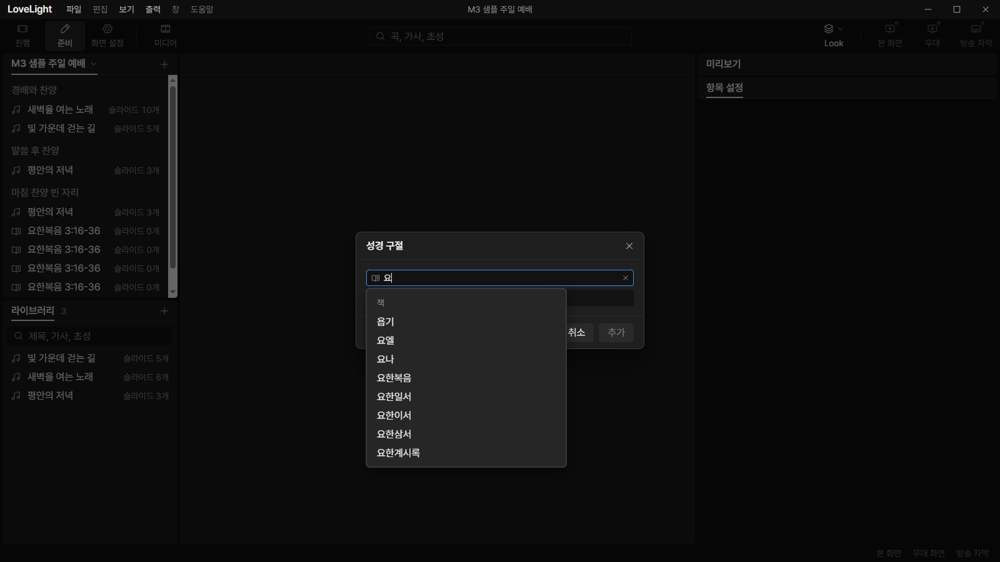

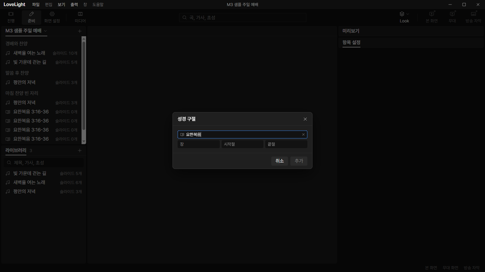

## Team member's reply

1. Fixed P2: `BibleSuggestions` now captures `modalStack.isOpen` when mounted
   and applies the existing `data-over-modal` treatment with
   `--z-popover-over-modal`, matching Menu and Tooltip. Ordinary Show
   suggestions retain the standard popover layer. Added a Prep integration
   regression for pointer completion in a live over-modal list, plus a
   normal-layer assertion in the shared-form test. The actual CDP pointer check
   and screenshots are recorded under "Checked in the app" above. Scoped tests,
   typecheck, ESLint, formatting, and build pass. CI pending under the
   dispatcher rule.

## Quality and review focus

The shared component owns both lookup readers and releases them on unmount. Only
the newest input and translation can preview or submit. Book suggestions are
bounded by 66 and recents by ten. Error reasons use existing tooltip and field
components, with short Korean labels and token-based layout. The new dialog uses
existing design-system sizing, focus trapping, and cleanup.

No new feature work outside the frozen four-field decision. The existing
stored-reference grammar and main-process endpoint validation remain unchanged.

## Verdicts

Recorded by the lead at merge.

## Verdicts (recorded by the lead at merge)

- Round 2 (ca6e1b16): reviewer (Codex) Approve. Lead Approve through the lead's
  merge check: the exact-head CI run passed, the branch rebased onto local
  `main` without conflicts, and typecheck passes. Earlier rounds' findings and
  replies are above.
