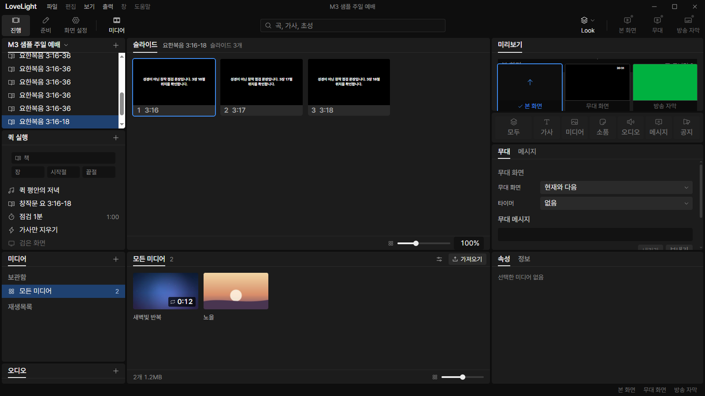
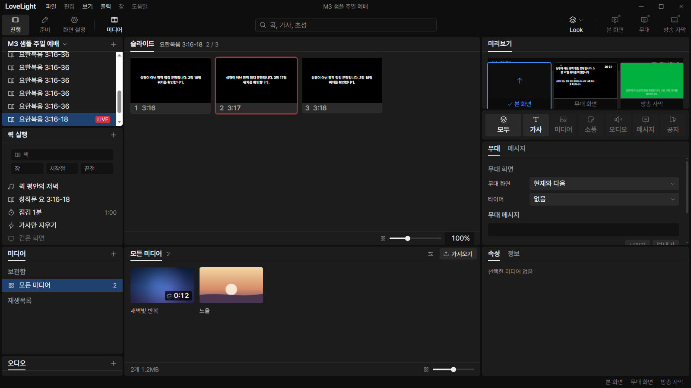
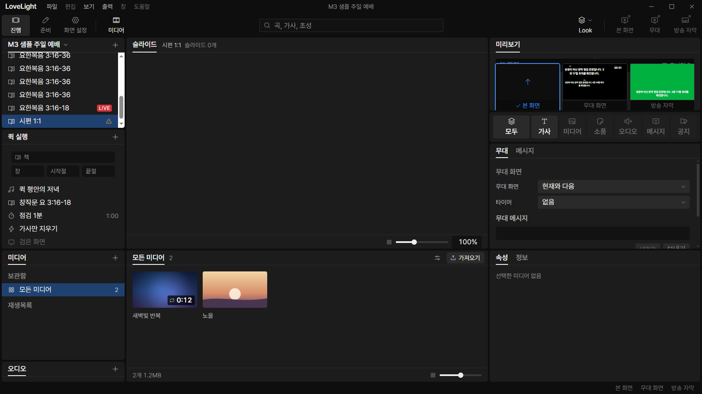
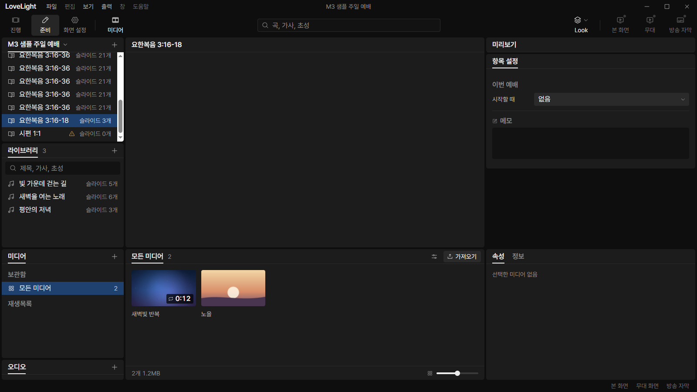

# Review request: `bible-4`

- Team member: bible
- Branch: `fix/bible/reference-flow-audit`
- Base: local main, recorded with the reviewed head in the member report.
- Related brief: `docs/briefs/tools.md`, M3-T4b; M3-UX-R1.

## What changed and why

A passage inserted into the service could be found through the four fields, but
selecting its saved row showed zero slides. The main service projection only
resolved song items. Saved Bible rows now resolve through the same installed,
chunked Bible session used by the reference form and receive the existing
per-verse tiles. Clicking a tile outputs the saved service item ID, so normal
item-start and keyboard navigation apply. Stored verse-number choices are
preserved.

Unavailable references have a `missing-bible` row warning and no tiles. A
missing book or failed read affects its own row; later passages and songs remain
available. Oversized stored references are rejected before reading, and passages
above the existing service tile cap never expose a partial range. Identical
references share a read during projection. Superseded refreshes cannot publish
stale tiles or schedule further unnecessary reads.

The data store owns one Bible session for IPC and saved-item projection. It
primes when the app obtains its Bible reader at launch, releases it on shutdown,
and rejects later reads. This preserves the single bounded chapter cache.
Changes to installed translation settings refresh saved rows.

This request restores the existing per-verse operation. The Prep center grid and
preview are the next unit. The open [계속] fitting questions remain with the
user; no new fitting or continuation behavior is specified here.

## Changes outside my paths

- `src/main/store/`: passes resolved passages into the existing service feed and
  projection, with snapshot and supersession checks.
- `src/main/index.ts`: gives the IPC registration the data store's reader.
- `src/shared/bibleTiles.ts`: extracts the existing verse projection so saved
  and ad hoc passages use the same text chunk limits and Unicode handling.
- `src/shared/schema/showService.ts`: adds `missing-bible` to the row problem
  enum. The request/reply shape is unchanged; schema tests cover the addition
  and continue rejecting unknown problems.
- `ServiceOrderList.tsx` and its integration test: display the warning without
  output when the row is selected.

## Checks run

- Scoped Vitest: 131 tests across eight node and renderer files pass.
- Typecheck, scoped ESLint, `npm run format`, diff check, and build pass.
- Regression coverage includes real chunked files, duplicate item identities,
  stored verse-number choices, unavailable books, rejected reads, projection
  limits, translation removal, a superseded refresh, and shared cache disposal.
- CI pending. The dispatcher checks the exact head; members do not poll CI.
- No full local verify, dependency changes, system clipboard access, crawled
  text, or Scripture fixtures.

## Checked in the app

Built on dev port 5193 and launched with `LLP_TEST_WINDOWS=offscreen` in
`D:\llp-dev\bible`. The launcher and built main entry passed `node --check`
before Electron started. The isolated copy contains only the repository's
invented QA sentences and items inserted by earlier checks. Two deterministic
saved rows exercise an available passage and a book absent from the fixture.

Real CDP mouse input switches between a song and the saved passage for 20
measured round trips after 20 warmup round trips. Selection preserves output.
The saved passage presents three slides; clicking the first outputs its saved ID
and position, and physical ArrowRight outputs the second verse. The
verse-number-off choice is honored. Selecting the missing book presents its
warning and no tiles, preserving the current live output. Two additional
close/reopen cycles leave the flow usable.

In Prep, the saved row now reports three slides. Its center grid and local
preview remain the next request in the series.

[Raw counters](bible-4/check.json) record forced-GC element, node, listener, and
JS heap observations. Across baseline, 10-cycle, and 20-cycle samples, elements
remain 586, nodes 1,721, and listeners 425. Used JS heap is 6,978,964 /
7,016,728 / 7,064,260 bytes, a 1.2% increase. These observations cover this
repeated flow, not long-duration stability or physical display behavior. The app
exits normally after the check.

## Review focus

Please check the shared session ownership and shutdown order, service-feed
supersession, and saved item identity during output. The remaining Prep center
gap is intentionally a separate request in this series.
