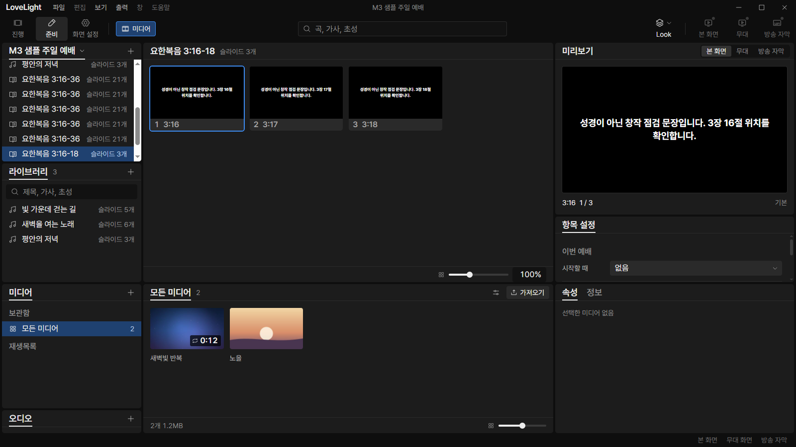
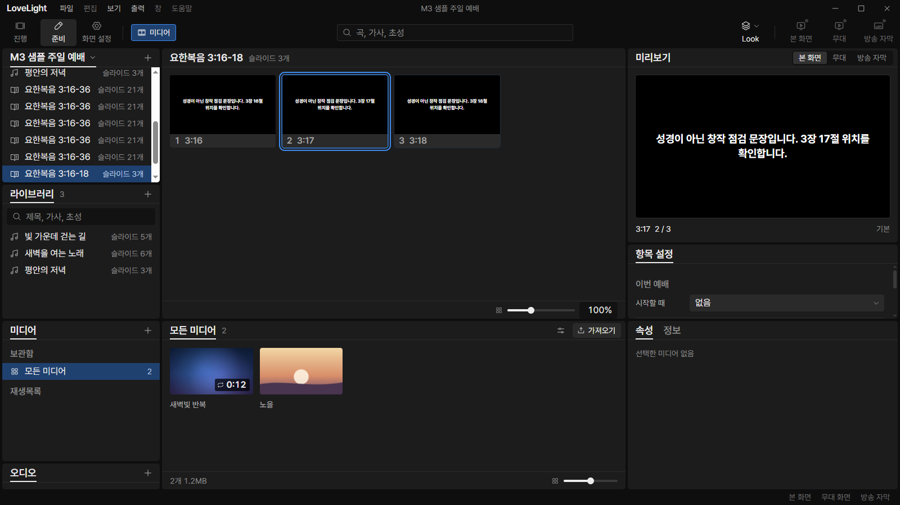
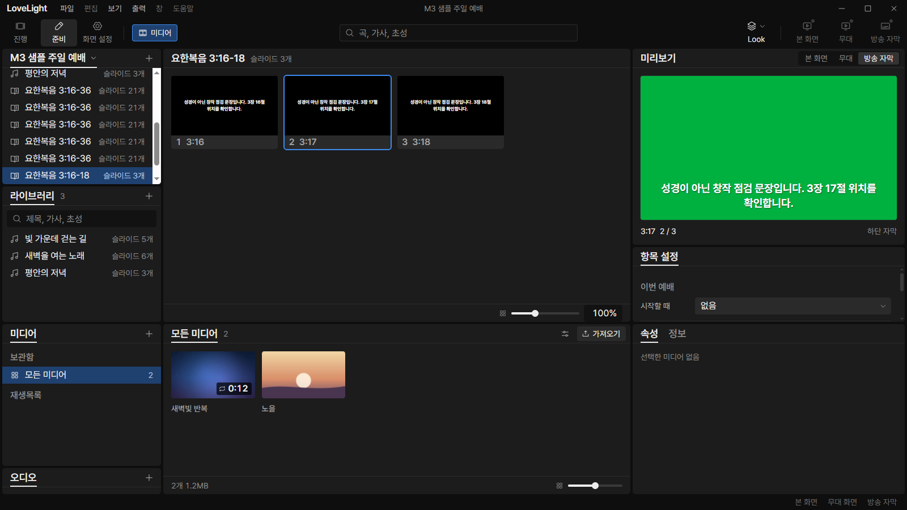
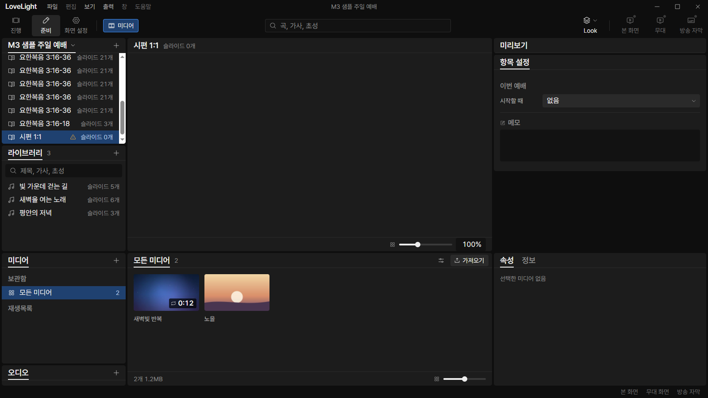

# Review request: `bible-5`

- Team member: bible
- Branch: `fix/bible/prep-saved-passage`
- Depends on bible-4, `0b1f1b0e7777862a729607fa291090c6250d0578`.
- Restacked onto main `aec7a5e10ea48245d4e56e64e678cbaae96739e8`; the lower
  bible-4 copy is `39799e1706048b08d0e65f892b9674e96bf8cb86`. Review this
  request from that copy to the reported head. The original bible-4 review
  branch remains unchanged.
- Related brief: `docs/briefs/tools.md`, M3-T4b; M3-UX-R1 Prep follow-up.

## What changed and why

Selecting a saved Bible item in Prep previously showed its reference heading and
an empty preview. The center now shows the main-owned passage tiles in the
existing virtualized Prep grid. Pointer and keyboard selection update the local
item position and preview. Opening another item resets the grid's scroll and
selection. An unavailable or removed projection clears both grid and preview; a
shortened projection clamps the displayed position.

The existing local preview frame now accepts a projected tile as well as a song
picture. It renders the selected tile directly, preserving current Look masks,
screen choices, and renderer cleanup. There is no synthetic song or second Bible
lookup/cache. The old SongPreviewFrame export remains compatible with existing
editor callers. Main-owned service and selection identities guard stale tiles
during service changes.

The first real-app run caught a zero-width grid caused by borrowing a flex body
from the notice panel. The Bible body now uses the same block layout as the song
grid. The CDP check verifies that each thumbnail owns its pointer target before
dispatching a real click.

## Changes outside my paths

- `prep/service/`: mounts the Bible panel and local selection, replaces the
  heading-only placeholder, and adds regression coverage.
- `prep/editor/SongPreview.tsx` and exports: reuse the existing local renderer
  and screen settings for projected tiles.
- No IPC, settings, or file format changes. The per-verse projection comes from
  bible-4. Open [계속] split questions remain with the user.

## Checks run

- Scoped renderer tests: 38 cases across five files pass, covering pointer and
  keyboard selection, no output or content edits, projection shrink/removal,
  stale service identity, new-item scroll reset, preview screen choice, and
  current Look masks.
- Existing song editor, preview mount, song item, and non-song panel tests pass.
- Typecheck, scoped ESLint, formatting, diff check, and build pass. The rebased
  source was rebuilt for the final app check. No full local verify.
- CI pending; the dispatcher checks the exact head. No CI polling.
- No dependencies, system clipboard access, downloaded text, or Scripture
  fixtures.

## Checked in the app

Built on dev port 5193 and launched with `LLP_TEST_WINDOWS=offscreen`, using
`D:\llp-dev\bible`. The launcher and built main entry pass `node --check` before
Electron. All visible sentences come from the repository's invented QA fixture.
The isolated service contains rows inserted by earlier checks.

The real CDP flow opens the three-verse saved passage in Prep, clicks verses,
and switches back and forth between song and Bible selections. Home and
ArrowRight change the local verse and caption. The broadcast preview renders the
selected verse. An unavailable book clears the grid and preview. Two additional
close/reopen cycles leave the panel usable. Output state and service row count
remain unchanged throughout.

The final repeated flow also wheel-scrolls a longer passage before opening a
different saved Bible item, checking that its first tile is visible and
clickable. The final loop uses 40 warmup and 20 measured round trips.
[Raw counters](bible-5/check.json) record forced-GC element, node, listener, and
JS heap samples. Elements remain 400, nodes 909, and listeners 382 at baseline,
10 cycles, and 20 cycles. Used heap is 7,033,660 / 7,201,120 / 7,241,864 bytes,
a 3.0% increase; the second half grows by 40,744 bytes. The earlier run after 20
warmup cycles grew 3.4%, prompting the longer warmup before this final run.
These short-flow observations do not establish long-duration stability or
physical monitor behavior. The app exits normally after the check.

## Review focus

Please check the shared preview frame's retained song behavior, stale-service
guard, local selection and scroll reset, and the absence of output commands from
Prep interactions.
