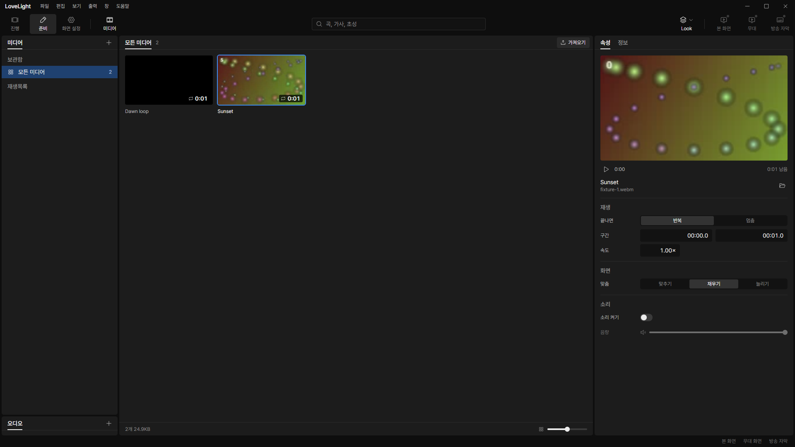

# Review request: `data-69`

- Team member: data
- Branch: `fix/data/media-properties-growth`
- Base: latest local `main` after rebase; exact range in the member report.
- Related issue: M3-C3-4, major, from the user's m3-check3 check.

## What changed and why

Selecting another media item left old preview nodes at the bottom of the
properties panel. The preview and the property form were siblings with the same
item ID as their key. React warned about duplicate keys and retained old nodes
when reconciling the next selection. The new regression failed on current main:
one video/image round trip grew the panel from 67 elements to 90.

A single Fragment now owns the item key. Its preview and form are unkeyed
children in distinct positions, so selection replaces the complete item subtree
and invokes the existing player cleanup. Tests alternate video/video and
video/image selections for twenty round trips, checking the exact element count,
one current video at most, and one current speed field at most.

## Changes outside my paths

`src/renderer/src/prep/media/MediaPropertiesPanel.tsx` and its test belong to
prep. The lead explicitly assigned these media features and this urgent bug to
data. No shared UI component or IPC contract changes.

## Checks

- Panel and preview player tests: 37 pass. New regression failed before the fix.
- Node and web TypeScript check, changed-file ESLint: pass.
- Production build: pass. Formatting and diff checks: final results in report.
- Full verify: CI pending (API 403). Lead confirms the exact head before merge.

## Checked in the app

Built with `npm run build` and launched the built Electron app with
`LLP_TEST_WINDOWS=offscreen`, data's `LLP_DEV_PORT=5188`, and isolated app data
under this worktree's ignored `.llp`. Checked the launcher with `node --check`
before starting Electron. Every BrowserWindow remained invisible. The two
one-second test clips are generated abstract frames, with invented names;
neither clips nor app data are committed.

Drove the real control renderer using `webContents.debugger` CDP commands:
`Runtime.evaluate` for operator clicks and loaded-video checks,
`HeapProfiler.collectGarbage`, `Runtime.getHeapUsage`, `Memory.getDOMCounters`,
and `Page.captureScreenshot`. Opened 준비 media, warmed up five round trips,
then alternated the two video tiles for twenty measured round trips. Closed and
reopened the media view twice and selected again.

- Every measured selection: panel 67 elements, document 216 elements, one video,
  one speed field. Both reopen cycles returned to the same counts.
- CDP retained DOM samples at rounds 5, 10, 15 and 20: 544 nodes and 369 event
  listeners each. Post-reopen counts remained identical.
- Collected JS heap used: 5,206,180 bytes before, 5,300,468 after twenty round
  trips, 5,389,452 after both reopen cycles. Heap capacity remained 6,066,176
  bytes throughout. Small retained-heap variation remains; this is a bounded
  repeated-flow check rather than a long-running soak.
- [Raw measurements](assets/data-69/measurements.json).

## Team member's reply

1.
