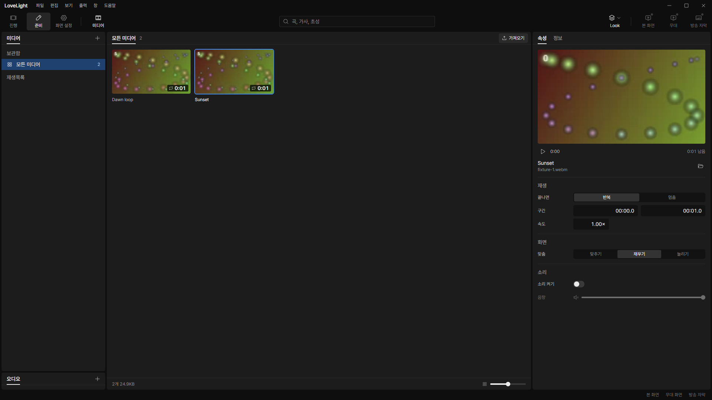

# Review request: `data-70`

- Team member: data
- Branch: `fix/data/media-import-dialog`
- Base: data-69 while stacked; rebase and exact range in the member report.
- Related issue: M3-C3-6, import picker startup and remembered folder.

## What changed and why

Media imports always let the Windows picker choose a fresh default location. The
picker now receives an explicit starting folder: the last successful file
choice, or the system Videos folder for an absent, empty or relative saved
value. This avoids asking the shell to choose its default location each time.

The optional `app.json.mediaImportFolder` is app-local UI state, persisted
through the existing AppConfigFile owner and its atomic autosave and close-flush
path. The media backend reads the in-memory value immediately and invokes
`showOpenDialog` before any await. It remembers the first selected file's parent
folder synchronously in memory, then lets autosave run separately. Cancellation
and dragged imports keep the previous folder. Other UI fields and unknown file
metadata survive. Independent app data folders keep independent preferences.

The existing picker dispatch already bypasses the copy/analysis queue. A
regression now holds an analysis job open and checks that a second dialog is
requested in the same call, with the remembered folder. This does not establish
the cause of the user's native Windows cold-start delay. The actual native
picker's display latency still needs a normal-window build check; the offscreen
safety guard deliberately suppresses native dialogs.

## Changes outside my paths

- `src/main/media/register.ts` and its tests are prep-owned. The lead assigned
  this urgent picker bug to data.
- `src/main/index.ts` and its wiring test are output-owned. They pass the
  existing app.json UI fields owner to the media registration and assert its
  identity.
- `docs/spec/02-data.md` is spec-owned. It records the new optional picker field
  and its success/cancel/drop rules.

No renderer contract or extra writer is added. The schema and app.json store are
data-owned.

## Checks

- Backend registration, app.json persistence/schema and main wiring tests: final
  count in report. Tests cover same-call picker dispatch with busy analysis,
  successful choice, cancel, fallback, save/reopen, independent app data,
  unknown fields and invalid stored field types.
- Node and web typecheck, changed-file ESLint, production build: pass.
- Formatting/diff: final results in report.
- Full verify: CI pending (API 403); lead confirms the exact head.

## Checked in the app

Ran the production build with `LLP_TEST_WINDOWS=offscreen`, `LLP_DEV_PORT=5188`,
isolated app data, and a syntax-checked launcher (`node --check`). CDP drove the
real 준비 media 가져오기 button twice. Each request reached main and completed
as an offscreen cancellation: 81 ms and 61 ms, including the driver's 50 ms
polling interval. The button returned to enabled after each request. These are
application dispatch measurements, not native picker display times. No Windows
dialog was opened.

Also selected the two generated abstract videos for twenty round trips and
closed/reopened the media view twice. Panel elements remained 67, document
elements 216, video and speed field counts one each. Collected CDP samples
remained 544 DOM nodes and 369 listeners; JS heap used was 5,290,872 bytes
before and 5,477,132 after, with stable 6,475,776-byte capacity. All windows
remained invisible. Generated media and app data are untracked.

[Raw measurements](assets/data-70/measurements.json).

## Team member's reply

1.

## Verdicts (recorded by the lead at merge)

- Round 1 (713e0dfd): reviewer (Codex) Approve. Lead Approve; fixes M3-C3-6 from
  the user's check: the import picker starts in the last folder used, or the
  Videos folder. The exact-head CI run passed, checked by the lead at merge.
  Rebased by the lead onto local `main` without conflicts; typecheck passes.
