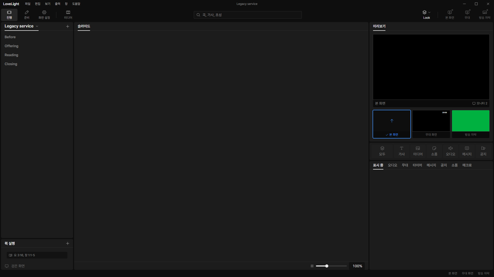
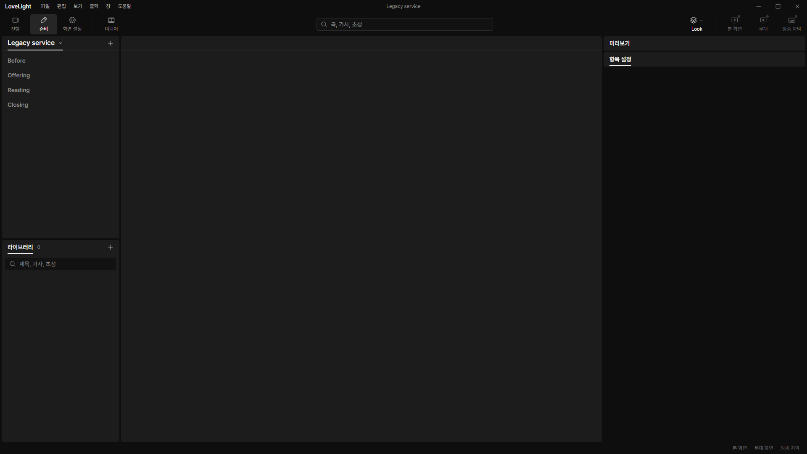

# Review request: `data-71`

- Team member: data
- Branch: `break/data/legacy-slot-sections`
- Base: latest local main after rebase, exact range in the member report.
- Related decision: October 26 user check, slots become empty sections.
- Spec dependency: `docs/spec/remove-slots`, `f5305a90` and `e6c1891a`, spec 02,
  "Sections and legacy slot items". This unblocks spec-58 round 2.

## What changed and why

Service and template validation now normalizes a recognized legacy slot row into
a section row: `title` becomes `header`; ID, position and unknown fields stay;
the consumed `slot` and `title` fields are removed. Song, Bible and slides slots
follow the same rule, including an empty title. Conversion creates no content
rows, and consecutive or final empty sections stay in the order.

The transform runs after item validation and unique-ID checks in the common
order schema. File reads, IPC document checks, edit checks and serializers all
use it, so even a legacy in-memory value supplied directly to a serializer
writes headers. Wrong legacy kinds, missing/nontext titles and conflicting kind
keys still fail validation. Unknown fields, including nested values and an own
`constructor` key, survive the existing safe-key handling.

This is an in-memory compatibility conversion at schema version 1. Reading does
not rewrite the file. Newer files retain read-only access and source version;
serialization still refuses their newer version. Public legacy input types and
dispatch keys remain for the separate UI removal request. They let old input be
validated; validated documents and newly written files contain no slot rows.

Existing store tests now expect migrated rows to be headers, excluded from
content counts. Importing a selected migrated section copies that section;
unlike a former slot child, it does not implicitly select a preceding header. No
store algorithm or renderer control changes in this request.

## Changes outside my paths

`src/renderer/src/prep/service/QuickAdd.test.tsx` is prep-owned. Its old slot
expectations now follow normalized schema data: an old submenu insert saves a
section, and selecting a migrated section adds a song without replacing the
section. The lead assigned the compatibility change to data. No renderer
implementation changes. Other paths belong to data.

## Checks

- Seven schema/store test files: 172 pass. Includes old service/template cases,
  direct legacy serialization, unknown-field preservation, input nonmutation,
  malformed old files, read-only newer files, IPC checks and existing store
  flows.
- Related renderer integration tests: 134 pass across ten files. Quick add now
  expects a migrated section rather than a replaceable slot; the section stays
  when a song is added.
- Node and web typecheck, changed-file ESLint and production build: pass.
- Formatting/diff checks: final results in report.
- Full verify: CI pending (API 403). The lead confirms the exact head.

## Checked in the app

Built with `npm run build`, syntax-checked the launcher with `node --check`, and
ran the built Electron app with `LLP_TEST_WINDOWS=offscreen`,
`LLP_DEV_PORT=5188`, and isolated app data under this worktree's ignored `.llp`.
Seeded one legacy service and one legacy template with invented names and all
three slot kinds. Read both documents through their real preload/main APIs and
checked that the live service feed contains section rows only.

CDP drove twenty 진행/준비 round trips and opened/closed the service picker
twice. Exact element and retained-memory measurements are attached below. Saved
both normalized documents through the real content edit IPC and checked their
actual disk JSON for headers, absence of slot rows, and preserved unknown data.
Every BrowserWindow remained invisible. Test app data is untracked.

After warming the picker and both workspaces, every measured round trip kept 395
document elements in 진행 and 143 in 준비. CDP retained DOM counts stayed at
1,439 nodes and 508 listeners before, during all four samples, and after the two
picker cycles and document saves. Collected JS heap used rose from 5,742,728 to
6,128,800 bytes, with capacity between 6,475,776 and 7,000,064 bytes; small
retained-heap variation remained without accumulating DOM or listeners.

[Raw measurements](assets/data-71/measurements.json).

## Team member's reply

1.
