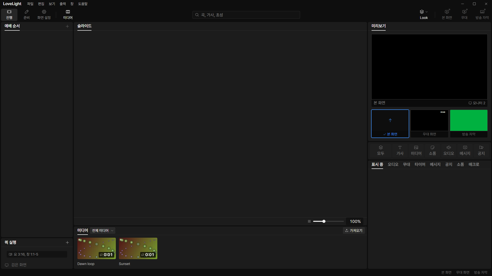
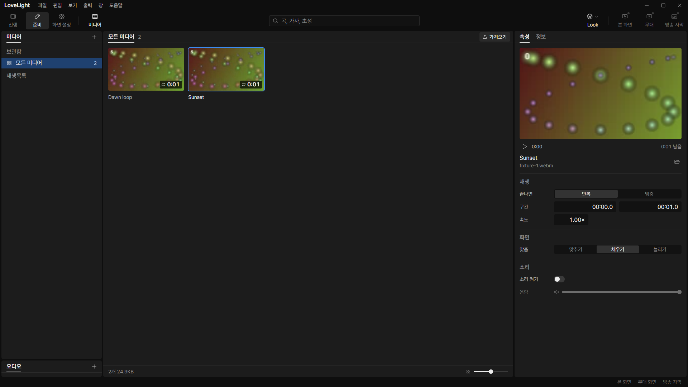

# Review request: `data-72`

- Team member: data
- Branch: `fix/data/shared-media-import`
- Base: latest local main after rebase; exact range in the member report.
- Related issue: M3-C3-5b, the disabled 진행 media import action.

## What changed and why

The 진행 bottom media panel permanently disabled 가져오기 even though the media
backend already handled the same command for 준비. Both surfaces now use one
request function and one action hook. The shared hook checks loading and
read-only state, exposes the disabled reason, and blocks repeated clicks in the
same event turn while a picker is pending. The shared request sends the chosen
playlist and reports refusals through the same notice and log path.

진행 feeds initial queued results into its existing bounded copy-job state, so a
returned job appears immediately, including in the playlist that requested it.
Its destination map contains active jobs only; completion, failure, cancellation
and unmount release entries. A late response does not update or notify an
unmounted panel. Importing does not issue a live output command. 준비 keeps its
existing file drops, path cap, destination and copy-progress behavior.

## Changes outside my paths

- `src/renderer/src/show/ShowMediaPanel.tsx`, `useMediaStrip.ts` and their tests
  are shell-owned. They enable and consume the shared action for the lead's
  urgent user-check bug.
- `src/renderer/src/prep/media/MediaView.tsx`, `mediaLibrary.ts` and the two new
  import modules are prep-owned under data's assigned media exception. They
  share the existing behavior with 진행.
- `docs/reviews/data-70.md` corrects its main wiring ownership to output.

## Checks

- Media view/library and 진행 panel/hook tests: 57 pass. Coverage includes
  playlist destinations, initial queued copies, duplicate-click refusal,
  loading/read-only guards, refused requests, terminal-job cleanup, unmount,
  existing file drops and output behavior.
- Node and web typecheck, changed-file ESLint and production build: pass.
- Formatting/diff checks: final results in report.
- Full verify: CI pending (API 403); lead confirms the exact head.

## Checked in the app

Built with `npm run build`, syntax-checked the launcher with `node --check`, and
drove the built Electron app through CDP with `LLP_TEST_WINDOWS=offscreen`,
`LLP_DEV_PORT=5188`, and isolated app data. The fixture contains two generated
abstract one-second videos and invented names. No generated clips or app data
are committed.

Checked that 가져오기 was enabled in 진행, clicked it twice, then closed and
reopened the bottom panel twice. Compared the complete live-state snapshot
before and after: unchanged. Switched to 준비 media and clicked its import
twice. The production offscreen guard suppressed each native dialog and returned
an empty selection; both buttons returned to enabled. Native Windows picker
display is not exercised by this offscreen check. Registration/unit tests cover
the native command's selected-folder and successful-result paths.

After warming both video selections, alternated them for twenty round trips and
closed/reopened the 준비 media view twice. The panel stayed at 67 elements,
document at 216, one current video and speed field. Retained CDP samples stayed
at 544 DOM nodes and 369 event listeners. Raw heap samples and dispatch times
are attached. Collected heap used changed from 5,575,548 to 5,868,792 bytes
while capacity stayed at 6,742,016 bytes. All BrowserWindows remained invisible.

[Raw measurements](assets/data-72/measurements.json).

## Team member's reply

1.
