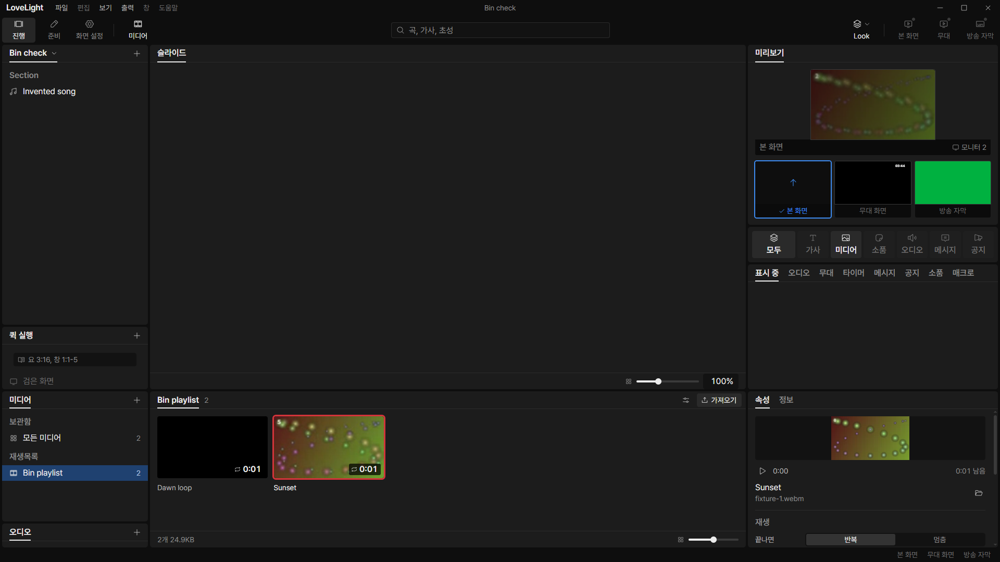
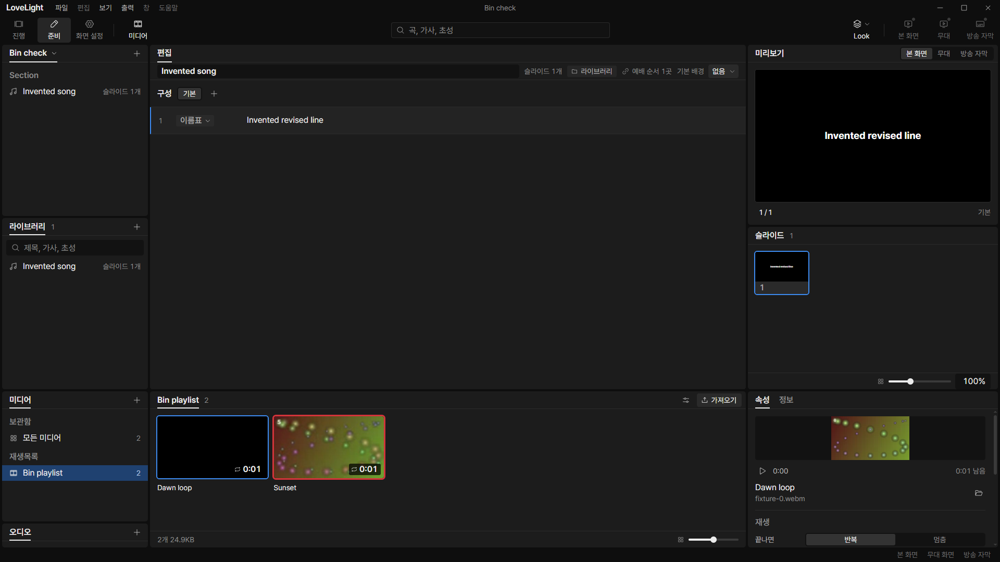
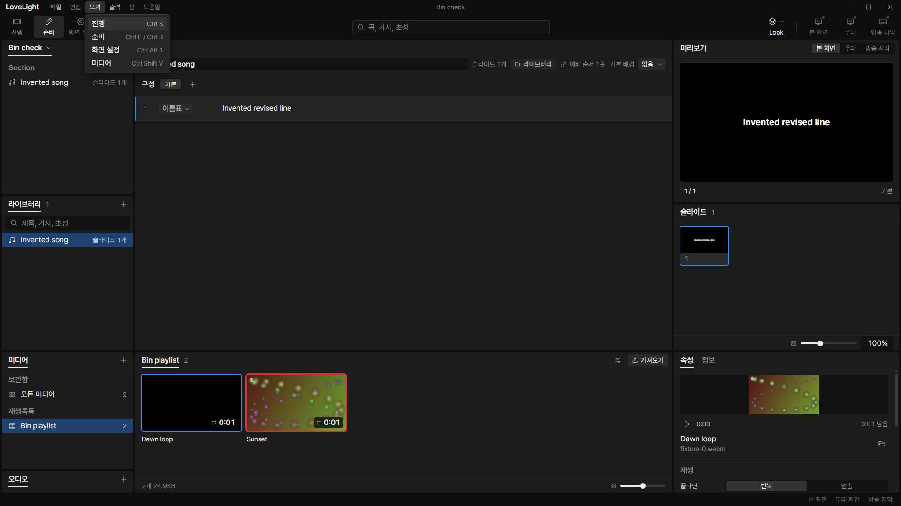
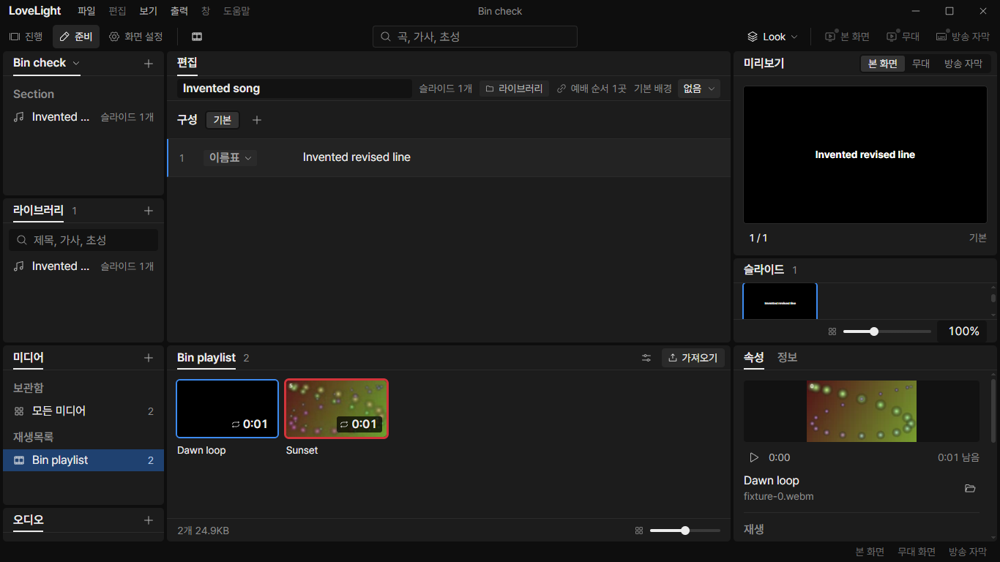

# Review request: `data-74`

- Team member: data
- Branch: `feat/data/shared-media-bin`
- Base and exact range: member report after the final rebase.
- Related decision: October 26, one bottom 미디어 bin in 진행 and 준비.
- Specification request: data-73, `docs/data/shared-media-bin`.

## What changed and why

The media toggle now opens the same bottom bin in 진행 and 준비. The normal
workspace columns stay above it, including the source editor and item settings.
The bin reuses the existing media playlists, audio playlists, virtualized grid,
import/file drop action, preview, properties and info panel. Its own right panel
does not replace the workspace preview or editor panels.

One window-owned provider keeps the chosen playlist, selected item and current
media document across workspace switches and hide/reopen. Its active flag
releases API subscriptions and copy-job state while hidden or in 화면 설정.
Hiding unmounts the bin's media elements and invokes existing player cleanup.
The document remains in the existing bounded media store. Resuming refreshes
from main through the same validated API.

Both toolbar modes use the existing saved `mediaStrip` choice and its size/DIP
defaults. The old local 준비 media mode is removed; `prepMedia` is ignored.
Opening the bin no longer removes the editor, and text import leaves the bin's
visibility choice alone. Source selection and drafts keep their existing owners.

Existing activation rules remain: 진행 click/Enter selects and outputs; arrow
navigation only selects. 준비 click/Enter selects and double-click outputs. The
grid carries the workspace focus appearance and uses the existing 진행
mouse-focus guard. Local preview playback stays separate from live output.

The bin uses existing column and spacing tokens, with a bounded bottom height.
The audio playlist panel takes its content height up to half the bin, leaving
the rest to media playlists. The compact player derives its height from the
existing tile/aspect tokens. Its explicit height prevents the picture from
collapsing in a small properties panel. Properties scroll inside that panel.

## Changes outside my paths

- `src/renderer/src/control/App.tsx` and its media mount test, plus
  `src/renderer/src/shell/Workspace.tsx` and its stylesheet, are shell-owned.
  They host one bin without replacing the normal workspace or duplicating its
  visibility choice.
- `src/renderer/src/ui/MediaTile.tsx` is ui-owned. Its additive optional grid
  workspace prop forwards the existing TileList focus appearance. The default
  remains 준비.
- The new bin and existing files under `src/renderer/src/prep/media/` are
  prep-owned under data's assigned media exception.

The distinct visual treatment of the toolbar media toggle remains ui's assigned
follow-up, involving the toolbar/control styles. This request connects its
shared action and pressed state. Retiring the unused old strip implementation
follows separately to keep this behavior change focused.

## Checks

- Eleven related renderer files: 161 tests pass, including shared visibility,
  legacy-mode ignore, selected playlist/item retention, subscription cleanup,
  editor panels, focus/activation, properties and player regressions.
- Node and web typecheck, changed-file ESLint and production build: pass.
- Formatting/diff checks: final results in report.
- Full verify: CI pending; lead confirms the exact head.

## Checked in the app

Built with `npm run build`, checked both launch/driver scripts with
`node --check`, and ran with `LLP_TEST_WINDOWS=offscreen`, `LLP_DEV_PORT=5188`
and isolated app data. Fixtures are generated abstract VP8 videos, an invented
song and a service. None of the media or app data is tracked. All BrowserWindows
remain invisible.

CDP used real `Input.dispatchMouseEvent` clicks at element coordinates and
`Input.insertText` in the song editor. It selected both videos for twenty round
trips in 진행, checked live media activation, opened the library song in 준비,
edited its text, hid/reopened the bin twice, and selected both videos for
another twenty round trips. Then it switched 진행/준비 twenty times. The
playlist, selection and edited text survived. Actual song data saved the new
invented line. 준비 selection and workspace navigation left the live layers
unchanged.

Round 2 also closes and reopens the bin through 보기 > 미디어 and Ctrl Shift V
while staying in 준비. Both paths retain the editor text and selected media.

After warming each view, the bin stayed at 132 elements and its properties at
67, with one current video. CDP retained-node and listener counts remained equal
within each measured phase. Heap used/capacity samples are in the attached JSON;
small retained-heap variation remains, without accumulating DOM or listeners.

At 1920x1080 the bin sits below the editor. At 1366x768 it remains inside the
viewport and the editor stays above it. The player picture has a nonzero bounded
height. These geometry assertions caught and corrected the initial compact
preview ratio issue before this request.

[Raw measurements](assets/data-74/measurements.json).

## Team member's reply

1. R1 P1: `onMedia` now uses the shared `mediaStrip.setVisible` action in 준비
   as well as 진행. The existing 화면 설정 command still opens 진행 with the bin
   visible. Regression tests exercise both 보기 > 미디어 and Ctrl Shift V in
   준비, opening and closing without changing the workspace or live output.
   Repeated the final rebased typecheck and real-app CDP check, including both
   entry points; updated screenshots and measurements below the checked-app
   section.

## CI follow-up (round 3)

Reproduced both failures from
[the previous CI run](https://github.com/0913vision/llpresenter/actions/runs/40356073422)
locally before changing the tests. Rebasing onto local main `4e3cdb41` retained
the newer screen-settings column class but did not fix these two assertions:
they still expected the retired separate media view.

The preparation mount test now verifies that the same library element stays
mounted when the bin opens and closes. The text-import test checks both initial
visibility choices, retaining the bin through import, a repeated import, and
discarding the draft. No runtime behavior was changed to satisfy the old tests.

The final related check includes `ShowPanels`, `App`, `PrepMount`, the shared
media mount, workspace layout/editor, media view/properties/player/tile and
screen-settings mount tests: 158 tests pass. Typecheck, changed-file lint,
production build and formatting pass. Repeated the checked-app flow after the
rebase and refreshed all screenshots and raw measurements above. The bin now
includes the optional-copy menu from main; its stable count is 132, with 67
properties elements and one video.

## Integration rebase (round 4)

Rebased onto local main `8eede4b1`. Resolved the App conflict with main's search
and text-import shortcuts by keeping `focusSearch`, its callback, the shared
`importText` helper and both new key bindings. Removed the retired `prepMedia`
state and its reset from that helper, so importing still preserves the shared
bin visibility choice. Both the menu and Ctrl Shift I use that same helper.

Expanded the Ctrl Shift I regression to both saved bin visibility choices,
checking one import read despite a held-key repeat and the unchanged visibility
after entering preparation. Main's Ctrl F focus/select regression remains. All
161 affected renderer tests pass, as do typecheck, changed-file lint, build and
formatting. Repeated the offscreen checked-app flow after this conflict
resolution. Screenshots and raw measurements above are refreshed. CI pending.

## Verdicts (recorded by the lead at merge)

- Round 4 (d647b455): reviewer (Codex) Approve. Lead Approve through the lead's
  merge check: the exact-head CI run passed, the branch rebased onto local
  `main` without conflicts, and typecheck passes. Earlier rounds' findings and
  replies are above.
