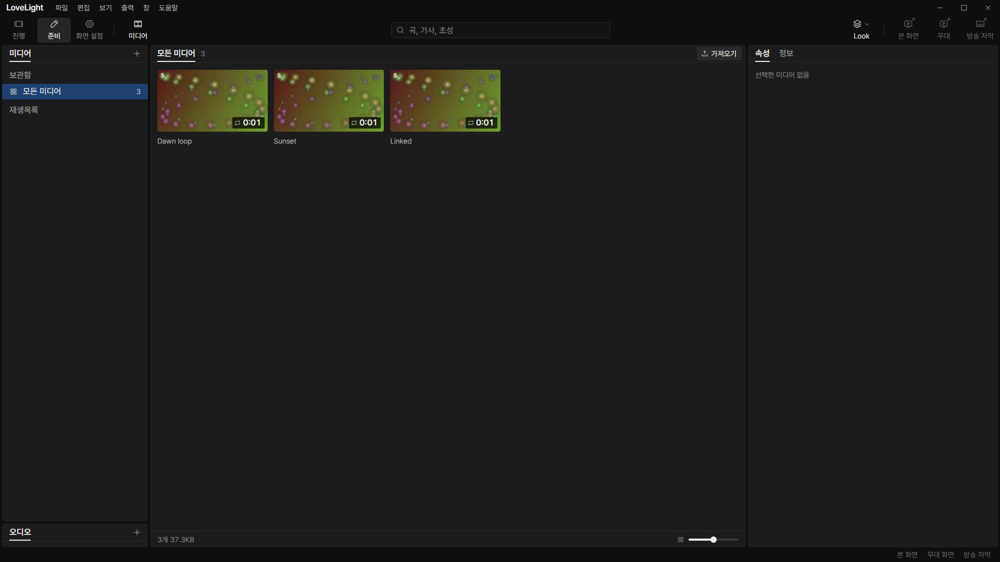
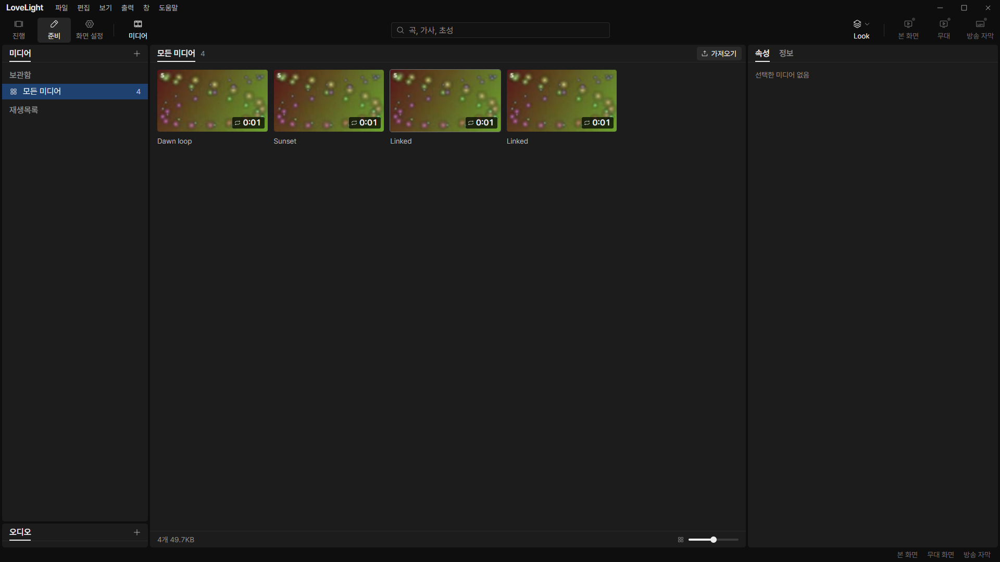
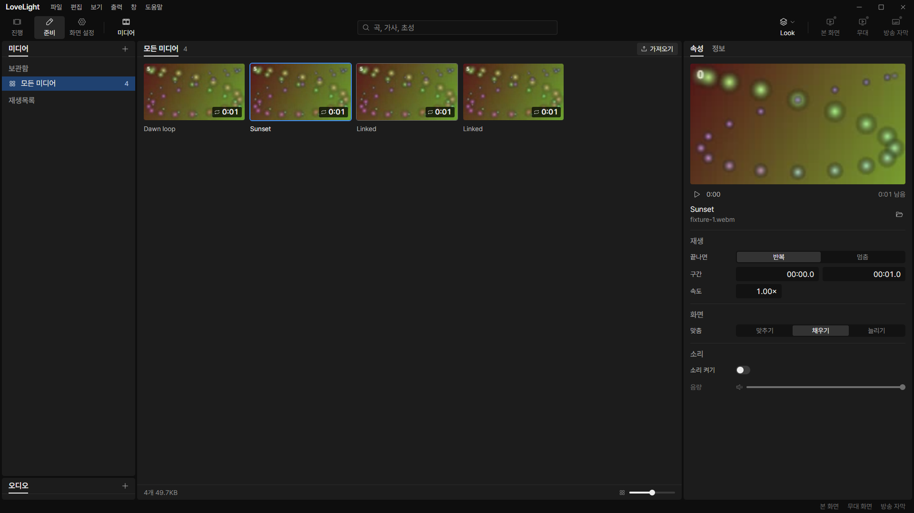

# Review request: `data-78`

- Team member: data
- Branch: `fix/data/media-copy-policy`
- Specification dependency: data-77 round 2; range in member report.
- User decision: optional media copying, default off, October 27.

## What changed and why

Adds validated `preferences.media.copyOnImport`, default false, with nested
default merging and unknown-field preservation. The media backend reads the
current main-owned preference for every admitted import request. One value is
stored on all that request's jobs, so a later settings change cannot change
their queued placement policy. Dialog opening still starts before any settings
read, and cancellation never enqueues jobs after a pending read.

The importer now references originals unless copying was explicitly enabled.
Reference imports report analysis and completion without a fake copying phase.
The existing copied-file guard ensures that cancellation, admission refusal or
decoder failure removes only a job-created copy. A failed media-list disk write
keeps its accepted item and file for the existing retry mechanism, under either
policy. Existing items are not moved or rewritten by changing the option.

The checked option in the bin is the next small request. This request connects
the backend and persistent setting through the existing validated settings IPC;
it does not claim the option already has its screen control.

## Changes outside my paths

`src/main/index.ts` is output-owned wiring. It passes the existing settings
reader to the media backend. All other code is in data's shared schema and main
media/store exception. No renderer or common UI implementation changes.

## Checks

- Related importer, registration, preferences, settings store and settings
  document tests: final count in report. Tests cover changing policy with a
  blocked queue, one snapshot per batch, original survival on cancellation and
  failure, both disk-write-failure policies and actual media-library resolution.
- Typecheck, changed-file lint, build, formatting and diff: results in report.
- Full verify: CI pending (API 403); lead confirms the exact head.

## Checked in the app

Built the app, checked launcher and driver with `node --check`, and launched
with `LLP_TEST_WINDOWS=offscreen`, port 5188 and isolated app data. All windows
remained invisible. Generated abstract VP8 clips contain no copyrighted media.

CDP dispatched native dragEnter/dragOver/drop events with an actual file. With
the preference absent, the new item referenced `source/Linked.webm`, created no
copy and emitted no copying phase. After a validated settings IPC edit to true,
a second drop created `Linked.webm` in the media folder and emitted copy
progress. Both the source and copy matched the original bytes. Screenshots show
the resulting imports; the option UI follows separately.

The source subfolder is inside this development media folder to respect the
development file-serving guard. Production absolute external references are
covered by main-process tests; this check does not claim a native Windows
chooser was displayed. The offscreen guard prevents it.

Repeated two-video selection round trips 20 times and hid/reopened the view
twice. Properties stayed at 67 elements and one video; document elements stayed
at 228. Retained-node and listener samples remained equal after warmup. The
attached JSON records retained heap samples and the file assertions.

[Measurements](assets/data-78/measurements.json).

## Verdicts (recorded by the lead at merge)

- Earlier rounds (Codex): see the findings and replies above.
- Final round (6ed00265): reviewer (Codex) Approve. Lead Approve after reading
  the importer: copying on import is the preference `media.copyOnImport`, off by
  default like ProPresenter's Manage Media Automatically (user decision of
  October 27), resolved once per request. Nit for the next branch: when the
  preference read rejects, fall back to the default instead of failing the
  import. The exact-head CI run passed, checked by the lead at merge. Rebased by
  the lead onto local `main` without conflicts; typecheck passes.
