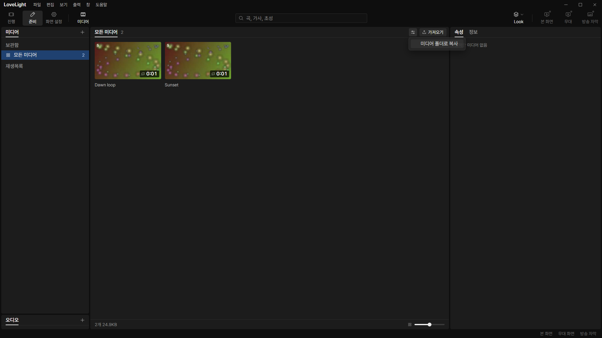
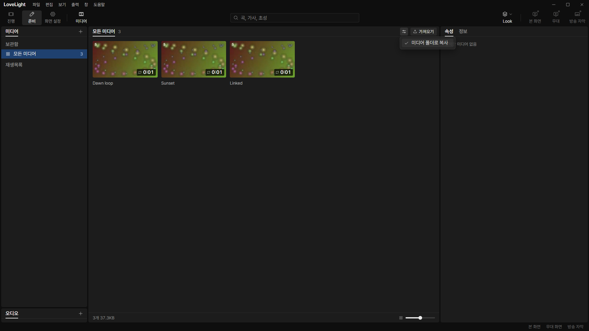
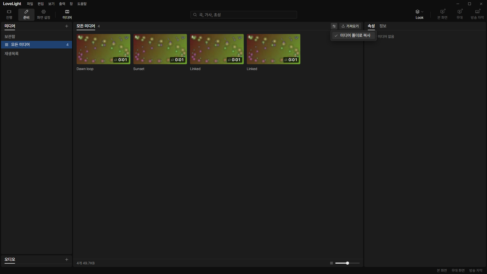
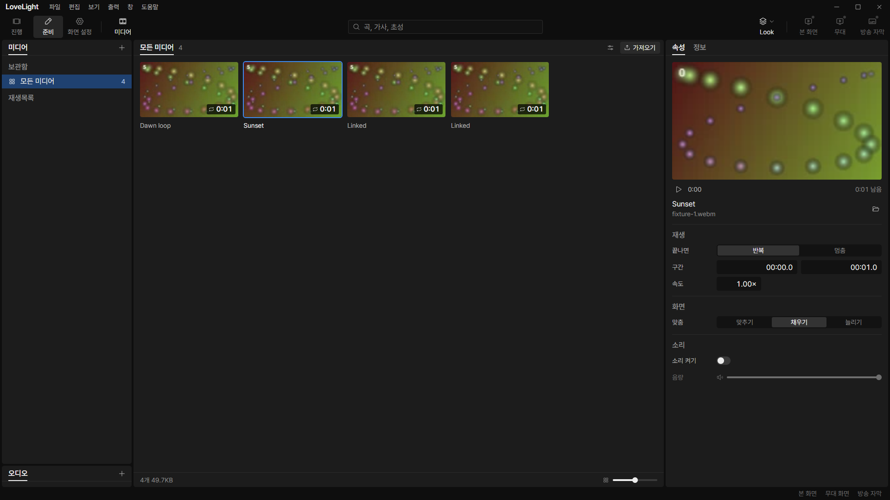

# Review request: `data-79`

- Team member: data
- Branch: `feat/data/media-import-options`
- Dependencies: data-77 specification and data-78 policy, both merged.
- Shared-bin placement follows data-74; its normal toolbar import stays
  separate.
- Exact base/range: member report.

## What changed and why

Adds 가져오기 설정 beside 가져오기 in the media view. Its checked menu item
미디어 폴더로 복사 edits the shared `media.copyOnImport` preference. Opening the
file dialog remains a separate, immediate action. The new menu reuses the
existing IconButton, Menu and settings-document reader without new styles.

The settings subscription exists only while the menu is open. It follows newer
revisions, ignores a stale initial read, disables a loading/read-only choice,
and preserves the current document and unknown media fields on save. One write
is allowed at a time. Rejections report a problem after the menu closes, while
completion after the whole bin unmounts does not update its abandoned UI.

Also addresses data-78's lead nit: a failed copy-preference read logs a warning
and imports using `COPY_IMPORTED_MEDIA` (off), with an original-survival test.

## Changes outside my paths

`src/renderer/src/prep/media/` is the assigned prep-owned media exception. It
imports the existing screen-owned settings reader without changing it. No common
UI or styles change. The importer's fallback is in data-owned main code.

## Checks

- Four related files: 59 tests pass, covering menu states, revision changes,
  unknown fields, repeated mount/cleanup, one in-flight write, late completion,
  unchanged import entry points and preference-read fallback.
- Final rebased typecheck, changed-file lint and production build: pass.
- Formatting/diff: final results in report.
- Full verify: CI pending (API 403); lead confirms the exact head.

## Checked in the app

Built the app and checked launcher plus both imported drivers with
`node --check`. Ran with `LLP_TEST_WINDOWS=offscreen`, port 5188 and isolated
app data. No native window/dialog was shown. The generated abstract videos and
all source files stay outside the repository.

CDP clicked the actual options button and checkbox, then dispatched native file
drops. Default off referenced the original; enabling through the menu copied the
next import. Both files matched the original bytes. The saved preferences file
contained true, and reloading the renderer retained the checked option. Existing
source/selection and live output survived menu use.

After warming selection and menus, opened/closed the menu twenty times and
compared element, retained-node and listener counts with no growth. Then
switched the two videos twenty round trips and hid/reopened media twice. Heap
samples, counts and assertions are attached. The source subfolder is inside the
isolated development media folder to respect the serving guard; external
absolute references and failure recovery are covered by main-process tests.

This check exercises the current main-based 준비 media host. data-74 mounts the
same component in the shared bottom bin in both workspaces; that bin request has
separate screenshots and repeated-workspace checks. This request does not claim
its current main baseline already has that pending placement change.

[Measurements](assets/data-79/measurements.json).

