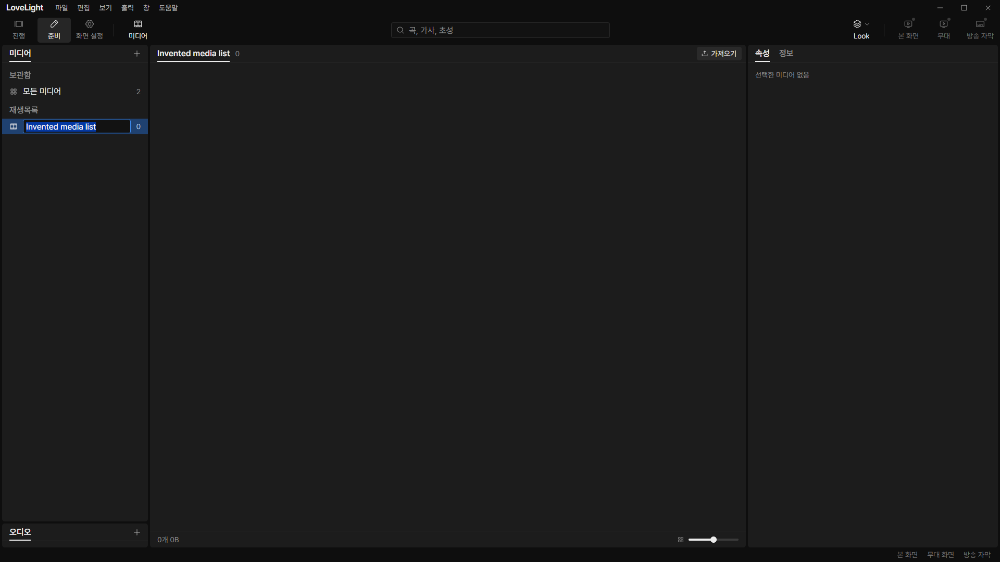
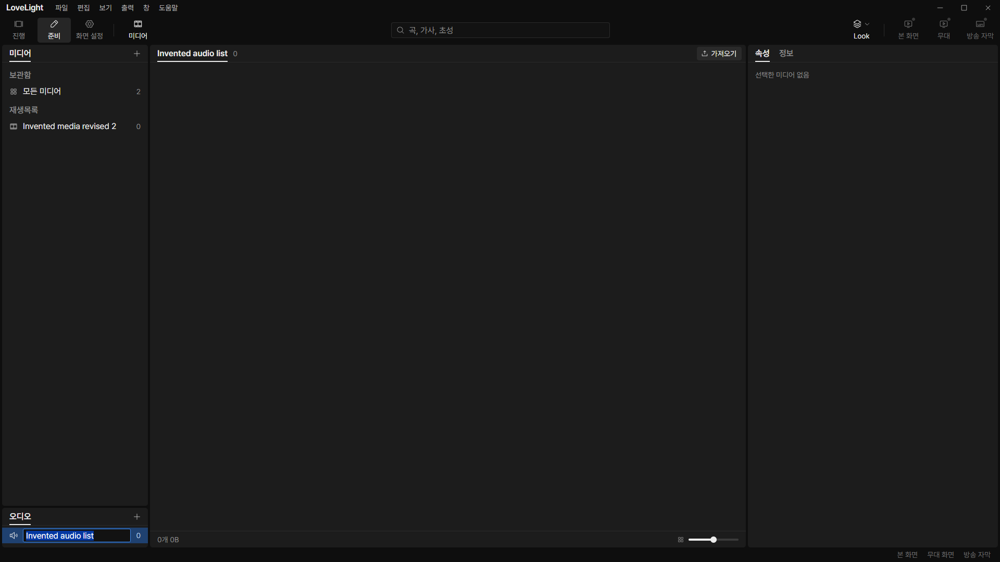
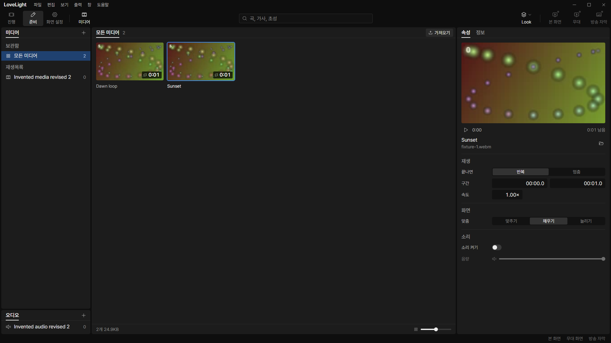

# Review request: `data-80`

- Team member: data
- Branch: `fix/data/playlist-rename-focus`
- Exact base/range: member report.
- Priority: M3-UX-10, before the shared-bin move.
- QA evidence: `docs/qa/m3-ux-pass.md` on `docs/qa/m3-ux`.

## What changed and why

Renaming an existing media or audio playlist mounted its auto-focused field
while closing the menu. Menu's passive cleanup then focused the original row.
The field's blur committed the unchanged name and removed the field before the
operator could type. The old regression test never focused that row, so
restoring its opener did not reproduce the failure.

The playlist hook now records the requested ID and opens its field in a passive
effect after the menu has closed and restored focus, following the existing Look
list's pattern. Initial playlist naming still enters directly, because it does
not close a menu. No timers, new listeners or shared Menu behavior change.

## Changes outside my paths

`src/renderer/src/prep/media/MediaListPanels.tsx` and its tests are within the
assigned prep-owned media exception. No common UI, QA worktree or audit file is
edited.

## Checks

- Added six regressions on the current main baseline first. All six failed
  before the fix: selected-row focus reproduces the disappearing input.
- After the fix, 67 tests pass across playlist panels, ListRow and MediaView.
  Both playlist kinds use pointer and keyboard menu activation; the tests wait
  past passive cleanup, require focus and no premature write, then type and
  commit. Escape cancellation never writes.
- Final rebased typecheck, changed-file lint and production build: pass.
- Formatting/diff: final results in report.
- Full verify: CI pending (API 403); lead confirms the exact head.

## Checked in the app

Built the app, checked launcher/driver with `node --check`, and ran with
`LLP_TEST_WINDOWS=offscreen`, port 5188 and isolated app data. Generated
abstract videos and invented playlist names are disposable fixtures; all windows
stay invisible.

CDP used native pointer and key input to create and initially name a media and
an audio playlist. For each, it selected the row, right-clicked and chose 이름
바꾸기 twice, waited 250ms, required the same focused field to remain mounted,
typed a revised name and committed. Both revised names were checked in the
actual saved `media.json`.

For each playlist kind, opened rename and cancelled a changed draft twenty times
after warmup, checking one active field, no retained cancelled name, and stable
closed-view DOM/listener counts. Then returned to all media, switched videos
twenty round trips and hid/reopened media twice. The live output stays
unchanged. Attached measurements contain per-phase node/listener/heap samples
and assertions; the screenshots show the focused rename fields.

[Measurements](assets/data-80/measurements.json).

## Verdicts (recorded by the lead at merge)

- Round 1 (89cbdcd5): reviewer (Codex) Approve. Lead Approve through the lead's
  merge check: the exact-head CI run passed, the branch rebased onto local
  `main` without conflicts, and typecheck passes. Earlier rounds' findings and
  replies are above.
