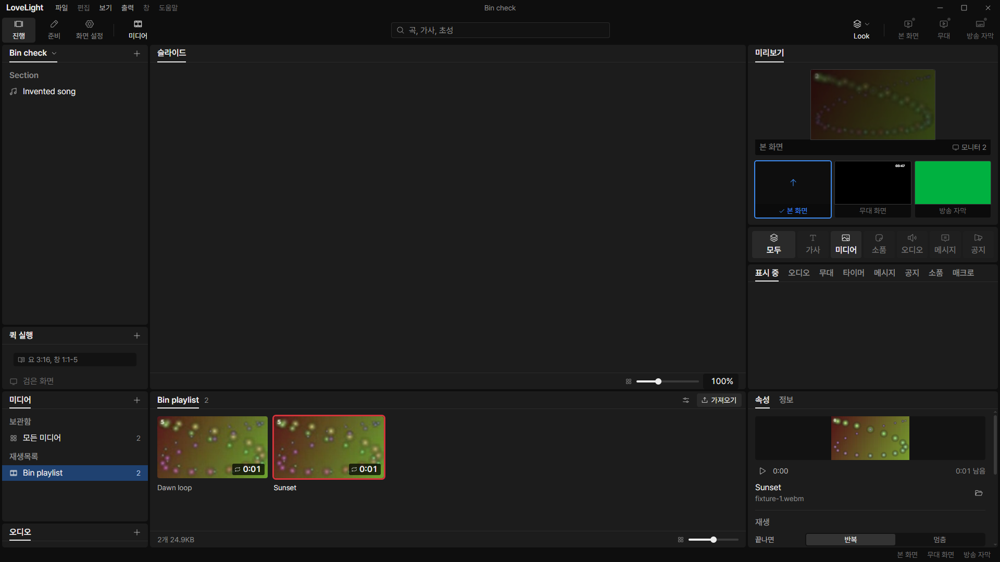
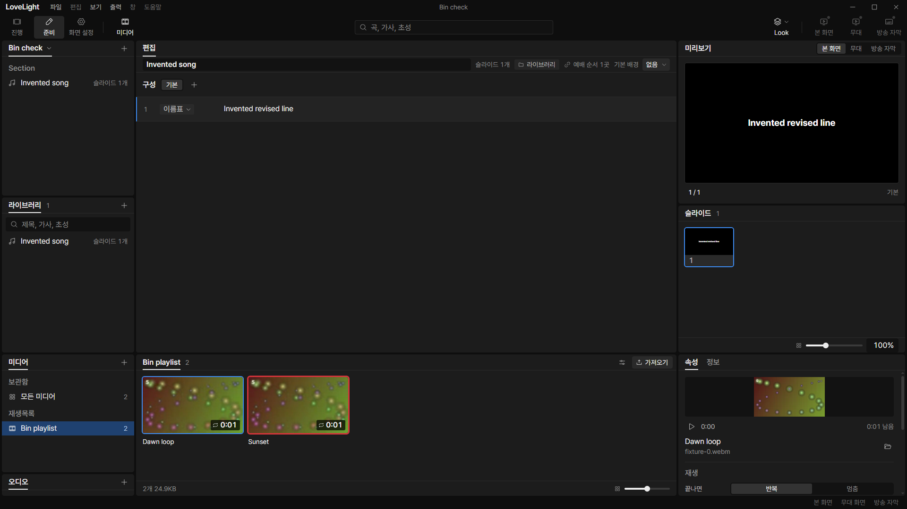
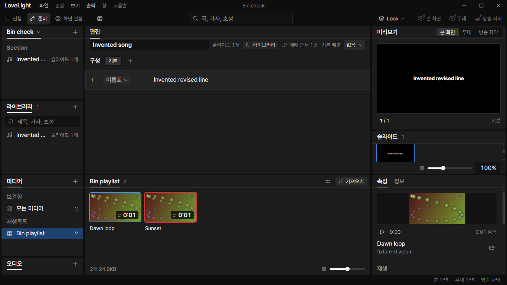

# Review request: `data-81`

- Team member: data
- Branch: `refactor/data/retire-media-strip`
- Stacked on data-74 round 4, `72fded3f`, rebased onto local main `8eede4b1`.
- Merge order: M3-UX-10/data-80 first, then data-74, then this cleanup.
- Exact base/range: member report.

## What changed and why

Removes the old ShowMediaPanel, WindowedMediaStrip, MediaStripTile, MediaPreview
and useMediaStrip implementation and their dedicated tests. data-74 already
replaced that subtree with MediaBin and the shared media-library provider. The
removed files have no remaining production consumers in that base.

QuickPanel and BiblePanel tests lose only their obsolete ShowMediaPanel mocks.
The shell visibility hook, shared UI MediaStrip primitive, current preview
player and media-copy job reducer remain because active code still uses them. No
replacement implementation or operator behavior is added here.

This is mostly deletion: eight retired files and two mock lines. It is one
cleanup unit so the mutually dependent obsolete components do not linger. Do not
apply it to a baseline that still mounts ShowMediaPanel.

## Changes outside my paths

The deleted Show components and hook are shell-owned, retired as part of the
assigned shared-bin move. The Bible/Quick test files are tools-owned; each
change removes one mock of the deleted module. No other tools behavior changes.

## Checks

- Reference search: no imports of the retired modules remain.
- Existing QuickPanel, BiblePanel, media library, media mount and MediaView
  tests, typecheck, changed-file lint and build: final results in report.
- Formatting/diff: final results in report.
- Full verify: CI pending; lead confirms the exact head.

## Checked in the app

Although this deletion has no intended screen change relative to data-74, the
shared-bin app check is repeated on this branch. Built the app, checked launcher
and driver with `node --check`, and ran with `LLP_TEST_WINDOWS=offscreen`, port
5188 and isolated invented data. All native windows stay invisible.

The CDP flow checks the bin in both workspaces, the View menu and Ctrl Shift V
in 준비, source text editing and persistence, twenty two-video selection round
trips in each workspace, twenty workspace round trips, and two hide/reopen
cycles. It requires flat element/node/listener counts within each warmed phase
and verifies normal/narrow geometry. This does not replace data-80's separate
playlist-rename regression check; the requests must merge in the order above.

[Measurements](assets/data-81/measurements.json).

## CI follow-up (round 2)

[The previous CI run](https://github.com/0913vision/llpresenter/actions/runs/40367932761)
failed two inherited preparation mount/text-import assertions. data-74 round 3
reproduces and corrects those obsolete separate-view expectations, retaining the
library element and the bin visibility choice. This branch is restacked onto
that correction; its own cleanup has no further runtime changes.

The current related check runs `ShowPanels`, `App`, `PrepMount`, `QuickPanel`,
`BiblePanel`, media-library, shared-media mount and media-view tests: 125 tests
pass. Typecheck, changed-file lint, build and formatting pass. Repeated the
checked-app flow after the rebase and refreshed screenshots and measurements;
the bin remains at 132 elements, with 67 properties elements and one video,
without accumulating retained DOM nodes or listeners in either warmed workspace.

## Integration rebase (round 3)

Restacked onto data-74 round 4's rebase to local main `8eede4b1`, retaining the
search and import shortcut integration fix. The cleanup itself applies without
conflicts and keeps exactly its original production deletion scope and the two
obsolete mock removals. Repeated the affected tests, typecheck, changed-file
lint, build, formatting and the offscreen checked-app flow. Updated screenshots
and measurements above. All 128 tests in the eight affected files pass. The
warmed bin, properties, retained nodes and listeners remain flat. CI pending.

## Verdicts (recorded by the lead at merge)

- Round 3 (d79aaa4f): reviewer (Codex) Approve. Lead Approve through the lead's
  merge check: the exact-head CI run passed, the branch rebased onto local
  `main` without conflicts, and typecheck passes. Earlier rounds' findings and
  replies are above.
