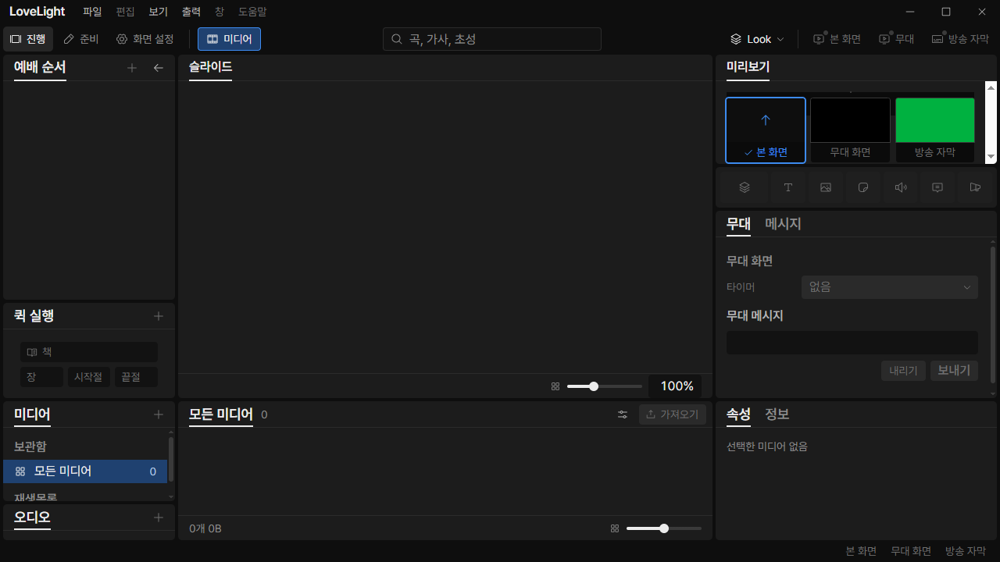
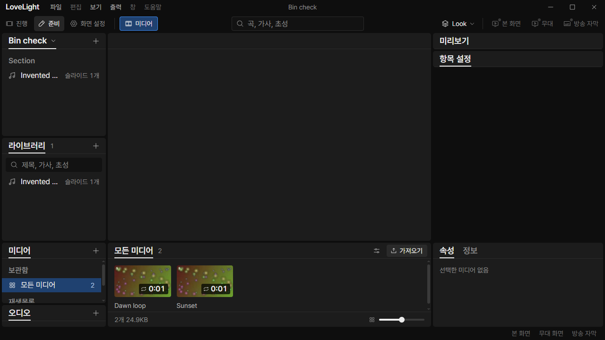
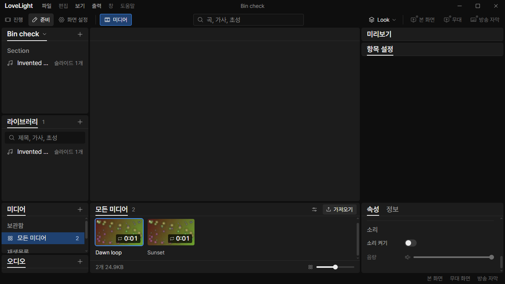
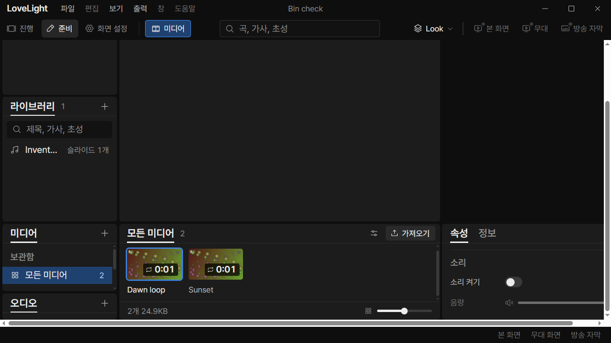

# Review request: `data-82`

- Team member: data
- Branch: `fix/data/media-bin-height`
- Rebased directly onto local main `aec7a5e1`, which includes data-74 and
  data-81.
- Implements data-73 round 2's clarified Layout height/overflow contract.
- Exact range: member report. CI pending.

## What changed and why

The original bin used 40% of the work area, capped at 300px, without reserving
the workspace above it. At minimum height a saved-open bin compressed the editor
and preview. The app-level minimum also scrolled the whole shell under UI zoom,
rather than keeping the bars accessible around the work area.

The workspace now allocates two grid rows. The upper row keeps 440px; the bin
uses the specified bounded allocation with a 168px minimum. If both rows cannot
fit, the work area scrolls over their combined minimum. Its menu bar, toolbar
and status bar remain outside that scroll region. Closing the bin releases its
row and gap. Preview bodies scroll inside their panels when needed.

Adds the two documented height tokens to the design source and both mirrored CSS
files. No visibility preference, activation rule or media state changes.

Also corrects two data-81 documentation nits: MediaStrip remains for the gallery
and design system, and the View menu screenshot is now embedded beside its app
check. Moving the media-copy job reducer is a separate follow-up.

## Changes outside my paths

- Shell-owned Workspace and its CSS define row allocation. A data attribute lets
  App's CSS give this scrolling workspace the available viewport height.
- `control/App.module.css` is shell-owned. Its override applies to Workspace
  roots, retaining the existing fallback for other main elements.
- The bin CSS is in the assigned prep media exception.
- Design `tokens.json`, design `tokens.css` and app `styles/tokens.css` are
  ui-owned. The only additions are `workspace-upper-min-height` (440px) and
  `media-bin-min-height` (168px), already defined by the approved Layout rule.

## Checks

- Eight related renderer/token test files: 121 tests pass, including
  `ShowPanels`, `App`, `PrepMount` and the workspace/media mount coverage.
- Typecheck, changed-file lint and build pass.
- Token asset checks and formatting/diff: final results in report.
- [CDP geometry regression driver](assets/data-82/check-height.cjs) checks
  actual computed rectangles, panel reachability, internal scrolling and zoom.
  The same driver fails the old bin build at its first upper-height assertion
  and passes the changed build. Its host supplies the existing Electron window
  and debugger send/evaluate functions; the driver itself is tracked for review.
- CI pending; no per-member CI polling under the new dispatcher rule.

## Checked in the app

Built both the pre-fix bin and changed app. Before every Electron launch,
checked the launcher and all imported drivers with `node --check`. Ran with
`LLP_TEST_WINDOWS=offscreen`, port 5188 and isolated generated videos/invented
song data. Every native window remains invisible.

The changed run starts the control window at 1280x720 with saved-open media.
Both 진행 and 준비 keep a 440px upper row and a 178px bin. The Show preview
retains at least 124px and tools at least 240px, all within that upper row.
Hiding/reopening twice releases/restores the bin row. Properties scroll inside
their panel without growing either row.

At 120% UI zoom the viewport cannot fit both rows. Main's validated zoom command
sets the actual window zoom; CDP wheel input scrolls the work area to the bin,
while its bars remain fixed. The bin stays 168px and the upper row 440px. At
1920x1080 the bin is capped at 300px with 662px above it.

Then repeated the shared-bin flow: twenty two-video round trips in each
workspace, twenty workspace round trips, two normal-size hide/reopens, both 준비
menu/shortcut entry points and a source edit checked on disk. Rendered element
counts stay flat; retained node and listener counts do not grow after each
warmed phase. All geometry and heap samples are attached. This branch must
integrate after the approved predecessor requests and data-80's separate
playlist-rename fix.

[Measurements](assets/data-82/measurements.json).

## CI follow-up (round 2)

[The previous CI run](https://github.com/0913vision/llpresenter/actions/runs/40372547769)
reported two inherited preparation mount/text-import test failures and five
`no-undef` lint errors in the tracked geometry driver. data-74 round 3 corrects
the obsolete separate-view assertions. This branch is restacked onto that fix
through data-81 round 2, based on local main `4e3cdb41`.

Reproduced all five driver lint errors locally, then imported `Buffer`,
`console` and `setTimeout` explicitly from Node's built-in modules. No lint
exceptions or production behavior changes were needed. The driver now passes
lint and syntax checking. Repeated related renderer/token tests, typecheck,
build, formatting and the checked-app flow, including minimum height, actual UI
zoom, internal scrolling, repeated selection and workspace switches. Screenshots
and raw measurements above are refreshed for this head.

## Integration rebase (round 3)

Rebased only this request's commit directly onto local main `4945d6fe`, dropping
the old data-74 and data-81 stack because both requests are merged. Its height
rules, driver and explicit Node imports apply without conflicts. Main's newer
calendar design tokens remain intact beside the two height-token additions.

Repeated the affected renderer/token tests, typecheck, lint, build, formatting
and checked-app flow on this base. Refreshed minimum-window, zoom, scrolling and
repeated-selection measurements and screenshots above. CI pending.

All 120 affected tests pass. The final app check allows 90 seconds for startup,
after the initial 15-second harness wait expired during loading. Its rendered
bin/properties counts still require exact equality on every selection; retained
node/listener counts must not increase, allowing already-detached nodes to be
collected. The completed run passes the same height, zoom, disk-save and heap
bounds as before.

## M3-C4-4 acceptance (round 4)

QA's `docs/qa/m3-check4/failures.md` on `docs/qa/m3-check4-smoke` reproduces
this request's original layout bug on main: at a 1280x720 content viewport, DPR
1 and 100% app zoom, the open bin takes about 248.8px and leaves about 369.2px
above it. Both 진행 and 준비 must instead allocate exactly 440px to the upper
workspace and 178px to the bin.

Rebased onto local main `aec7a5e1`. The tracked app driver now explicitly resets
and verifies zoom, checks DPR and both content-viewport dimensions, and asserts
those exact upper/bin heights in both workspaces. It also records left-panel
rectangles alongside the preview/tools rectangles, so QA's clipped service panel
can be compared with the corrected allocation. This adds acceptance evidence to
the existing fix; the production height rules are unchanged.

The final app run passes those exact assertions in both workspaces. In the
invented fixture, the Show service panel is 314px high, its preview is 140px and
tools are 240px. The minimum-window screenshots and raw measurements above are
refreshed. The related 121 tests, typecheck, driver/source lint and build pass;
the run also repeats the zoom, scrolling, selection and reopen checks.
