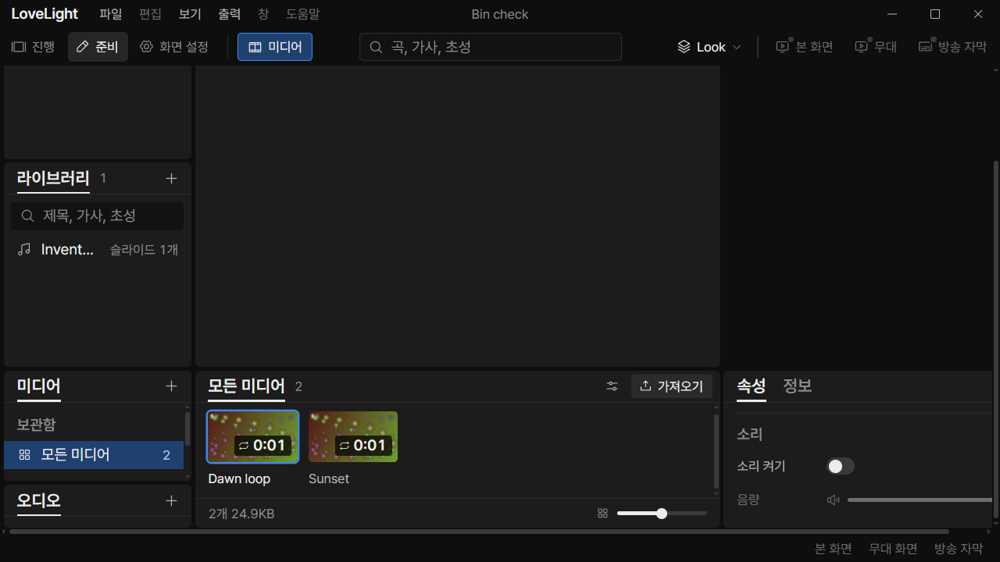
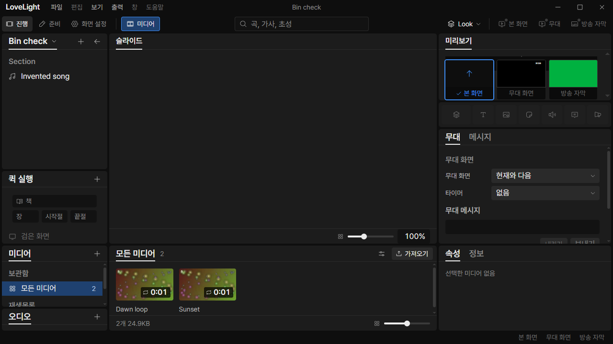

# Review request: `data-84`

- Team member: data
- Branch: `fix/data/workspace-scrollbar`
- Stacked on data-82 round 4, `3fb3f39a`, based on local main `aec7a5e1`.
- Follow-up: data-82's scrollbar nit.
- CI pending.

## What changed and why

Sets Workspace's scrollbar to `thin`, with `var(--line-strong)` for the thumb
and a transparent track. This removes the bright native track visible in the
zoomed media-bin screenshot and matches the adjacent panel treatment. Height
allocation and scroll behavior remain the existing data-82 implementation.

## Changes outside my paths

`src/renderer/src/shell/Workspace.module.css` is shell-owned. The two scrollbar
properties finish the assigned shared-bin height/overflow work. No shared
component, token or other stylesheet changes.

## Checks

- Eight related renderer/token test files: 121 tests pass, including
  `ShowPanels`, `App`, `PrepMount` and the workspace/media mount coverage.
- Production build, formatting and diff: final results in report.
- CDP checks `getComputedStyle(main).scrollbarWidth === 'thin'` and that the
  computed thumb matches `--line-strong` with a transparent track before every
  screenshot. Rendered geometry and scrolling are checked in Electron.
- CI pending; no member CI polling.

## Checked in the app

Built the app and checked the launcher, wrapper and both imported drivers with
`node --check` before Electron. Ran with `LLP_TEST_WINDOWS=offscreen`, port 5188
and isolated invented fixtures. Every native window stayed invisible.

Repeated the data-82 CDP checks: saved-open bin at 1280x720 in both workspaces,
two minimum-size hide/reopens, independent property scrolling, 120% UI zoom,
wheel scrolling to the bin with fixed bars, and regular-window geometry. The
screenshots and raw measurements include the computed scrollbar colors.

Then selected both videos for twenty round trips in each workspace, switched
workspaces twenty times, hid/reopened the bin twice, checked both 준비
menu/shortcut entries and saved a source text edit. The warmed bin/properties
DOM remained flat, retained nodes and listeners did not grow, and the properties
panel kept one current video.

[Measurements](assets/data-84/measurements.json).

## CI follow-up (round 2)

[The previous CI run](https://github.com/0913vision/llpresenter/actions/runs/40375427591)
reported the same two inherited preparation mount/text-import assertion failures
and five geometry-driver lint errors as data-82. Those failures were reproduced
locally and fixed in data-74 round 3 and data-82 round 2 respectively. Restacked
this request onto those corrections, based on local main `4e3cdb41`. The
request's own two scrollbar declarations are unchanged.

Repeated `ShowPanels`, `App`, `PrepMount`, shared-media mount, workspace
layout/editor/mount and token asset tests, plus the inherited geometry-driver
lint check and production build. Repeated the offscreen checked-app flow with
computed scrollbar assertions before every capture. Screenshots and raw
measurements above are refreshed for this head. CI pending; the dispatcher
confirms the exact-head result.

## Integration rebase (round 3)

Restacked only the scrollbar request onto data-82's direct rebase to local main
`4945d6fe`; the old data-74/data-81 stack is gone. The two CSS declarations
apply without conflicts and remain unchanged. Repeated affected tests and
typecheck, build, driver syntax/lint checks and the offscreen app flow, with
fresh computed scrollbar, geometry, DOM and heap measurements. CI pending.

All 120 tests and typecheck pass on the new base. The final app run passes the
same exact rendered-element checks and bounded retained-node/listener/heap
checks used in data-82 round 3. The computed scrollbar remains `thin`, with
`rgb(58, 58, 58)` as its thumb and a transparent track.

## Stack refresh (round 4)

Restacked onto data-82 round 4's explicit M3-C4-4 acceptance checks. The
scrollbar declarations remain unchanged. The same app flow now also verifies
100% zoom, DPR 1 and a 1280x720 content viewport with the exact 440px/178px
workspace/bin allocation in both workspaces before checking enlarged scrolling.
Fresh screenshots and measurements record that acceptance on this stack.

All 121 affected tests, typecheck, lint and build pass. The completed app run
passes the exact M3-C4-4 dimensions in both workspaces, the thin dark scrollbar
checks, twenty selection round trips per workspace, twenty workspace round
trips, both preparation menu/shortcut paths and two normal-size reopens.

## Verdicts (recorded by the lead at merge)

- Round 4 (46ea6dc3): reviewer (Codex) Approve. Lead Approve through the lead's
  merge check: the exact-head CI run passed, the branch rebased onto local
  `main` without conflicts, and typecheck passes. Earlier rounds' findings and
  replies are above.
