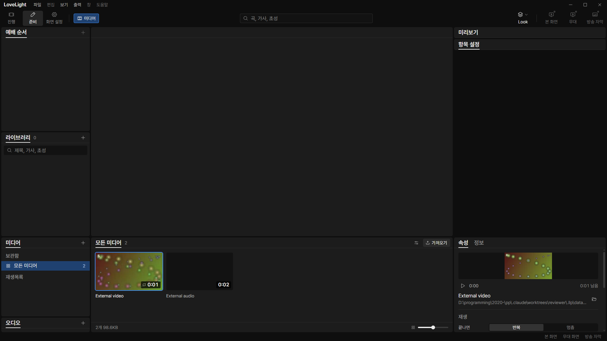
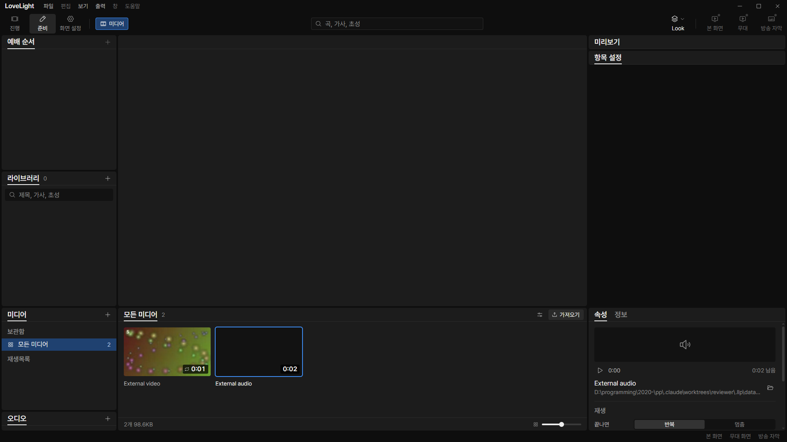
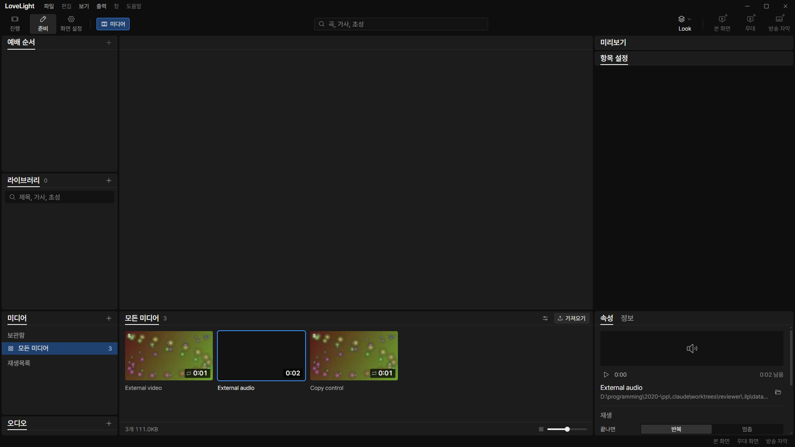
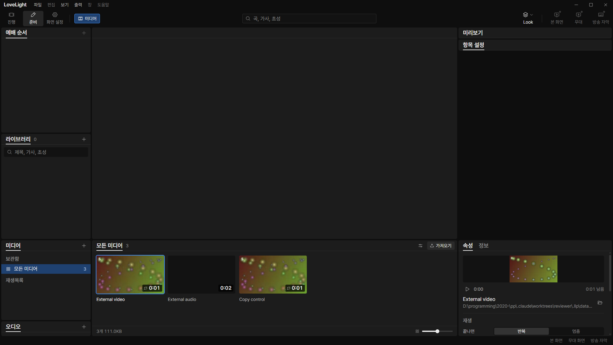

# Review request: `data-87`

- Team member: data
- Branch: `fix/data/external-media-import`
- Base: local main `aec7a5e1`; exact range in the member report.
- Priority: M3-C4-1, ahead of grouped-song activation.
- CI pending; no member CI polling.

## Problem and resulting behavior

With the default copy-off policy, importing an original outside the app folders
decoded successfully but failed when joining the media list. The old development
guard discarded every external absolute path. MediaStore correctly refused a new
entry whose path the library had discarded. QA reproduced this with WAV and WebM
in `docs/qa/m3-check4/failures.md` on `docs/qa/m3-check4-smoke`.

Spec 02's preferences and media-list rules, and the October 27 optional-copy
decision, require storing original paths in place: relative inside the media
folder and absolute otherwise. The library now admits catalogued absolute
originals in both development and packaged runs. Its obsolete development-root
option is removed through the media loader and its callers. Folder configuration
still goes through the existing confined-location validation.

The validation boundary otherwise stays intact: MediaStore still validates
metadata, IDs, revisions and playlist membership. Relative paths cannot leave
the media folder. Serving and reveal still resolve a registered media ID and
check real paths against the media folder and the parent folders of catalogued
originals. Missing files, unknown IDs, directories and links outside all
admitted roots remain refused. No generic filesystem root is added.

## Regression evidence

- Before the fix: two tests fail, 29 pass. A real MediaStore rejects an external
  absolute item, and the importer/store integration fails with copy off under
  the old development restriction.
- After the fix: 111 tests in ten related files pass, including media library,
  store, importer, loader, file-store startup, channels, protocol range/path
  checks, reveal and macro integration.
- The importer/store integration now also omits the copy preference, exercising
  its false default and the existing applied-write-failure retry boundary.
  Original bytes remain intact. A store test checks the absolute persisted path.
- The link fixture uses an unregistered third directory, separate from the
  deliberately admitted external original. It still proves that links cannot
  escape all catalogued media roots.
- Typecheck, changed-file lint and production build pass. Final formatting and
  app results are recorded in the member report.

## Changes outside my paths

- Main store/media paths are part of data's assigned persistence and media work.
- `src/main/macros/register.test.ts` is tools-owned. Its only change removes the
  obsolete MediaStore constructor option; macro behavior is unchanged.
- The window media-serving and real-path implementations are unchanged and
  covered by the related tests.

## Checked in the app

Built the app, checked every launcher/driver with `node --check`, and ran with
`LLP_TEST_WINDOWS=offscreen`, port 5188 and isolated app data. All native
windows remain invisible. Fixtures are a generated abstract VP8 WebM and a
generated two-second PCM WAV. The originals live outside `LLP_USER_DATA`, inside
this worktree's ignored fixture directory.

The app check imports the video through native CDP file-drop input and the WAV
through production `media.import` IPC, the same boundary used by QA. It checks
the initially absent copy preference resolves to false, both stored paths are
absolute, no file is added to the media folder, and original bytes are
unchanged. Both real preview elements must decode with a nonzero duration and no
error. Native file pickers are suppressed; no native-picker pass is claimed.

The remaining checks repeat video/audio selection twenty times with exact
per-kind element counts, hide/reopen twice, and require bounded retained nodes,
listeners and heap after collection. A native option-menu click enables copying
for a separate control import. That file must be stored relatively and its copy
must match the untouched original. A fresh Electron run then checks persisted
external references, playback and the repeated flows again.

Both phases pass. Video/audio property element counts remain exactly 67/56, with
one media element. The first run's retained nodes/listeners stay at 566/385; the
fresh run stays at 574/387 after warming its three-item list. Collected heap
changes from 5,669,556 to 5,861,816 bytes in the first run and 5,595,256 to
5,847,236 on reload, within the checked bound.

[Import measurements](assets/data-87/measurements.json) and
[fresh-run measurements](assets/data-87/measurements-reload.json).

## Verdicts (recorded by the lead at merge)

- Final round (380e4c32): reviewer (Codex) Approve. Lead Approve; the lead read
  the store diff (absolute media references outside the media folder are now
  admitted in development runs too, as they already were in packaged runs; every
  file is still resolved by catalogued ID and checked against the media roots),
  which closes qa's M3-C4-1. The exact-head CI run passed, checked by the lead
  at merge. Rebased by the lead onto local `main` without conflicts; typecheck
  passes. Earlier rounds' findings and replies are above.
