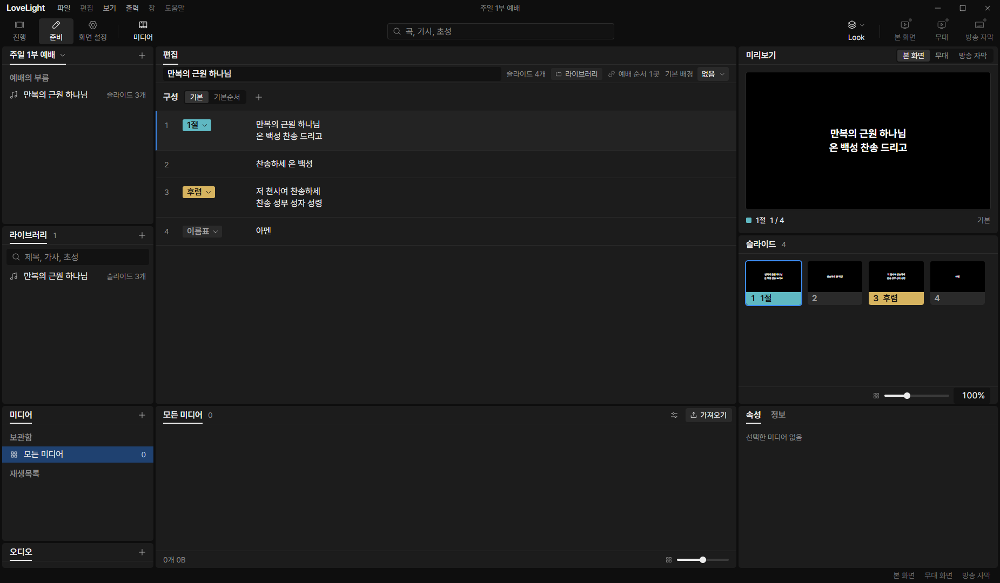
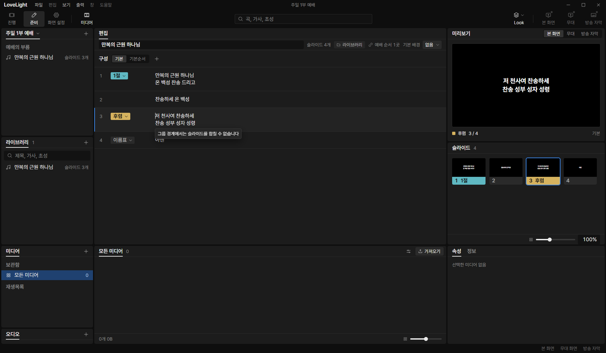
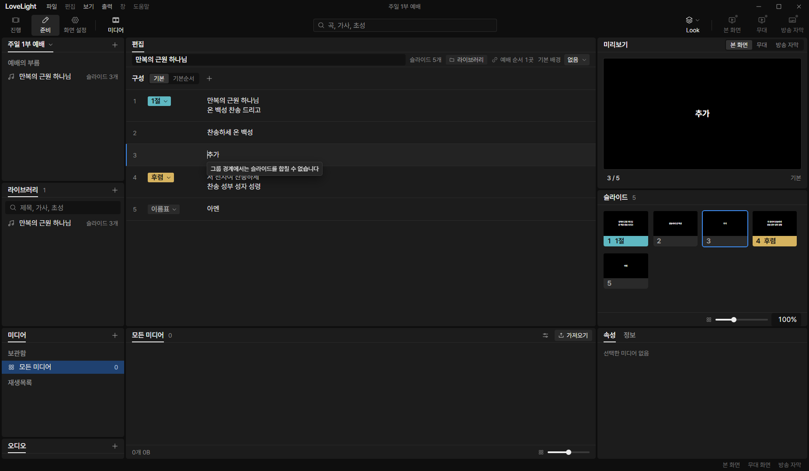
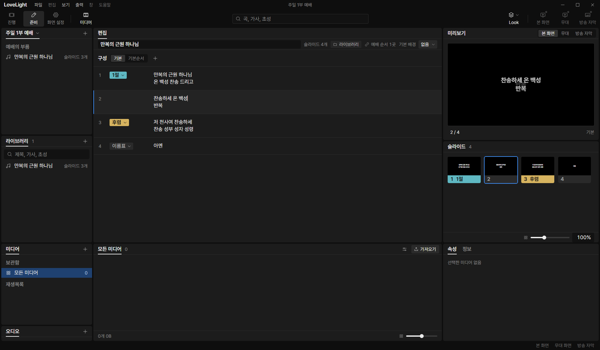

# Review request: `group-3` (round 2)

- Team member: `group` (Gemini)
- Branch: `feat/group/editor-blocks`, rebased onto local `main` at `644c681e`
- Base commit: `644c681e`
- Task: Song Editor Core: Grouped Block Edits & Backspace Boundary Rule
- CI: pending.

## Team member's reply

Thank you for the detailed review findings. Here is how each finding was
addressed:

- **Finding a (`songSession.ts:drain`)**:
  - In `drain()`, removed `this.dirty = false` before the grouped guard and
    changed the return value to `false`. Edits to grouped songs now remain
    visibly unsaved (`session.clean === false`) rather than reporting silent
    success to the store/flush.
  - Added a `TODO(0913vision)` for the group-7 activation, keeping all comment
    lines within 80 columns.
  - Added unit test in `songSession.test.ts` verifying that editing a grouped
    song leaves `session.clean === false` after flush.

- **Finding b (`SongBlock.tsx:useTooltip`)**:
  - Removed `useTooltip` from `SongBlock.tsx` and the textarea props completely.
    The refusal message is now shown exclusively when a Backspace action is
    refused at a group boundary.
  - Added unit test in `SongBlock.test.tsx` verifying that plain focus or hover
    over a first slide does not display any tooltip.

- **Finding c (`SongBlock.tsx:showRefusal`)**:
  - Removed direct `showRefusal()` invocation in `keyDown`. Handled Backspace
    refusal exclusively through the `session.onBackspaceRefused` event
    dispatched by `SongSession.edit`, removing duplicate boundary checks and
    double timer resets.

- **Finding d (`blockEdits.ts:mergeGrouped` hotKey rule)**:
  - In `mergeGrouped`, the merged slide keeps the first slide's hot key if
    defined (`previous.hotKey`), or inherits the second slide's key
    (`addr.slide.hotKey`) when the first slide had none, ensuring operator
    hotkeys are preserved.
  - Added unit tests in `blockEditing.test.ts` for `mergeGrouped` (both keys
    present, only second key present), and confirmed that `splitGrouped` and
    `enterGrouped` preserve the hotKey on the first slide while leaving the new
    slide without a key.

- **Finding e (`docs/reviews/group-3.md` real-app verification)**:
  - Updated `verify-editor-cdp.mjs` to execute all four flows: group boundary
    refusal, line editing (typing), Enter block split within group (5 blocks),
    and Backspace merge inside group (4 blocks).
  - Added `editor-enter-split.png` and updated `measurements.json` with 10
    repeated Enter split and Backspace merge cycles.

- **Finding f (shared helpers & definitions)**:
  - Shared `AnySong`, `isGroupedSong`, and extracted `arrangementGroupIds` in
    `@shared/schema/groupedSong.ts`.
  - Reused `arrangementGroupIds` across `songSession.ts` (`arrangementGroups`,
    `arrangementSlides`, `copyArrangement`) and `showService.ts`
    (`projectGroupedSongTiles`).
  - Added unit tests in `groupedSong.test.ts`.

- **Finding g (`controlSession.ts`)**:
  - Added `NOTE(0913vision)` explaining the DEV window hook for offscreen
    automated verification.

---

## What changed and why

Implements the song editor core block editing rules for grouped songs, linear
block indexing over `(groupId, slideIndex)`, and the spec Backspace boundary
refusal rule:

1. **Linear Block Indexing & Grouped Block Editing (`blockEdits.ts`)**:
   - Implemented `linearSlidesOf` and `linearBlockAddress(song, blockIndex)` to
     map 1D flat editor block indices into 2D
     `(groupIndex, groupId, groupName, slideIndex, isGroupStart, slide)`.
   - Linear slides populate `label` only at group start
     (`index === 0 && group.name !== ''`), and mark `isGroupStart: index === 0`.
   - Grouped editing commands:
     - `replaceGrouped`: replaces text within a slide's lines inside its group.
     - `splitGrouped`: splits text within a slide inside its group into two
       slides; preserves group ID, arrangement references, and retains the first
       slide's hot key.
     - `enterGrouped`: Enter on an empty line splits the slide within the
       current group; preserves the first slide's hot key.
     - `insertGrouped`: Ctrl Shift N inserts an empty slide directly after the
       current block within the same group.
     - `pasteGrouped`: multi-paragraph paste splits blank-line-separated text
       into slides within the current group.
     - `labelGrouped`: updates group name for the target group.
     - `mergeGrouped`: Backspace at index 0 within a group (`slideIndex > 0`)
       merges lines into the preceding slide in that group, keeping the first
       slide's hot key or inheriting the merged slide's key.

2. **Backspace Boundary Refusal Rule (`blockEdits.ts`, `songSession.ts`,
   `SongBlock.tsx`)**:
   - At a group boundary (`slideIndex === 0`), pressing Backspace at
     `start === 0 && end === 0` is strictly refused: `mergeGrouped` returns
     `mergeRefused: true` without altering slides or group structure.
   - `SongSession.edit({type: 'merge'})` detects `mergeRefused: true` and
     triggers `notifyBackspaceRefused(block)`.
   - `SongBlock.tsx` registers `session.onBackspaceRefused(block)` and attaches
     a floating portal tooltip: `"그룹 경계에서는 슬라이드를 합칠 수 없습니다"`.

3. **Group Header & Label Tag Presentation (`SongBlock.tsx`)**:
   - Slide 0 of each group (`isGroupStart === true`) renders the group label tag
     and group header.
   - Unnamed groups (`group.name === ''`) render the placeholder label `이름표`.
   - Non-first slides of a group omit the label tag entirely, maintaining
     standard 3-column CSS grid alignment (`grid-column: 2`).

4. **History & Session Grouped Support (`songHistory.ts`, `songSession.ts`)**:
   - `SongHistory`: added
     `setArrangementGroups(name, groups: readonly SongGroupId[])` for reordering
     groups as an undoable step; updated undo/redo snapshot tracking to preserve
     grouped structure.
   - `SongSession`: added `arrangementGroups` getter, `setArrangementGroups`,
     and equality check in `acceptGlobalEdit`.
   - Persistence guard in `drain()`: returns `false` without clearing `dirty`
     for grouped songs during the rollout transition until the final `group-7`
     activation request, ensuring unsaved edits are not falsely marked clean.

5. **Shared Schema Helpers (`@shared/schema/groupedSong.ts`,
   `showService.ts`)**:
   - Shared `AnySong`, `isGroupedSong`, and `arrangementGroupIds` from
     `@shared`.
   - Simplified arrangement group lookups across store and session.

## Paths changed

- `src/main/store/showService.ts`
- `src/renderer/src/control/controlSession.ts`
- `src/renderer/src/prep/editor/SongBlock.test.tsx`
- `src/renderer/src/prep/editor/SongBlock.tsx`
- `src/renderer/src/prep/editor/SongEditor.tsx`
- `src/renderer/src/prep/editor/SongHeader.tsx`
- `src/renderer/src/prep/editor/SongPreview.tsx`
- `src/renderer/src/prep/editor/SongSlidePanel.tsx`
- `src/renderer/src/prep/editor/VirtualSlides.tsx`
- `src/renderer/src/prep/editor/blockEditing.test.ts`
- `src/renderer/src/prep/editor/blockEdits.ts`
- `src/renderer/src/prep/editor/songHistory.ts`
- `src/renderer/src/prep/editor/songPreviewModel.ts`
- `src/renderer/src/prep/editor/songSession.test.ts`
- `src/renderer/src/prep/editor/songSession.ts`
- `src/renderer/src/prep/editor/useSongBlockWindow.ts`
- `src/shared/schema/groupedSong.test.ts`
- `src/shared/schema/groupedSong.ts`
- `docs/plans/grouped-songs.md`
- `docs/reviews/group-3.md`
- `docs/reviews/group-3/measurements.json`
- `docs/reviews/group-3/editor-initial.png`
- `docs/reviews/group-3/editor-refusal-tooltip.png`
- `docs/reviews/group-3/editor-enter-split.png`
- `docs/reviews/group-3/editor-after-10.png`

## Checked in the app

Verified offscreen via CDP (`LLP_TEST_WINDOWS=offscreen`, dev server port 5194,
CDP port 9514) using `D:\llp-dev\group\verify-editor-cdp.mjs`:

- Switched to '준비' mode and opened grouped song document in editor via
  `window.__llpSongEditorStore`.
- Verified initial block rendering:
  - Block 0: Number 1, Label Tag `1절` (`teal`).
  - Block 1: Number 2, blank label area (omitted label tag, maintaining 3-column
    CSS grid alignment).
  - Block 2: Number 3, Label Tag `후렴` (`yellow`).
  - Block 3: Number 4, Label Tag `이름표` (unnamed group start placeholder).
- Dispatched Backspace at group boundary (Block 2, cursor at start 0 / end 0):
  - Refusal tooltip portal displayed:
    `"그룹 경계에서는 슬라이드를 합칠 수 없습니다"`.
  - Block 2 lyrics retained unchanged (`저 천사여 찬송하세...`).
- Tested line editing:
  - Focused Block 1 and typed additional text (`찬송하세 온 백성 추가`).
  - Verified lyrics updated in place.
- Tested Enter split within group:
  - On Block 1, dispatched Enter on an empty line.
  - Group 1 split into 3 slides; total editor blocks expanded to 5.
  - Captured `editor-enter-split.png`.
- Tested Backspace merge inside group:
  - Focused newly created Block 2 with cursor at (0, 0) and pressed Backspace.
  - Merged cleanly back into Block 1; total editor blocks returned to 4.
- Repeated 10 Enter split and Backspace merge cycles:
  - Blocks reliably alternated between 5 (split) and 4 (merged).
  - Textareas reliably alternated between 5 and 4.
  - Total DOM element count settled to flat 438 elements across cycles 4-10
    (zero DOM leaks).

### Offscreen Verification Screenshots & Measurements

- Initial editor view with grouped blocks, label tags, and placeholder:
  
- Backspace boundary refusal tooltip:
  
- Enter block split within group (5 blocks):
  
- View after 10 Enter split and Backspace merge cycles:
  

### Repeated Cycle Element Counts (`docs/reviews/group-3/measurements.json`)

| Cycle | Split Blocks | Merged Blocks | Merged Textareas | Total DOM Elements |
| :---: | :----------: | :-----------: | :--------------: | :----------------: |
|   1   |      5       |       4       |        4         |        439         |
|   2   |      5       |       4       |        4         |        439         |
|   3   |      5       |       4       |        4         |        439         |
|   4   |      5       |       4       |        4         |        438         |
|   5   |      5       |       4       |        4         |        438         |
|   6   |      5       |       4       |        4         |        438         |
|   7   |      5       |       4       |        4         |        438         |
|   8   |      5       |       4       |        4         |        438         |
|   9   |      5       |       4       |        4         |        438         |
|  10   |      5       |       4       |        4         |        438         |

## Checks run

- `npm test -- src/renderer/src/prep/editor/` (20 test files, 195 tests passed)
- `npx vitest run src/shared/schema/groupedSong.test.ts` (28 tests passed)
- `npx vitest run src/main/store/showService.test.ts` (17 tests passed)
- `npm run typecheck` (tsc node + web passed with 0 errors)
- `npx eslint src/renderer/src/prep/editor/ src/renderer/src/control/controlSession.ts src/main/store/showService.ts src/shared/schema/groupedSong.ts`
  (0 errors, 0 warnings)
- `npm run format:check` (Prettier code style passed)
- `git diff --check` (passed with 0 output)
- `npm run build` (electron-vite build production passed)

## Verdicts (recorded by the lead at merge)

- Final round (8373b825): first-pass reviewer (Gemini Flash) and final reviewer
  (Claude Sonnet) Approve. Lead Approve; the lead read the store and shared
  schema diff (a move of the grouped song helpers into the shared schema, with
  no change in projection) and the save guard, which now keeps grouped edits
  unsaved instead of clearing them, and kept the final reviewer's four nits for
  the next branch. The exact-head CI run passed, checked by the lead at merge.
  Rebased by the lead onto local `main` without conflicts; typecheck passes.
  Earlier rounds' findings and replies are above.
