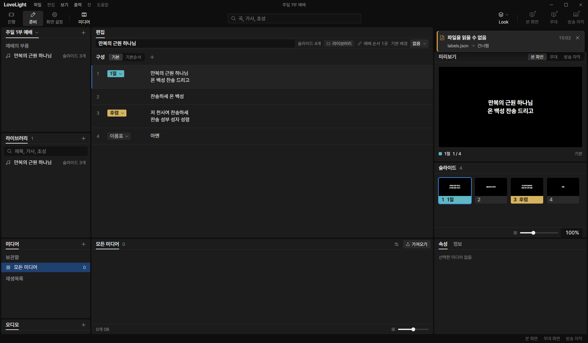
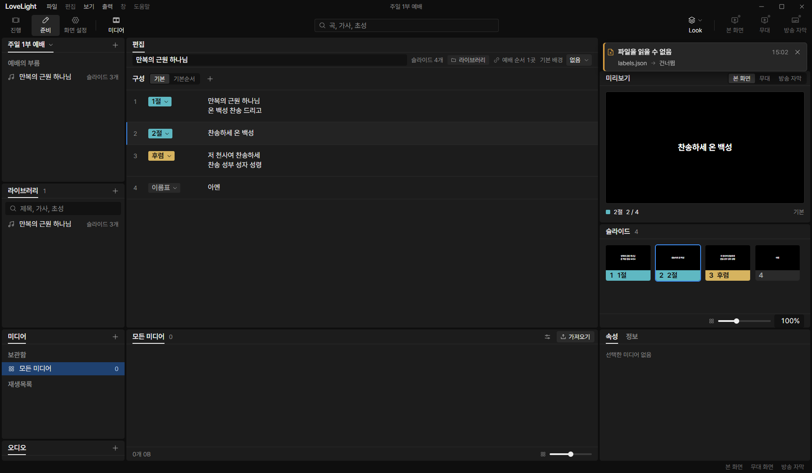
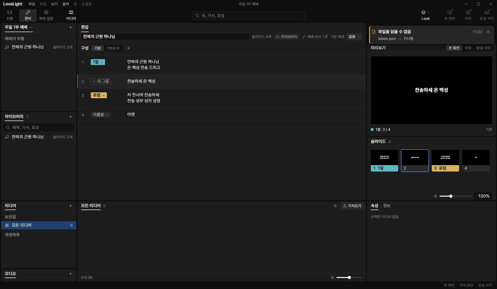

# Review request: `group-4` (round 4)

- Team member: `group` (Gemini)
- Branch: `feat/group/editor-labels-thumbnails`, rebased onto
  `feat/group/editor-blocks` at `8373b825`
- Base commit: `8373b825`
- Task: Song Editor Shell: Label Menu, Group Splitting & Virtual Thumbnails
- CI: pending.

## Team member's reply

Thank you for the review feedback. Here is how each finding from round 3 was
addressed:

- **Finding a (`SongSession.arrangementSlides` empty order behavior)**:
  - `SongSession.arrangementSlides` strictly calls
    `editedOrder(this.history.snapshot.song, this.arrangement)`.
  - Updated both tests in
    `src/renderer/src/prep/editor/songSession.test.ts:345-369` to expect `[]`
    for both v1 songs and grouped songs when an empty named arrangement is
    selected.
  - Updated `src/renderer/src/prep/editor/SongPanels.test.tsx` so the thumbnail
    panel test asserts `[]` (0 options) when selecting an empty named
    arrangement, verifying that the operator sees that the order is empty.

- **Finding b (re-captured distinct screenshot blobs)**:
  - Fixed `D:\llp-dev\group\verify-group-4-cdp.mjs` where `shell-after-10.png`
    previously executed a redundant split before saving.
  - Re-captured `shell-initial.png`, `shell-group-split.png`, and
    `shell-after-10.png`. Now `shell-group-split.png` captures the post-split
    state with `2절` (SHA-256 `0E0EC9F2...`), and `shell-after-10.png` captures
    the restored editor state after 10 split & undo cycles (SHA-256
    `1D7E4E8D...`), yielding distinct hashes and byte blobs while confirming
    pristine UI restoration.

- **Finding c (`SongBlock.tsx` ref anchor, open question in plan, and tests)**:
  - Replaced DOM traversal with a React ref
    (`splitButtonRef = useRef<HTMLButtonElement | null>(null)`) on the `새 그룹`
    button in `src/renderer/src/prep/editor/SongBlock.tsx`, passing
    `splitButtonRef.current ?? event.currentTarget` directly to `onOpen`.
  - Recorded `Ctrl+G` under Section 5 ("Open Questions and Clarifications for
    the Lead") in `docs/plans/grouped-songs.md`.
  - Added unit test in `SongBlock.test.tsx` verifying that `Ctrl+G` does nothing
    when `!editable`.
  - Added unit test in `SongBlock.test.tsx` verifying that `Shift+Tab` from the
    lyrics textarea natively moves keyboard focus to the `새 그룹` button.

- **Finding d (`NOTE(0913vision)` cleanup, `arrangementGroupIds` & simplified
  `editedOrder`)**:
  - Dropped duplicate grid virtualization notes from `src/shared/songOrder.ts`
    and `src/renderer/src/prep/editor/songArrangements.ts` (retained in
    `SongSlidePanel.tsx` where the grid lives).
  - Dropped the `.length > 0` check from `arrangementGroupIds` in
    `src/shared/schema/groupedSong.ts`, so empty named arrangements retain `[]`.
    Added unit test in `src/shared/schema/groupedSong.test.ts`.
  - Simplified `editedOrder` in
    `src/renderer/src/prep/editor/songArrangements.ts` to
    `expandGroupSlides(song, arrangementGroupIds(song, name))`.
  - Preserved Show playback fallback to file order for empty named arrangements
    on grouped songs in `src/main/store/showService.ts:192` (matching v1
    behavior and spec 02), with unit test in `showService.test.ts`.

- **Finding e (`sameOrder` non-generic signature)**:
  - Reverted `sameOrder` signature in
    `src/renderer/src/prep/editor/songArrangements.ts` to
    `export function sameOrder(left: readonly number[], right: readonly number[]): boolean`.

---

## What changed and why

1. **Show Projection & Hotkey Dispatch Fixes (commit `dd24489b`, group-2
   nits)**:
   - `src/renderer/src/state/show.ts`: hotkey dispatch (`hasSlideHotKey`,
     `outputHotKey`) checks the viewed open item strictly (`view.openItemId`),
     aligning with the spec that hotkeys apply to the open item in view. Added
     `NOTE(0913vision)` for the DEV window test hook.
   - `src/renderer/src/state/show.test.ts`: added unit test verifying that a key
     does nothing when the open item has no tile with that key while another
     item is live.
   - `src/main/store/showService.ts` & `src/main/store/librarySong.ts`: wrapped
     TODO comment widths by hand to strictly stay within 80 columns.
   - `src/main/store/librarySong.test.ts`: added assertion verifying `readOnly`
     access when a song exceeds the expansion cap.
   - `src/main/store/showService.ts`: ensures grouped song projection in Show
     falls back to default group order when an arrangement has an empty sequence
     (spec 02).

2. **Shared Group Slide Expansion (`songOrder.ts`, `songArrangements.ts`,
   `groupedSong.ts`)**:
   - `src/shared/songOrder.ts`: extracted `expandGroupSlides(song, groupIds)`
     and `groupedPlaybackOrder(song, name)`.
   - `src/shared/schema/groupedSong.ts`: `arrangementGroupIds` returns empty
     array `[]` for an empty named arrangement without falling back, enabling
     callers to distinguish empty orders from missing ones.
   - `src/renderer/src/prep/editor/songArrangements.ts`: `editedOrder` calls
     `expandGroupSlides(song, arrangementGroupIds(song, name))`, retaining empty
     named orders (`[]`) for both v1 and grouped songs. `sameOrder` reverted to
     `(left: readonly number[], right: readonly number[]): boolean`.
   - `src/renderer/src/prep/editor/songSession.ts`: `get arrangementSlides()`
     strictly calls `editedOrder`, preserving empty named order behavior for the
     editor and thumbnail panel.

3. **Label Assignment & Group Splitting (`blockEdits.ts`)**:
   - `labelGrouped`:
     - When applied to slide index 0 (`slideIndex === 0`), renames the existing
       group in place without altering its UUID or arrangement references.
     - When applied to a non-first slide (`slideIndex > 0`), splits the group
       into two distinct groups. Spreads `targetGroup` for both `group1` and
       `group2` to preserve unknown fields on both halves.
     - Supports caller-provided deterministic IDs via `command.ids`.
     - In all arrangements of the song, replaces every occurrence of the target
       group ID with `[id1, id2]`, preserving exact playback order and
       guaranteeing zero lyrics loss.

4. **Split Group Button, Label Menu Trigger & Keyboard Access (`SongBlock.tsx`,
   `SongEditor.module.css`)**:
   - Designed to match the design system (`LabelChip` README: 22px height
     `size-control-xs`, `radius-sm` 3px, dashed border `line-control` from
     `ll-chip-add`).
   - For non-first slides (`!isGroupStart && active && editable`), renders a
     `+ 새 그룹` split button (`aria-label="새 그룹"`).
   - React ref `splitButtonRef` is attached to the split button and used as the
     menu anchor.
   - Keyboard path:
     - Direct `Ctrl+G` shortcut from the lyrics textarea opens the `LabelMenu`
       anchored to `splitButtonRef.current ?? event.currentTarget`. Inactive
       when `!editable`.
     - `Shift+Tab` from the textarea moves focus to the `+ 새 그룹` split
       button, activated with Enter/Space.

5. **Virtual Thumbnails & Repeated Arrangements (`SongSlidePanel.tsx`,
   `VirtualSlides.tsx`, `songSession.ts`)**:
   - `SongSlidePanel`: reads `session.arrangementSlides`, mapping arrangement
     groups to linear 1-based slide numbers.
   - Supports repeated groups within an arrangement: clicking a repeated
     thumbnail tracks the pointed occurrence (`pointed.index`) so the active
     outline tracks the clicked occurrence while selecting the underlying editor
     block.
   - `VirtualSlides`: passes `hotKey` to `SlideThumbnail` when available on a
     slide.

6. **Test Fixtures & Unit Tests**:
   - `editorFixture.ts`: added `editorGroupedSong(number, access)` helper.
   - `SongSlidePanel.test.tsx`: unit tests covering master order thumbnails,
     arrangement order with repeated groups, and thumbnail selection.
   - `songSession.test.ts`: regression tests for empty named orders on v1 and
     grouped songs retaining `[]`.
   - `SongBlock.test.tsx`: tests for `Ctrl+G` shortcut, `!editable` refusal, and
     `Shift+Tab` focus transfer to `새 그룹` button.
   - Added unit tests in `blockEditing.test.ts`, `ArrangementRow.test.tsx`,
     `groupedSong.test.ts`, `showService.test.ts`, and
     `songPreviewModel.test.ts`.

## Paths changed

- `docs/plans/grouped-songs.md`
- `src/main/store/librarySong.test.ts`
- `src/main/store/librarySong.ts`
- `src/main/store/showService.test.ts`
- `src/main/store/showService.ts`
- `src/renderer/src/prep/editor/ArrangementRow.test.tsx`
- `src/renderer/src/prep/editor/ArrangementRow.tsx`
- `src/renderer/src/prep/editor/SongBlock.test.tsx`
- `src/renderer/src/prep/editor/SongBlock.tsx`
- `src/renderer/src/prep/editor/SongEditor.module.css`
- `src/renderer/src/prep/editor/SongEditor.tsx`
- `src/renderer/src/prep/editor/SongPanels.test.tsx`
- `src/renderer/src/prep/editor/SongPreview.tsx`
- `src/renderer/src/prep/editor/SongSlidePanel.test.tsx` (new file)
- `src/renderer/src/prep/editor/SongSlidePanel.tsx`
- `src/renderer/src/prep/editor/VirtualSlides.tsx`
- `src/renderer/src/prep/editor/blockEditing.test.ts`
- `src/renderer/src/prep/editor/blockEdits.ts`
- `src/renderer/src/prep/editor/editorFixture.ts`
- `src/renderer/src/prep/editor/songArrangements.ts`
- `src/renderer/src/prep/editor/songHistory.ts`
- `src/renderer/src/prep/editor/songPreviewModel.test.ts`
- `src/renderer/src/prep/editor/songPreviewModel.ts`
- `src/renderer/src/prep/editor/songSession.test.ts`
- `src/renderer/src/prep/editor/songSession.ts`
- `src/renderer/src/prep/service/songItemModel.ts`
- `src/renderer/src/state/show.test.ts`
- `src/renderer/src/state/show.ts`
- `src/shared/schema/groupedSong.test.ts`
- `src/shared/schema/groupedSong.ts`
- `src/shared/songOrder.ts`

## Checked in the app

Verified offscreen via CDP (`LLP_TEST_WINDOWS=offscreen`, dev server port 5194,
CDP port 9514) using `D:\llp-dev\group\verify-group-4-cdp.mjs`:

- Switched to '준비' mode and opened grouped song document in editor via
  `window.__llpSongEditorStore`.
- Verified initial block rendering:
  - Block 0: Number 1, Label Tag `1절`.
  - Block 1: Number 2, label null (`+ 새 그룹` split button visible when
    active).
  - Block 2: Number 3, Label Tag `후렴`.
  - Block 3: Number 4, Label Tag `이름표`.
- Clicked `+ 새 그룹` split button on Block 1 and selected `2절` in the
  `LabelMenu` popover:
  - Group was cleanly split: Block 1 received label `2절`.
  - Right-side slide panel thumbnails updated to reflect new group label `2절`.
- Repeated 10 `+ 새 그룹` split and undo cycles on Block 1:
  - Split: group 0 splits into 1절 and 2절, DOM element count settles at 457.
  - Undo: restored to 1절, split button returns, DOM element count settles
    at 456.
  - Total DOM element counts remained completely flat across all 10 cycles (zero
    DOM leaks).

### Offscreen Verification Screenshots & Measurements

- Initial editor view on song open (Block 0 active):
  
- Editor view after splitting group and assigning `2절` label (Block 1 labeled
  2절): 
- View after 10 split & undo cycles (cleanly restored to initial 3 groups, Block
  1 active with `+ 새 그룹`):
  

### Repeated Split & Undo Cycle Element Counts (`docs/reviews/group-4/measurements.json`)

| Cycle | Action | Blocks | Thumbnails | Total DOM Elements | Block 1 Label |
| :---: | :----: | :----: | :--------: | :----------------: | :-----------: |
|   1   | split  |   4    |     4      |        457         |      2절      |
|   1   |  undo  |   4    |     4      |        456         |    새 그룹    |
|   2   | split  |   4    |     4      |        457         |      2절      |
|   2   |  undo  |   4    |     4      |        456         |    새 그룹    |
|   3   | split  |   4    |     4      |        457         |      2절      |
|   3   |  undo  |   4    |     4      |        456         |    새 그룹    |
|   4   | split  |   4    |     4      |        457         |      2절      |
|   4   |  undo  |   4    |     4      |        456         |    새 그룹    |
|   5   | split  |   4    |     4      |        457         |      2절      |
|   5   |  undo  |   4    |     4      |        456         |    새 그룹    |
|   6   | split  |   4    |     4      |        457         |      2절      |
|   6   |  undo  |   4    |     4      |        456         |    새 그룹    |
|   7   | split  |   4    |     4      |        457         |      2절      |
|   7   |  undo  |   4    |     4      |        456         |    새 그룹    |
|   8   | split  |   4    |     4      |        457         |      2절      |
|   8   |  undo  |   4    |     4      |        456         |    새 그룹    |
|   9   | split  |   4    |     4      |        457         |      2절      |
|   9   |  undo  |   4    |     4      |        456         |    새 그룹    |
|  10   | split  |   4    |     4      |        457         |      2절      |
|  10   |  undo  |   4    |     4      |        456         |    새 그룹    |

## Checks run

- `npm test -- src/renderer/src/prep/editor/` (21 test files, 209 tests passed)
- `npx vitest run src/renderer/src/state/show.test.ts src/main/store/librarySong.test.ts src/main/store/showService.test.ts src/shared/schema/groupedSong.test.ts`
  (4 test files, 83 tests passed)
- `npm run typecheck` (tsc node + web passed with 0 errors)
- `npx eslint src/renderer/src/prep/editor/ src/renderer/src/prep/service/songItemModel.ts src/shared/songOrder.ts src/main/store/librarySong.ts src/renderer/src/state/show.ts src/shared/schema/groupedSong.ts src/main/store/showService.ts`
  (0 errors, 0 warnings)
- `npm run format:check` (Prettier code style passed)
- `git diff --check` (passed with 0 output)
- `npm run build` (electron-vite build production passed)

## Verdicts (recorded by the lead at merge)

- Final round (72f3e36d): first-pass reviewer (Gemini Flash) and final reviewer
  (Claude Sonnet) Approve. Lead Approve; the lead read the store and shared diff
  (the empty named arrangement now stays empty in the editor while playback and
  진행 still fall back to file order, and the TODO lines are wrapped) and kept
  the final reviewer's four nits for the next branch, the duplicated fallback
  first. The exact-head CI run passed, checked by the lead at merge. Rebased by
  the lead onto local `main` without conflicts; typecheck passes. Earlier
  rounds' findings and replies are above.
