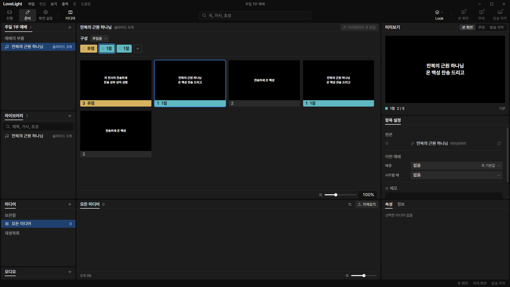
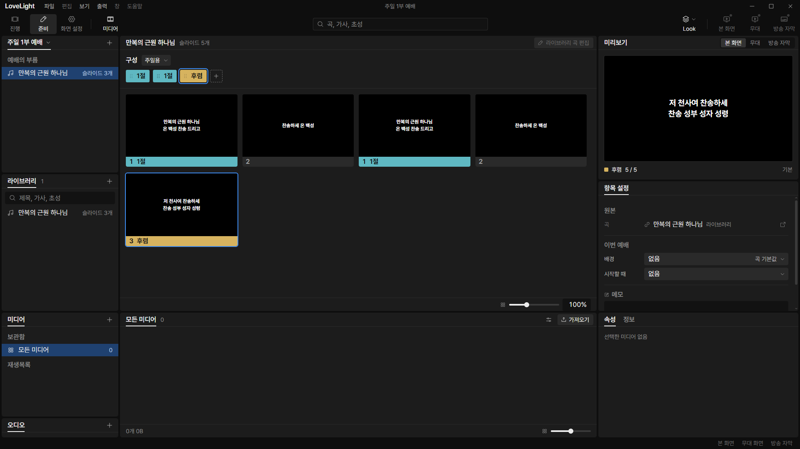
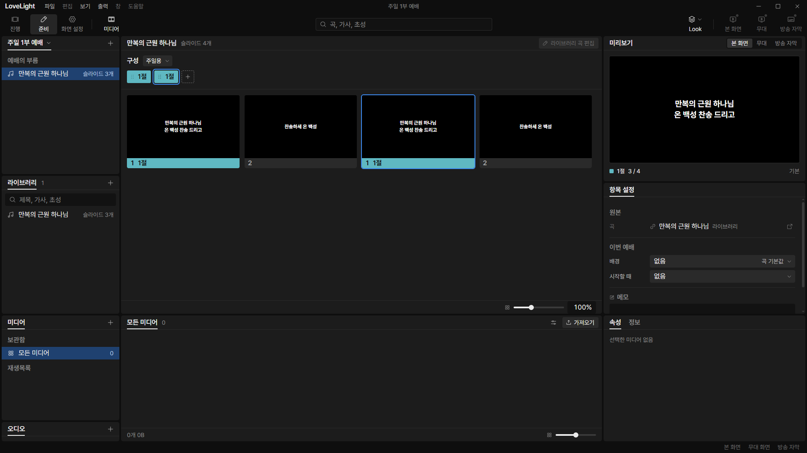
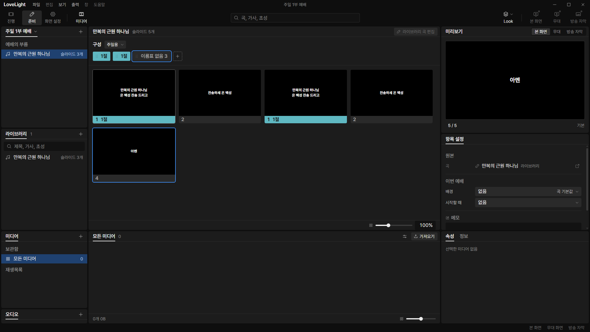
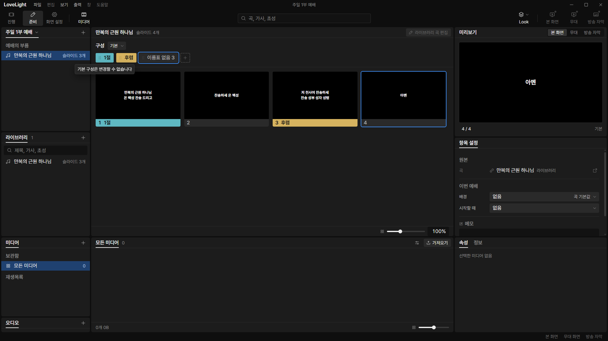

# Review request: `group-5` (round 3)

- Team member: `group` (Gemini)
- Branch: `feat/group/service-item-chips`, rebased onto `main` at `4945d6fe`
- Base commit: `4945d6fe`
- Task: Prep 예배 순서 Item Panel: Group Chip Strip & Arrangement Editing
- CI: passed.

## Team member's reply

This update resolves all 6 findings (a through f) from the round 2 review:

- **Finding a (`songItemModel.ts:editedGroupOrder`,
  `ItemArrangement.tsx:makeGroupedAdapter`)**:
  - `editedGroupOrder` drops dangling group IDs that do not exist in
    `song.groups` when the active order is read.
  - `makeGroupedAdapter` derives chips, occurrence ranges, and all mutation
    operations (`movedOrder`, `withoutPosition`, `insert`) from this single
    filtered list.
  - When an edit is performed on an arrangement with dangling IDs, saving
    persists the sanitized list without the dangling IDs.
  - Added unit tests in `src/renderer/src/prep/service/songItemModel.test.ts`
    and `src/renderer/src/prep/service/ItemArrangement.test.tsx` verifying that
    move and remove operate accurately without index shifts when a dangling
    group ID appears first.
- **Finding b (`SongItemPanel.tsx:98`)**:
  - Restored `sequence` calculation for v1 songs to
    `playbackOrder(song, arrangement)`, preserving the existing behavior where
    an empty named arrangement falls back to file order and displays file-order
    thumbnails.
  - Grouped songs continue using `editedOrder(song, arrangement)`, displaying
    `슬라이드 0개` and 0 thumbnails to match the empty chip strip.
  - Documented the grouped empty-state rule under `group-5: Scope` in
    `docs/plans/grouped-songs.md`.
  - Added a v1 regression unit test in
    `src/renderer/src/prep/service/SongItemPanel.test.tsx` verifying that a v1
    song with an empty named 구성 shows `슬라이드 2개` and renders file-order
    thumbnails.
- **Finding c (`SongItemPanel.tsx`, `ItemSidePanels.tsx`)**:
  - Replaced `NEWER_FILE_REASON` with `GROUPED_SONG_EDIT_REASON` ("그룹 곡은
    아직 라이브러리에서 편집할 수 없습니다") for grouped songs on both the
    library edit button (`SongItemPanel.tsx`) and the library open button
    (`ItemSidePanels.tsx`).
  - Added
    `// TODO(0913vision): Remove the guard and enable library edit in group-7.`
    to `SongItemPanel.tsx` and `ItemSidePanels.tsx`.
  - Added both files under `group-7: Paths changed` in
    `docs/plans/grouped-songs.md`.
- **Finding d (Offscreen CDP verification & screenshots)**:
  - Updated `D:\llp-dev\group\verify-group-5-cdp.mjs` to execute a deterministic
    test sequence covering mouse drag, keyboard move across multiple chips,
    `Delete` key chip removal, "그룹 넣기" menu insertion, read-only tooltip on
    기본, and 10 repeated reorder cycles.
  - Captured screenshots for all 5 operations: `item-drag.png`,
    `item-move-multiple.png`, `item-delete.png`, `item-insert.png`, and
    `item-tooltip.png`.
  - Verified that all five figures have distinct SHA-256 hashes and embedded
    them in this document.
  - Element counts across all 10 cycles are strictly flat at 449 DOM elements
    across all 20 steps.
- **Finding e (`serviceItemStore.ts:311-330`)**:
  - Deleted the overloaded `setOrder` method entirely from `ServiceItemStore`.
  - Updated all caller tests in
    `src/renderer/src/prep/service/serviceItemStore.test.ts` to call
    `setSlideOrder` or `setGroupOrder`.
- **Finding f (`ItemArrangement.tsx:225`)**:
  - Wrapped `adapter` creation in `useMemo` with dependencies
    `[isGrouped, song, arrangement, labels, items, sequenceLength, onSelect]`,
    preventing adapter and chip recalculation on live slide changes.

---

## What changed and why

1. **Group Chip Strip & Arrangement Editing
   (`src/renderer/src/prep/service/ItemArrangement.tsx`)**:
   - Extracted `ArrangementAdapter` to cleanly isolate grouped and legacy logic.
   - For grouped songs (`isGroupedSong(song)`), the arrangement strip renders
     one chip per group occurrence (`order: readonly SongGroupId[]`).
   - Group chips display group names in their preset label color; unnamed groups
     display `이름표 없음` followed by their source position (e.g.
     `이름표 없음 1`) with `none` color swatch.
   - Reordering via drag-and-drop (`useChipDrag`) and keyboard shortcuts
     (`Alt+ArrowLeft` / `Alt+ArrowRight`) moves group occurrences within the
     arrangement.
   - Pressing `Delete` on a focused group chip removes that group occurrence
     from the arrangement.
   - The "슬라이드 넣기" button opens a "그룹 넣기" menu for grouped songs,
     listing all song groups in master file order with name/position, color
     swatch, and `meta: firstLine` lyrics. Selecting an item appends that group
     occurrence to the arrangement.
   - Read-only tooltip on 기본: `기본 구성은 변경할 수 없습니다`.
   - Read-only tooltip on newer files: `새 버전의 파일이라 바꿀 수 없습니다`.
   - Read-only tooltip on library edit/open buttons for grouped songs:
     `GROUPED_SONG_EDIT_REASON`
     (`그룹 곡은 아직 라이브러리에서 편집할 수 없습니다`).
   - Adapter creation is memoized with `useMemo` on song/arrangement/selection
     dependencies.

2. **Group Occurrence Model
   (`src/renderer/src/prep/service/songItemModel.ts`)**:
   - `editedGroupOrder`: drops dangling group IDs not present in `song.groups`.
   - `groupedOrderChips`: builds `ArrangementChip[]` with unique occurrence keys
     (`${groupId}:${occurrence}`) and 1-based source position labels for unnamed
     groups.
   - `groupRangesFromGroups` / `groupRanges`: computes `{start, length}` ranges
     for each group occurrence in the arrangement order.
   - `chipIndexForSlide`: accurately locates the chip containing a given slide
     index, properly skipping zero-slide groups.
   - `itemPicture`: resolves total slide count and current slide block for
     grouped songs.

3. **Store Support (`src/renderer/src/prep/service/serviceItemStore.ts`)**:
   - `setGroupOrder(order: readonly SongGroupId[]): boolean`: updates the
     selected 구성's group list on grouped songs.
   - `setSlideOrder(order: readonly number[]): boolean`: updates slide numbers
     for legacy v1 songs.
   - Completely removed deprecated `setOrder`.

4. **Service Item Center Panel
   (`src/renderer/src/prep/service/SongItemPanel.tsx`)**:
   - Grouped songs expand thumbnails using `editedOrder(song, arrangement)` (0
     thumbnails and `슬라이드 0개` for an empty named 구성), while v1 songs
     preserve `playbackOrder(song, arrangement)` fallback.
   - Library edit button disabled for grouped songs with
     `GROUPED_SONG_EDIT_REASON` and `TODO(0913vision)` for group-7.

5. **Inspector Side Panel
   (`src/renderer/src/prep/service/ItemSidePanels.tsx`)**:
   - Library open button disabled for grouped songs with
     `GROUPED_SONG_EDIT_REASON` and `TODO(0913vision)` for group-7.

---

## Paths changed

- `src/renderer/src/prep/service/ItemArrangement.tsx`
- `src/renderer/src/prep/service/ItemArrangement.test.tsx`
- `src/renderer/src/prep/service/ItemSidePanels.tsx`
- `src/renderer/src/prep/service/SongItemPanel.tsx`
- `src/renderer/src/prep/service/SongItemPanel.test.tsx`
- `src/renderer/src/prep/service/serviceItemStore.ts`
- `src/renderer/src/prep/service/serviceItemStore.test.ts`
- `src/renderer/src/prep/service/songItemModel.ts`
- `src/renderer/src/prep/service/songItemModel.test.ts`
- `docs/plans/grouped-songs.md`
- `docs/reviews/group-5/item-drag.png` (new file)
- `docs/reviews/group-5/item-move-multiple.png` (new file)
- `docs/reviews/group-5/item-delete.png` (new file)
- `docs/reviews/group-5/item-insert.png` (new file)
- `docs/reviews/group-5/item-tooltip.png` (new file)
- `docs/reviews/group-5/measurements.json`

---

## Offscreen CDP verification

Automated verification script `D:\llp-dev\group\verify-group-5-cdp.mjs` was
executed against an offscreen Electron build (`LLP_TEST_WINDOWS=offscreen`, port
5194, CDP port 9514) on clean profile `D:\llp-dev\group`.

The verification executed the following steps:

1. Mounted a service item referencing a grouped song with 3 groups (`1절` with 2
   slides, `후렴` with 1 slide, and an unnamed group `아멘` with 1 slide)
   playing arrangement `주일용` (`[1절, 후렴, 1절]`, 5 virtual thumbnails).
2. **Mouse drag**: Dragged chip 0 to position 1 via CDP mouse events
   (`Input.dispatchMouseEvent`). Captured `item-drag.png`.
3. **Move across multiple chips**: Moved chip 0 (`후렴`) across multiple chips
   to the end (position 2) via keyboard shortcuts (`Alt+ArrowRight` x 2).
   Captured `item-move-multiple.png`.
4. **Delete key**: Focused chip 2 (`후렴`) and pressed `Delete`. Verified chip
   strip reduced to `[1절, 1절]` and thumbnails decreased to 4. Captured
   `item-delete.png`.
5. **Menu insert**: Opened "그룹 넣기" menu and selected `이름표 없음 3`
   (`아멘`). Verified chip strip updated to `[1절, 1절, 이름표 없음 3]` and
   thumbnails increased to 5. Captured `item-insert.png`.
6. **Read-only tooltip**: Switched arrangement to `기본` and hovered chip 0.
   Verified tooltip `기본 구성은 변경할 수 없습니다` appeared. Captured
   `item-tooltip.png`.
7. **10 reorder cycles**: Switched back to `주일용` (`[1절, 후렴, 1절]`) and
   executed 10 repeated reordering and reversal cycles, taking measurements
   strictly after settle / `requestAnimationFrame` re-render.
8. Verified that all five captured screenshot blobs have distinct SHA-256
   hashes.

### Element counts across 10 repeated reorder cycles

| Cycle | Action    | Chips              | Thumbnails | Total DOM Elements |
| ----- | --------- | ------------------ | ---------- | ------------------ |
| 1     | moveRight | `[후렴, 1절, 1절]` | 5          | 449                |
| 1     | moveLeft  | `[1절, 후렴, 1절]` | 5          | 449                |
| 2     | moveRight | `[후렴, 1절, 1절]` | 5          | 449                |
| 2     | moveLeft  | `[1절, 후렴, 1절]` | 5          | 449                |
| 3     | moveRight | `[후렴, 1절, 1절]` | 5          | 449                |
| 3     | moveLeft  | `[1절, 후렴, 1절]` | 5          | 449                |
| 4     | moveRight | `[후렴, 1절, 1절]` | 5          | 449                |
| 4     | moveLeft  | `[1절, 후렴, 1절]` | 5          | 449                |
| 5     | moveRight | `[후렴, 1절, 1절]` | 5          | 449                |
| 5     | moveLeft  | `[1절, 후렴, 1절]` | 5          | 449                |
| 6     | moveRight | `[후렴, 1절, 1절]` | 5          | 449                |
| 6     | moveLeft  | `[1절, 후렴, 1절]` | 5          | 449                |
| 7     | moveRight | `[후렴, 1절, 1절]` | 5          | 449                |
| 7     | moveLeft  | `[1절, 후렴, 1절]` | 5          | 449                |
| 8     | moveRight | `[후렴, 1절, 1절]` | 5          | 449                |
| 8     | moveLeft  | `[1절, 후렴, 1절]` | 5          | 449                |
| 9     | moveRight | `[후렴, 1절, 1절]` | 5          | 449                |
| 9     | moveLeft  | `[1절, 후렴, 1절]` | 5          | 449                |
| 10    | moveRight | `[후렴, 1절, 1절]` | 5          | 449                |
| 10    | moveLeft  | `[1절, 후렴, 1절]` | 5          | 449                |

DOM element count remained flat at exactly 449 elements across all 10 cycles.

### Captured screenshots

 _Figure 1:
Reordered item panel after mouse drag (`[후렴, 1절, 1절]`)._

 _Figure 2: Move
across multiple chips to the end (`[1절, 1절, 후렴]`)._

 _Figure 3: Delete key
removes focused group chip (`[1절, 1절]`, thumbnails reduced to 4)._

 _Figure 4: "그룹 넣기" menu
appends third group (`[1절, 1절, 이름표 없음 3]`, thumbnails increased to 5)._

 _Figure 5: Tooltip
displayed on read-only chip in 기본 구성 ("기본 구성은 변경할 수 없습니다")._

Screenshot SHA-256 hashes (all distinct):

- `item-drag.png`:
  `afa21743e21056ef42c26bb304545ae432141bbd91e8e8b5ea353f3026c1f067`
- `item-move-multiple.png`:
  `5b97f25a51f523abc70e6d67667e35b5a5905a5d0f0f714886c1bb3d952d6c65`
- `item-delete.png`:
  `1f6500e90ebd01b507b69a85471435c2761060e4d76ee9837b0d1db7207c13cc`
- `item-insert.png`:
  `d7dfc55a3cdbd8b5e648128f6be14ec1f27afd9e2273a988f33f918d0889c2d7`
- `item-tooltip.png`:
  `6b37bd84dcec9db883bb3982d1b0f98c8f57301e1452cd1af46d85f5adc55e4c`

## Verdicts (recorded by the lead at merge)

- Final round (5af7c6ee): reviewer (Codex) Approve. Lead Approve; the lead read
  the store and shared diff (the playback fallback for an empty arrangement now
  lives in one helper, playbackGroupIds, with no change in projection). The
  exact-head CI run passed, checked by the lead at merge. Rebased by the lead
  onto local `main` without conflicts; typecheck passes. Earlier rounds'
  findings and replies are above.
