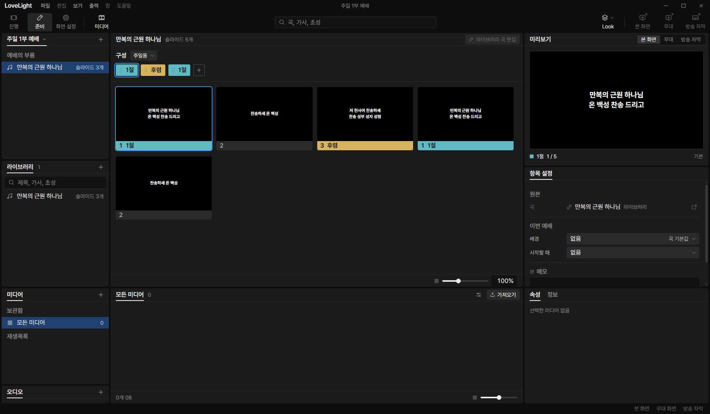
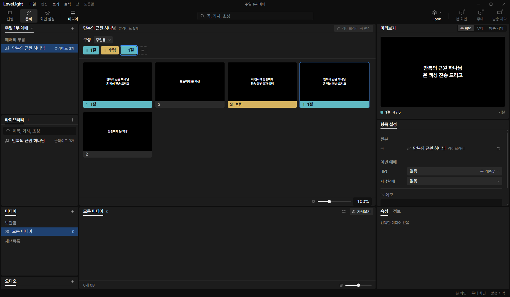

# Review request: `group-5` (round 2)

- Team member: `group` (Gemini)
- Branch: `feat/group/service-item-chips`, rebased onto `main` at `4945d6fe`
- Base commit: `4945d6fe`
- Task: Prep 예배 순서 Item Panel: Group Chip Strip & Arrangement Editing
- CI: passed.

## Team member's reply

This update resolves all 8 findings (a through h) from the round 1 review:

- **Finding a (`ItemArrangement.tsx:112-125`, `SongItemPanel.tsx`)**:
  - Aligned thumbnail grid and arrangement chip strip to use the same rule for
    empty named arrangements: `editedOrder(song, arrangement)` returns `[]`
    slides and `[]` chips.
  - In `SongItemPanel.tsx`, `sequence` uses `editedOrder` for grouped songs,
    showing `슬라이드 0개` and 0 thumbnails.
  - Added unit test in `src/renderer/src/prep/service/ItemArrangement.test.tsx`
    verifying 0 chips render without errors.
  - Added unit test in `src/renderer/src/prep/service/SongItemPanel.test.tsx`
    verifying `슬라이드 0개` and 0 chips for an empty named 구성.
- **Finding b (`songItemModel.ts:orderChips`)**:
  - `groupedOrderChips` and `groupRangesFromGroups` now safely skip dangling
    group IDs that do not exist in `song.groups`.
  - Position for unnamed groups (`이름표 없음 <sourcePosition>`) correctly uses
    the source position (`entry.position = index + 1`).
  - Added unit tests in `src/renderer/src/prep/service/songItemModel.test.ts`
    verifying skipped dangling IDs, multiple unnamed groups (`이름표 없음 1`,
    `이름표 없음 2`), and repeated unnamed groups (same source position label on
    all occurrences).
- **Finding c (`songItemModel.ts:chipIndexForSlide`)**:
  - Introduced `groupRanges` and `groupRangesFromGroups` returning
    `GroupOccurrenceRange` (`{start, length}`).
  - Updated `chipIndexForSlide` to check
    `range.start <= slideIndex && slideIndex < range.start + range.length`, so a
    zero-slide group never steals selection from an adjacent non-empty group.
  - Added unit test in `src/renderer/src/prep/service/songItemModel.test.ts`
    with an empty group in the middle.
- **Finding d (`serviceItemStore.ts:280-327`)**:
  - Added dedicated methods
    `setGroupOrder(order: readonly SongGroupId[]): boolean` and
    `setSlideOrder(order: readonly number[]): boolean` to `ServiceItemStore`.
  - Provided typed overloads for `setOrder` delegating directly based on
    `isGroupedSong(song.history.snapshot.song)`.
  - Split `orderChips` into typed `groupedOrderChips` and `legacyOrderChips`
    with typed overloads, eliminating silent drops.
  - Added unit tests for `setGroupOrder([])`, `setSlideOrder([])`, and type
    mismatches in `serviceItemStore.test.ts`.
- **Finding e (Offscreen CDP verification)**:
  - Updated `D:\llp-dev\group\verify-group-5-cdp.mjs` to execute:
    - Chip reorder via CDP mouse events (`Input.dispatchMouseEvent`).
    - Chip deletion via `Delete` key, verifying thumbnail count updates.
    - Group insertion via "그룹 넣기" menu, verifying chip and thumbnail count
      updates.
    - Read-only tooltip display on 기본 arrangement
      (`기본 구성은 변경할 수 없습니다`).
    - 10 repeated reordering cycles taking measurements strictly after settle /
      `requestAnimationFrame` re-render.
  - Flat 449 DOM elements recorded across all 10 cycles with zero leaks.
  - Three captured screenshots verified with distinct sha256 hashes.
- **Finding f (`SongItemPanel.tsx:120-134`, `ItemSidePanels.tsx:87-102`)**:
  - Disabled the "라이브러리 곡 편집" button with tooltip `NEWER_FILE_REASON`
    ("새 버전의 파일이라 바꿀 수 없습니다") when the item is a grouped song
    (`!isV1SongDocument(session.document)`).
  - Shared single `isV1SongDocument` type guard exported from
    `songItemModel.ts`.
  - Added unit test in `SongItemPanel.test.tsx` verifying the button is disabled
    with tooltip and click does not open the editor.
- **Finding g (`ItemArrangement.tsx`)**:
  - Extracted `ArrangementAdapter` interface with `makeGroupedAdapter` and
    `makeLegacyAdapter` factories, consolidating differences and eliminating all
    7 `isGrouped` branches from `ItemArrangement`.
  - In `groupedInsertEntries`, assigned first lyric line to `meta: firstLine`,
    conforming to the design system's `MenuItem` slot.
- **Finding h (Paths changed in plan)**:
  - Updated `docs/plans/grouped-songs.md` to remove `useChipDrag.ts` and add
    `ItemSettingsRows.tsx`, `ItemSidePanels.tsx`, and `SongItemPanel.test.tsx`.

---

## What changed and why

1. **Group Chip Strip & Arrangement Editing
   (`src/renderer/src/prep/service/ItemArrangement.tsx`)**:
   - Extracted `ArrangementAdapter` to cleanly isolate grouped and legacy logic.
   - For grouped songs (`isGroupedSong(song)`), the arrangement strip renders
     one chip per group occurrence (`order: readonly SongGroupId[]`).
   - Group chips display group names in their preset label color; unnamed groups
     display `이름표 없음` followed by their source position (e.g.
     `이름표 없음 1`) with `none` color swatch.
   - Reordering via drag-and-drop (`useChipDrag`) and keyboard shortcuts
     (`Alt+ArrowLeft` / `Alt+ArrowRight`) moves group occurrences within the
     arrangement.
   - Pressing `Delete` on a focused group chip removes that group occurrence
     from the arrangement.
   - The "슬라이드 넣기" button opens a "그룹 넣기" menu for grouped songs,
     listing all song groups in master file order with name/position, color
     swatch, and `meta: firstLine` lyrics. Selecting an item appends that group
     occurrence to the arrangement.
   - Tooltips enforce read-only semantics: `DEFAULT_ORDER_REASON` ("기본 구성은
     변경할 수 없습니다") on 기본 arrangement, and `NEWER_FILE_REASON` ("새
     버전의 파일이라 바꿀 수 없습니다") on read-only files.

2. **Group Song Item Helpers
   (`src/renderer/src/prep/service/songItemModel.ts`)**:
   - `groupedOrderChips`: iterates group occurrences, skips dangling IDs,
     resolves group names/positions, and formats `key: "${id}:${occurrence}"`.
   - `legacyOrderChips`: retains 1-based slide numbers and label lookup.
   - `groupRanges` and `groupRangesFromGroups`: return start index and length
     for each group occurrence.
   - `chipIndexForSlide`: accurately locates the chip containing `slideIndex`
     (`start <= index < start + length`), handling zero-slide groups safely.
   - `isV1SongDocument`: shared type guard for version 1 song documents.

3. **Store & Panel Integration (`serviceItemStore.ts`, `SongItemPanel.tsx`,
   `ItemSettingsRows.tsx`, `ItemSidePanels.tsx`)**:
   - `serviceItemStore.ts`:
     - Dedicated `setGroupOrder` and `setSlideOrder` methods alongside
       overloaded `setOrder`.
     - Supports `SongSession | SongSession<GroupedSong>`.
   - `SongItemPanel.tsx`:
     - Uses `editedOrder` for grouped songs so thumbnails accurately reflect the
       chip order (including `슬라이드 0개` for empty arrangements).
     - Disables "라이브러리 곡 편집" with `NEWER_FILE_REASON` for grouped songs.
   - `ItemSidePanels.tsx`:
     - Uses shared `isV1SongDocument` and disables "라이브러리 곡 열기" with
       `NEWER_FILE_REASON` for grouped songs.

---

## Paths changed

- `docs/plans/grouped-songs.md`
- `src/main/store/showService.ts`
- `src/renderer/src/control/controlSession.ts`
- `src/renderer/src/prep/editor/SongBlock.test.tsx`
- `src/renderer/src/prep/editor/SongBlock.tsx`
- `src/renderer/src/prep/editor/songSession.test.ts`
- `src/renderer/src/prep/service/ItemArrangement.test.tsx` (new file)
- `src/renderer/src/prep/service/ItemArrangement.tsx`
- `src/renderer/src/prep/service/ItemSettingsRows.tsx`
- `src/renderer/src/prep/service/ItemSidePanels.tsx`
- `src/renderer/src/prep/service/SongItemPanel.test.tsx`
- `src/renderer/src/prep/service/SongItemPanel.tsx`
- `src/renderer/src/prep/service/serviceItemStore.test.ts`
- `src/renderer/src/prep/service/serviceItemStore.ts`
- `src/renderer/src/prep/service/songItemModel.test.ts`
- `src/renderer/src/prep/service/songItemModel.ts`
- `src/shared/schema/groupedSong.ts`
- `src/shared/songOrder.ts`
- `docs/reviews/group-5/item-initial.png` (new file)
- `docs/reviews/group-5/item-reordered.png` (new file)
- `docs/reviews/group-5/item-after-10.png` (new file)
- `docs/reviews/group-5/measurements.json` (new file)

---

## Offscreen CDP verification

Automated verification script `D:\llp-dev\group\verify-group-5-cdp.mjs` was
executed against an offscreen Electron build (`LLP_TEST_WINDOWS=offscreen`, port
5194, CDP port 9514) on clean profile `D:\llp-dev\group`.

The verification executed the following steps:

1. Mounted a service item referencing a grouped song with 3 groups (`1절` with 2
   slides, `후렴` with 1 slide, and an unnamed group with 1 slide) playing
   arrangement `주일용` (`[1절, 후렴, 1절]`, 5 virtual thumbnails).
2. Captured `item-initial.png` showing the initial 3 chips (`[1절, 후렴, 1절]`)
   and 5 virtual thumbnails.
3. Reordered chip 0 via CDP mouse drag (`Input.dispatchMouseEvent`) to position
   1 (`[후렴, 1절, 1절]`). Verified that virtual thumbnails updated in real
   time. Captured `item-reordered.png`.
4. Deleted chip 0 (`후렴`) via `Delete` key; verified chip strip updated to
   `[1절, 1절]` and thumbnails decreased to 4.
5. Opened "그룹 넣기" menu and selected `이름표 없음 3` (`아멘`); verified chip
   strip updated to `[1절, 1절, 이름표 없음 3]` and thumbnails increased to 5.
6. Switched arrangement to `기본` and hovered chip 0 via pointer events;
   verified read-only tooltip `기본 구성은 변경할 수 없습니다` appeared.
7. Switched back to `주일용` and executed 10 repeated reordering and reversal
   cycles, taking measurements strictly after settle / `requestAnimationFrame`
   re-render.
8. In the restored order, selected chip 2 and captured `item-after-10.png`.
9. Verified that all three captured screenshot blobs have distinct SHA-256
   hashes.

### Element counts across 10 repeated reorder cycles

| Cycle     | Action    | Chips              | Thumbnails | Total DOM Elements |
| --------- | --------- | ------------------ | ---------- | ------------------ |
| Initial   | -         | `[1절, 후렴, 1절]` | 5          | 446                |
| Reordered | mouseDrag | `[후렴, 1절, 1절]` | 5          | 446                |
| 1         | moveRight | `[후렴, 1절, 1절]` | 5          | 449                |
| 1         | moveLeft  | `[1절, 후렴, 1절]` | 5          | 449                |
| 2         | moveRight | `[후렴, 1절, 1절]` | 5          | 449                |
| 2         | moveLeft  | `[1절, 후렴, 1절]` | 5          | 449                |
| 3         | moveRight | `[후렴, 1절, 1절]` | 5          | 449                |
| 3         | moveLeft  | `[1절, 후렴, 1절]` | 5          | 449                |
| 4         | moveRight | `[후렴, 1절, 1절]` | 5          | 449                |
| 4         | moveLeft  | `[1절, 후렴, 1절]` | 5          | 449                |
| 5         | moveRight | `[후렴, 1절, 1절]` | 5          | 449                |
| 5         | moveLeft  | `[1절, 후렴, 1절]` | 5          | 449                |
| 6         | moveRight | `[후렴, 1절, 1절]` | 5          | 449                |
| 6         | moveLeft  | `[1절, 후렴, 1절]` | 5          | 449                |
| 7         | moveRight | `[후렴, 1절, 1절]` | 5          | 449                |
| 7         | moveLeft  | `[1절, 후렴, 1절]` | 5          | 449                |
| 8         | moveRight | `[후렴, 1절, 1절]` | 5          | 449                |
| 8         | moveLeft  | `[1절, 후렴, 1절]` | 5          | 449                |
| 9         | moveRight | `[후렴, 1절, 1절]` | 5          | 449                |
| 9         | moveLeft  | `[1절, 후렴, 1절]` | 5          | 449                |
| 10        | moveRight | `[후렴, 1절, 1절]` | 5          | 449                |
| 10        | moveLeft  | `[1절, 후렴, 1절]` | 5          | 449                |

DOM element count remained flat at exactly 449 elements across all 10 cycles.

### Captured screenshots

 _Figure
1: Initial item panel with group chips (`[1절, 후렴, 1절]`) and 5 virtual
thumbnails._

 _Figure 2: Reordered item
panel after mouse drag (`[후렴, 1절, 1절]`) with updated thumbnails._

 _Figure 3: Restored item panel
after 10 cycles with chip 2 selected._

Screenshot SHA-256 hashes (all distinct):

- `item-initial.png`:
  `b9f154456e26173c8809d705b86e40644b99e20bfc6937e2479b6aa8becd3d04`
- `item-reordered.png`:
  `8b9b5c126a0a72b0524e3e33b2a566a0190fa128f19472467c741cdc608fa491`
- `item-after-10.png`:
  `7cf2d9d284649511eadee9303164b991de864a81d5354109747779c8373ff0e7`
