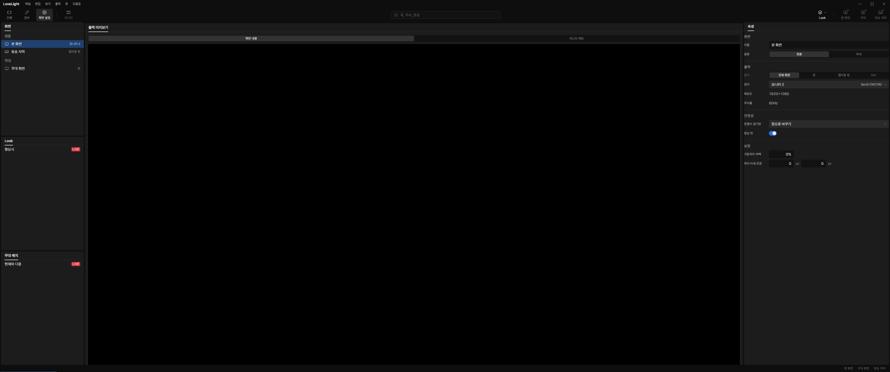
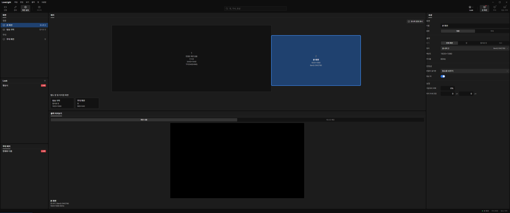
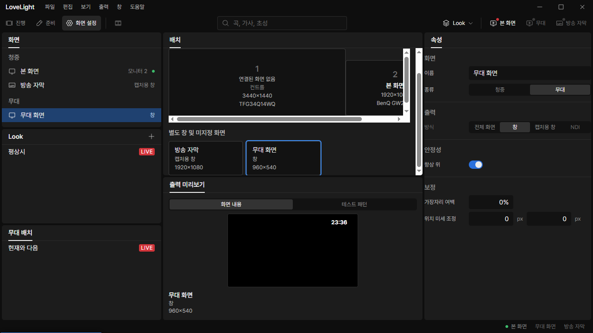
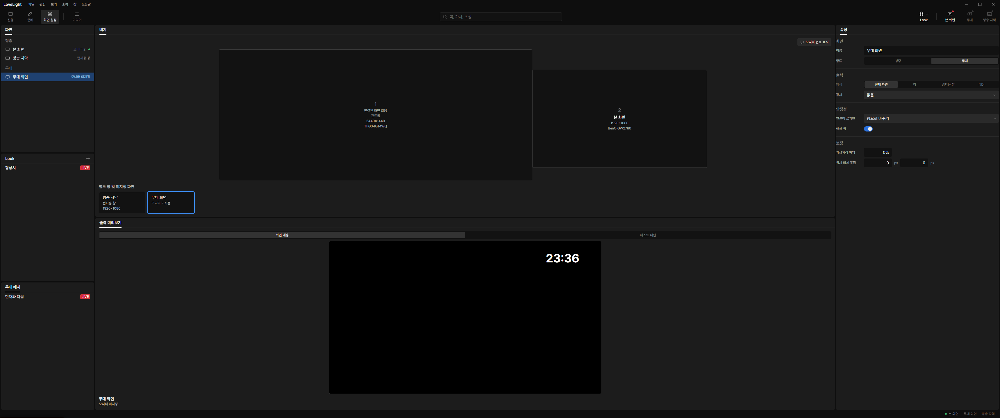
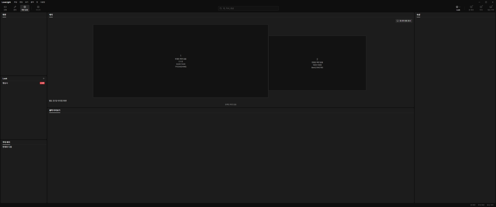

# Review request: `screens-10`

- Team member: `screens`
- Branch: `fix/screens/display-layout-sizing`
- Base commit (`main`): `a25e2af2`, rebased before final checks.
- Exact head and CI: see request line.
- Bug: M3-C3-8, the user's live check of 화면 설정 > 배치.
- Feature-freeze scope: bug fix only. New O2 units are parked.

## What changed and why

With a 3440 x 1440 primary monitor and a 1920 x 1080 monitor at (3440, 222), the
output preview sized itself from the full center-column width. Its intrinsic
height consumed the column, shrinking the layout panel to zero height. In the
real app both monitor boxes became overlapping 2 x 2 px borders.

The layout and output-preview panels now share available height. The preview
fits a 16:9 picture into its measured remaining space, keeping the mode switch
and caption at their normal heights. It no longer determines the height of the
column from its width.

The arrangement still uses one uniform scale, preserving monitor aspect ratios,
adjacency and offsets. Its minimum scale gives every monitor at least six row
units of width and four of height (180 x 120 px with the current tokens). A
smaller viewport scrolls the arrangement instead of shrinking labels below that
size. Margins center a fitting arrangement while keeping overflowing content
reachable from its origin.

Monitor boxes and separate-window cards are keyboard-accessible buttons.
Clicking an occupied monitor selects a screen main publishes on that monitor; an
empty monitor can be highlighted without assigning a screen or sending a
command. Changing the screen selection or monitor publication replaces that
local highlight. Clicking a separate card selects its screen in the shared list
and properties. Read-only documents still allow selection. Drag assignment
retains the control-monitor and read-only guards.

Fullscreen screens without a published placement now appear beside separate
windows instead of disappearing from the layout. Cards distinguish capture
windows, regular windows, missing assignments and a pending connection. The
panel names the no-monitor and no-screen states. Assignment display continues to
use main's published `screenIds`; the window does not resolve monitor ownership.

## Changed files

- `DisplayLayout.tsx`, CSS and tests: scale floor, scrollable layout, buttons,
  current selection and empty states.
- `layoutBoxes.ts` and tests: selectable screen ids and unassigned targets.
- `testing/monitorArrangement.ts`: the exact two-monitor geometry from the
  check.
- `OutputPreview.tsx` and CSS: fit the picture inside available panel space.
- `docs/reviews/screens-10/`: before and after real-app screenshots.

### Changes outside my paths

- `src/renderer/src/shell/Workspace.tsx`: remove content-based sizing only from
  the screens workspace's output-preview panel, so it shares height with 배치.
  ScreenEditor and selection public APIs are unchanged. The lead was notified.

## Checks run

After rebasing onto `a25e2af2`, all 184 tests in the 18 screens and shell
workspace files passed. The final single-selection refinement passed all 17
DisplayLayout tests again. Typecheck, scoped ESLint and the production build
pass. The geometry fixture checks both aspect ratios and the 222 px offset.
Component tests cover both editable and read-only selection, changed published
ownership, empty states and existing drag guards. Formatting and exact-head CI
are recorded in the request line.

## Checked in the app

Built the final rebased code and launched it twice with
`LLP_TEST_WINDOWS=offscreen`, `LLP_DEV_PORT=5192` and CDP port 9512. The driver
and flow scripts passed `node --check` before each launch. An isolated fixture
profile under `D:\llp-dev\screens` held only invented screen configuration.
Every window, including the output used to check published monitor ownership,
stayed offscreen. Both final launches exited cleanly with code 0 and no runtime
exceptions.

The real monitor feed matched the exact user setup: 3440 x 1440 at (0, 0), and
1920 x 1080 at (3440, 222), both at scale factor 1. CDP drove actual pointer and
keyboard events and measured the resulting browser layout.

| Check                        | Result                                                                                                                                                                                                                                                                      |
| ---------------------------- | --------------------------------------------------------------------------------------------------------------------------------------------------------------------------------------------------------------------------------------------------------------------------- |
| Before, 3440 x 1440 viewport | Layout panel height 0 px; both monitor boxes overlap at 2 x 2 px.                                                                                                                                                                                                           |
| After, same viewport         | Layout and preview panels each have 661 px height. Monitor boxes are 1077.38 x 450.98 px and 601.33 x 338.23 px. Both aspect ratios, adjacency and the scaled 222 px offset pass assertions.                                                                                |
| Select boxes and cards       | The assigned monitor selects 본 화면, and the caption/stage cards select their screen in the list and properties. An empty monitor has one local highlight and clears card highlighting without assigning a screen.                                                         |
| Narrow layout                | At 1280 x 720, the column gap can be dragged to leave 506 px for the arrangement. Its 596 px scroll width remains reachable. Boxes retain about 382 x 160 px and 213 x 120 px. The 16:9 output preview fits at 279 x 157 px and the mode switch stays at its normal height. |
| Empty and unassigned         | A stage screen changed to fullscreen without a display remains selectable as 모니터 미지정. Removing fixture screens shows 등록된 화면 없음. The configuration is restored before closing.                                                                                  |

Each final launch switched between the caption card and assigned monitor 20
round trips after four warmup trips, then left and reopened 화면 설정 twice.
Samples at 0/5/10/15/20 trips kept 337 elements, 797 DOM nodes and 353 listeners
in both launches. The two workspace reopens kept 337 elements and 353 listeners;
DOM nodes settled at 830 after the first visit to 진행 and stayed at 830 on the
second. The intermediate 진행 workspace was not loaded in the initial samples.

Forced-GC JS heap during 20 trips was 5.61 to 5.83 MB in launch 1 and 5.62 to
5.84 MB in launch 2, a spread below 4%. Final heaps after both workspace reopens
were 5,994,520 and 5,996,172 bytes, within 2 KB of each other. DOM and listener
counts did not grow with repeated selection or reopening.

## Review: lead

- Verdict: Approve / Request changes
- Findings:

  1.

## Review: reviewer

- Verdict: Approve / Request changes
- Findings:

  1.

## Team member's reply

1.
