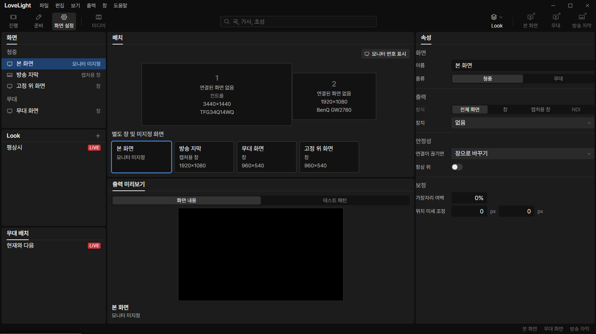
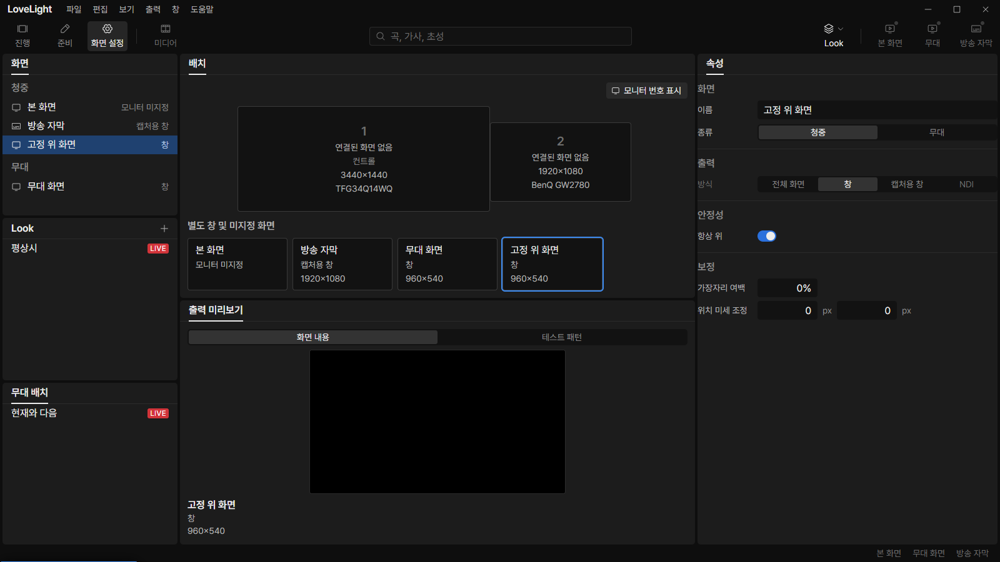
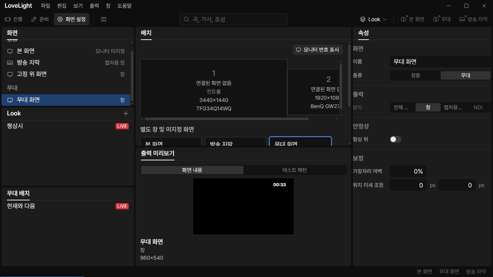

# Review request: `screens-11`

- Team member: `screens`
- Branch: `fix/screens/screen-config-alignment`
- Base commit (`main`): `be389f87`, rebased before final checks.
- Exact head and CI: see request line.
- Scope: freeze-allowed Screen Configuration comparison, M3-C3-9 properties
  default, and the deferred screens-10 scrollbar nit. O2 stays parked.

## What changed and why

An absent screen-level 항상 위 value now displays as off for every output
method. Explicit true and false values remain effective. This is the user's
October 26 decision in `docs/decisions.md`, not a claim about ProPresenter's
default. The panel changes match output-54's existing patch exactly, so output
can retain its backend work without a conflicting UI implementation.

There is no screen-creation action in the current renderer. Its shared
new-screen preferences default and main's starter-screen defaults are covered by
output-54. The first new screen-creation unit below will explicitly default to
off in the screens-owned creation path as well.

The arrangement and the enclosing Screen settings panel bodies now use thin
scrollbars with the design system's `line-strong` thumb. This addresses the
approved screens-10 nit, including the outer scrollbar visible at narrow sizes.

## Sources checked

Checked October 27, 2026. No ProPresenter application was installed or run.

- **R1:** Renewed Vision,
  [Screen Configuration in ProPresenter](https://support.renewedvision.com/hc/en-us/articles/360041879173-Screen-Configuration-in-ProPresenter).
  The current article includes newer features; its v22 disable-screen feature is
  not treated as a ProPresenter 7.5 requirement.
- **R2:** Renewed Vision,
  [Preferences, Screens section](https://learn.renewedvision.com/propresenter/preferences#screens).
  The current URL redirects to the support index, but the official indexed
  section remains readable. It is corroborated by R3 pp. 172 to 173. A separate
  current support article titled "Screens Settings" was not found; a supplied
  link can refine this source without changing the 7.5 baseline.
- **R3 / spec 10 S4:** Renewed Vision, _ProPresenter 7 User Guide_, updated for
  version 7.5, April 27, 2021,
  [the specified Internet Archive snapshot](https://web.archive.org/web/20250802220651/https://files.renewedvision.com/propresenter/support/Pro7UserGuide.pdf).
  Downloaded and read the original PDF. Page numbers below are its printed
  numbers. Relevant sections are pp. 29 to 34 and 172 to 173.
- **R4:** Renewed Vision,
  [Understanding the ProPresenter User Interface](https://support.renewedvision.com/hc/en-us/articles/360041345954-Understanding-The-ProPresenter-User-Interface).
  Corroborates the Audience/Stage output controls in the main interface.

## Comparison and disposition

The off-state arrangement comparison is an inference from the documented
separation of configuration and enable controls, not an observed ProPresenter
application run. It remains an investigation item with output.

This compares behavior, not a literal copy of ProPresenter's window layout.
Repository observations refer to the current `ScreenList`, `ScreenDeviceRow`,
`DisplayLayout`, `ScreenProperties`, screen settings writer and toolbar.

| Area                           | ProPresenter 7 evidence                                                                                                                                          | Current app                                                                                                                                | Disposition                                                                                                                                                                         |
| ------------------------------ | ---------------------------------------------------------------------------------------------------------------------------------------------------------------- | ------------------------------------------------------------------------------------------------------------------------------------------ | ----------------------------------------------------------------------------------------------------------------------------------------------------------------------------------- |
| Add screens                    | Plus controls add within Audience or Stage. System devices and offline placeholders are available. R1; R3 pp. 30, 32.                                            | Only starter/file-loaded screens exist; no add control.                                                                                    | Add screen lifecycle and group-specific add menus in small follow-up requests. Keep version 1 methods and one output per screen. New screens start with 항상 위 off and output off. |
| Rename and delete              | Screens can be renamed or deleted from their context menu. R1; R3 p. 32.                                                                                         | Name edits exist in properties; deletion is absent.                                                                                        | Add the missing lifecycle actions through the existing serialized writer. Preserve unknown fields and stop only the removed screen's output.                                        |
| Assign a device                | Hardware's Output dropdown chooses a device and resolution. R1; R3 p. 34.                                                                                        | The fullscreen device select and drag assignment save main's monitor identity; assignment clears a previous owner atomically.              | Keep the existing select and atomic assignment. The control monitor exclusion and exclusive ownership are our version 1 rules, not claims about ProPresenter.                       |
| Arrangement and selection      | The center represents outputs of the selected logical screen; clicking an output selects its properties. Mirror/group arrangements are supported. R3 pp. 31, 34. | Our center represents physical monitor topology and separate windows. Click selection, aspect ratios and offsets were fixed in screens-10. | Preserve the physical topology required by M3-C3-8. Do not replace it with mirrored/grouped/edge-blended screens under this alignment task.                                         |
| Assignment while output is off | Device configuration is separate from the output enable controls. R3 pp. 32, 34.                                                                                 | The device setting persists, but the arrangement uses published placement; an off screen may appear as connection pending.                 | Investigate a main-published configured-assignment view with output. Never infer ownership in the renderer or replace actual placement silently.                                    |
| Enable and disable             | Group-header toggles control System screens. NDI/SDI/Syphon have different enable semantics. R3 p. 32.                                                           | Audience/Stage shortcuts and per-screen toolbar controls exist, but the screen list has no group output controls.                          | Add settings-list access to the same main-owned commands. Keep the user's per-screen toolbar buttons and existing version 1 output methods.                                         |
| Startup output                 | Automatic screen enablement at launch is a separate preference. R2; R3 p. 172.                                                                                   | The shared launch preference exists; screen selection is only editor selection.                                                            | Preserve this separation. Adding, selecting or assigning a screen must not turn an output on.                                                                                       |
| Output off and topmost         | The cited material does not establish the user's exact desktop-reveal or default-off topmost rule.                                                               | User decisions require output off to hide the window and always-on-top to default off.                                                     | Preserve both decisions. M3-C3-9 is coordinated with output-54; do not substitute black output or force topmost to imitate an unsupported assumption.                               |

## Small implementation sequence

1. This request: default-off properties, scrollbar nit, and sourced comparison.
2. Screen creation/removal model and persistence, then small add/delete UI with
   an explicit off default and offscreen app checks.
3. Screen-settings group output controls using the existing command behavior.
4. Configured-versus-active assignment display, coordinated with output before
   changing the published data. Keep the renderer's authority boundary intact.

Changes to the excluded control monitor, exclusive ownership, the physical
arrangement, supported output methods, startup behavior or desktop-reveal rule
require the lead's decision first. None are changed by this request.

## Changed files

- `screenEdits.ts` and tests, `ScreenProperties.test.tsx`: default-off fallback
  and explicit-value regressions, matching output-54.
- `DisplayLayout.module.css`: the approved thin-scrollbar nit.
- `docs/reviews/screens-11.md` and app evidence: this comparison and validation.

### Changes outside my paths

- `src/renderer/src/shell/Workspace.tsx` and CSS: scope thin panel-body
  scrollbars to Screen settings, including the outer layout scroll container.

## Checks run

After rebase: typecheck, scoped ESLint, 189 tests in 18 screens and shell
workspace files, and the production build pass. Formatting and exact-head CI are
recorded in the request line.

## Checked in the app

Built the rebased code, syntax-checked both CDP scripts with `node --check`
before each launch, and ran the real app twice with
`LLP_TEST_WINDOWS=offscreen`, `LLP_DEV_PORT=5192` and CDP port 9512. The
isolated fixture profile contained only invented screen settings. Both launches
exited 0 and reported no runtime exceptions.

- Selected fullscreen, capture and window screens whose topmost field was
  absent: each switch showed off. A fourth screen with explicit true stayed on.
- Toggled a fullscreen screen on and off, confirmed the saved boolean through
  main's settings API, closed the app and verified the off value on restart.
- Each launch made 20 caption/main selection round trips after four warmup trips
  and left/reopened 화면 설정 twice. Selection samples kept 339 elements, 801
  DOM nodes and 369 listeners. Reopen samples kept 339 elements and 369
  listeners; after the first visit to 진행, nodes settled at 834 and stayed
  there on the second visit.
- Forced-GC JS heap was 5.57 to 5.82 MB and 5.62 to 5.85 MB during the selection
  runs. Final heaps after reopening were 5,982,872 and 5,990,548 bytes.
- At 1280 x 720, dragged the column gap to exercise actual overflow. Both the
  inner arrangement and outer panel body computed `scrollbar-width: thin` and a
  `rgb(58, 58, 58)` thumb, matching `line-strong`. The 596 px arrangement
  scrolled in a 516 px area.

These checks verify the renderer default and saved values. Native stacking is
suppressed in offscreen mode and remains output-54's backend verification.

## Verdicts (recorded by the lead at merge)

- Round 1 (b2656d2c): reviewer (Codex) Approve. Lead Approve through the lead's
  merge check: the exact-head CI run passed, the branch rebased onto local
  `main` without conflicts, and typecheck passes. Earlier rounds' findings and
  replies are above.

## Team member's reply

1.
