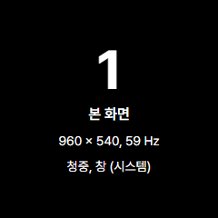
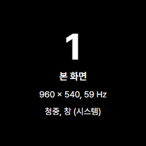
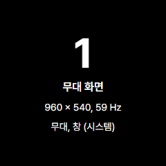
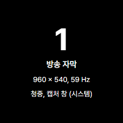
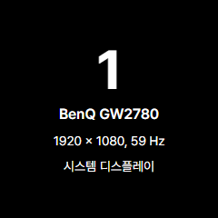
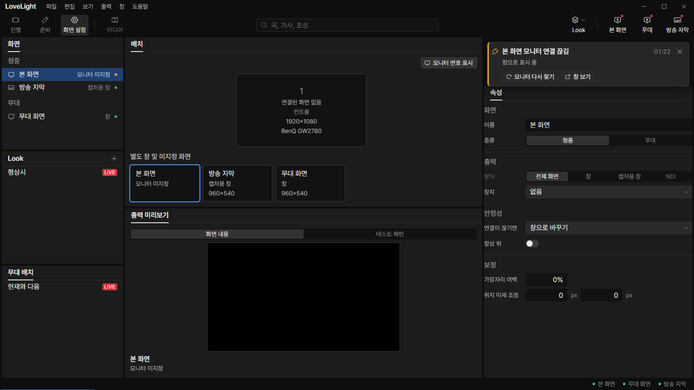

# Review request: `screens-12`

- Team member: `screens`
- Branch: `fix/screens/identify-details`
- Base (`main`): `2d1d8bfe`, rebased once before final checks.
- Exact head and CI: see request line.
- Scope: freeze-allowed C02 Identify alignment, user decision October 27.

## What changed and why

Identify now shows each running screen's name, resolution, monitor refresh rate,
Audience or Stage kind, presentation method, and System output type. A monitor
without a running screen shows its hardware name and display details instead. An
unknown refresh rate is identified explicitly rather than reported as zero.

The main process supplies the identities and actual output placements. The
renderer does not infer monitor ownership. Multiple outputs on one monitor get
separate cards. Cards keep the existing 240 DIP size, three-second timeout,
click-through behavior and capture-area avoidance. Repeated Identify reuses the
same windows and resets the timeout; changed names or details replace them. If
the existing center and corner candidates are occupied, that card is skipped
under the existing capture-avoidance policy. No new output is enabled by
Identify.

The overlay windows remain unfocusable and call `showInactive` only in normal
mode. Offscreen runs now draw real hidden Identify pages for app verification,
without presenting a window, changing window order or taking focus. Output
handles expose their virtual bounds in offscreen mode to exercise placement and
capture avoidance through the same main-process path.

Details cross into the isolated page as URL data with an additive bounded
schema: 200-character names, finite refresh from 0 to 1000 Hz, bounded positive
pixel dimensions and explicit kind/method enums. The page uses text nodes and
rejects malformed or oversized data. No preload bridge is added to Identify. The
ScreenEditor and selection APIs remain unchanged.

## ProPresenter evidence

The comparison in [screens-11](screens-11.md) contains the source audit. The
[specified ProPresenter 7.5 guide snapshot](https://web.archive.org/web/20250802220651/https://files.renewedvision.com/propresenter/support/Pro7UserGuide.pdf),
printed p. 33, documents Identify names and technical output details while
Audience or Stage outputs are on. C02 in `docs/qa/proposals-vs-pp.md` and the
October 27 user decision authorize this alignment. The exact duration, card
size, capture avoidance and noninterference remain our existing rules; they are
not claimed as ProPresenter measurements. Separate Screen/Output identify modes
and advanced output drivers are outside this request.

## Changes outside my paths

All Identify windows live in output's paths. Changed paths are listed
explicitly:

- `src/main/outputs/monitorNumbers.ts` and tests: screen identities, safe card
  placement, reuse and changed-details handling.
- `src/main/outputs/numberWindow.ts` and tests: encoded details and hidden
  offscreen drawing, preserving no-focus behavior.
- `src/main/outputs/start.ts` and tests: connect the existing main-owned output
  placements to Identify and exercise hidden Identify windows.
- `src/main/outputs/outputWindow.ts`, `manager.ts` and manager tests: expose
  currently shown output metadata and actual bounds; exclude off/hidden outputs.
- `src/main/outputs/electronWindow.ts` and tests: expose offscreen virtual
  bounds.
- `src/main/outputs/screens.ts`, `settingsScreens.ts` and tests,
  `defaultScreens.ts`: retain saved Audience/Stage kind in main's internal
  output metadata.
- `src/renderer/src/output/monitorNumber.ts`, CSS and tests, `main.ts`: draw the
  validated Identify card without interactive elements.
- `src/shared/schema/identification.ts` and tests: additive bounded URL payload.

## Checks run

After rebase: typecheck, scoped ESLint, 175 tests in 10 related output/renderer
and schema files, formatting, and the production build pass. Regressions cover
the exact 3440x1440 primary plus 1920x1080 at x3440/y222, physical pixels on a
scaled display, multiple outputs, capture avoidance, saved kinds, hidden
outputs, changed names, repeated-window reuse, validation and no native focus
calls. Exact-head CI is recorded in the request line.

## Checked in the app

Built the rebased code and syntax-checked both CDP scripts with `node --check`
before each launch. Ran Electron twice with `LLP_TEST_WINDOWS=offscreen`, dev
port 5192, CDP 9512 and the isolated Identify-check profile. Both processes
closed normally with exit 0 and no renderer exceptions.

The OS currently enumerates one BenQ GW2780, 1920x1080 at 59 Hz. The previously
available ultrawide is no longer enumerated. No OS display settings were
changed. The two-monitor fullscreen placement is covered by the exact-pair unit
test; the app check exercises actual fallback-window, Stage-window, capture and
unused display cards on the currently connected monitor.

Each launch enables the three fixture outputs, verifies their names, physical
resolution, refresh and kinds, then switches selection back and forth 20 times
while pressing Identify. All three Identify target IDs remain unchanged, and the
control's Identify button retains focus after each press. Each card stays within
its 240x240 content box. After the last press, all Identify targets close within
the three-second timeout. Each launch also leaves and reopens Screen settings
twice, switches all outputs off, and verifies the hardware-only card.

Across both launches, every Identify page stays at 18 elements, 38 DOM nodes and
0 listeners. Its post-GC heap decreases slightly: about 1.431 to 1.428 MB in the
first launch, and 1.426 to 1.423 MB in the second. The control stays at 346
elements, 812 nodes and 372 listeners through the 20 round trips. Its final
post-GC heaps are 5,969,620 and 5,992,036 bytes across the independent launches.
The two workspace reopens settle at the same 845 nodes and 372 listeners in each
launch after loading the Show workspace. No accumulating Identify windows,
elements, listeners or heap retention were observed.

| Screen               | First launch                                         | Relaunch                                                           |
| -------------------- | ---------------------------------------------------- | ------------------------------------------------------------------ |
| Main fallback window |           |           |
| Stage window         |         |         |
| Capture window       |     |     |
| Outputs off          |     |     |
| Control workspace    |  |  |

## Team member's reply
