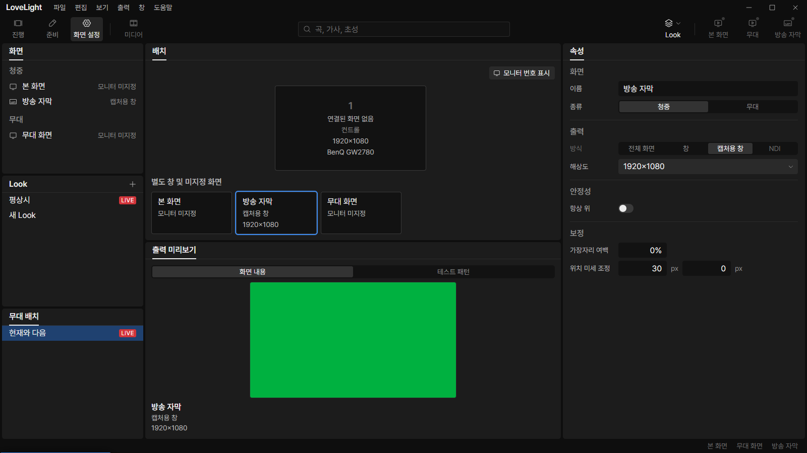
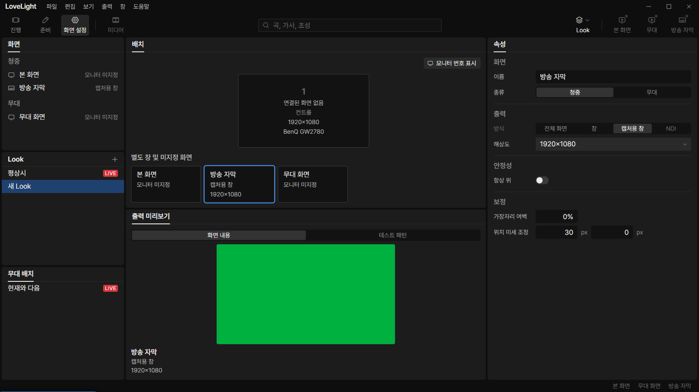
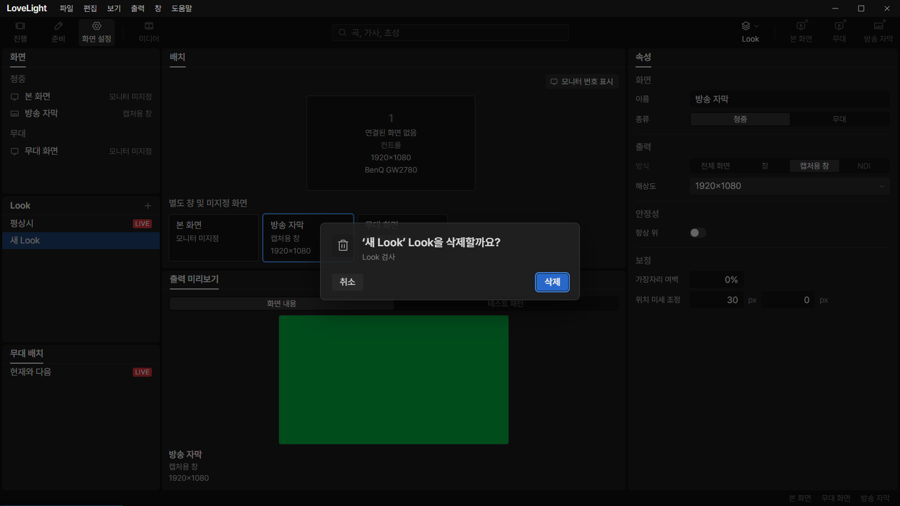
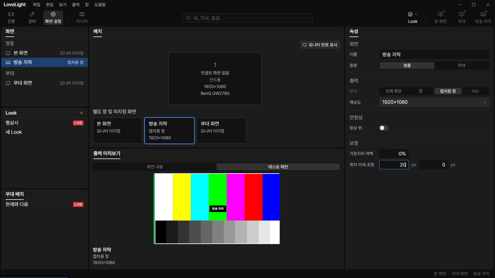

# Review request: `screens-14`

- Team member: `screens`
- Branch: `fix/screens/keep-screen-panels`
- Base (`main`): `9cc36558`, rebased before round 2 final checks.
- Exact head and CI: see request line.
- Scope: M3-UX-03/04 interim screen-view retention, M3-UX-06 inset and M3-UX-09
  delete wording from `docs/qa/m3-ux-pass.md` on `docs/qa/m3-ux`.

## What changed and why

Selecting a Look or stage-layout row used to make the screen preview and
properties empty. Until the corresponding editors replace these panels, they now
keep the previously viewed screen. The selected row still belongs to the Look or
stage-layout list; screen rows do not gain a second selection. The retained
screen survives leaving and reopening Screen settings. If it is removed, the
existing Audience-first fallback chooses an available screen.

`selection.kind`, `select` and `selectedScreenIn` keep their existing contracts.
The store adds only `lastScreenId` and the `useScreenView` hook for screen
panels. Output's O3 can continue routing on the existing `selection.kind`
unchanged. No settings document, IPC contract or output command behavior
changes.

The preview renderer stays mounted when another list takes selection. Its
test-pattern mode resets and sends the existing hide command. A property edit
that pins the same visible screen does not reset the pattern, so correction
controls remain usable during a pattern check.

Screen properties now use the shared `panel-inset` on both edges.
Referenced-Look delete confirmations now ask a complete polite Korean question,
matching the design-system writing rule. Macro names and cancellation behavior
are preserved.

## Changes outside my paths

None. Shared screen-view files touched: `selection.ts`, `DisplayLayout.tsx`,
`OutputPreview.tsx`, `ScreenProperties.tsx` and its CSS. O3 is output-owned;
this request leaves its selection discriminator intact.

## Checks run

After rebase: typecheck, scoped ESLint, 76 tests in five related files,
formatting and the production build pass. Regression tests cover both row kinds,
remounts, one selected list, pattern cleanup without recreating the renderer,
and retaining the pattern while a property edit pins the same screen.

## Checked in the app

Built the rebased source. Syntax-checked both CDP scripts before each Electron
launch with `node --check`. Ran twice with `LLP_TEST_WINDOWS=offscreen`, dev
port 5192, CDP 9512 and an isolated profile. Both processes closed normally with
exit 0 and no renderer exceptions.

Each launch selects 방송 자막, then existing and newly created Looks and the
현재와 다음 layout. The preview and editable screen properties keep 방송 자막
while the chosen Look/layout row holds the list selection. After enabling a test
pattern, selecting a Look hides it in main's live state and restores 화면 내용.
Each launch switches Look/layout selection back and forth 20 times and leaves
and reopens Screen settings twice. The retained view remains populated.

Both runs stay at 318 elements, 772 DOM nodes and 365 listeners through all 20
round trips. Final post-GC heaps are 5,708,748 and 5,704,960 bytes. After
loading the Show workspace, the two reopens settle at the same 802 nodes and 365
listeners in both runs, with 318 elements. No accumulating DOM, listeners or
heap growth was observed across independent launches.

Geometry checks measure the property label at x1130 with the panel beginning at
x1116: exactly the 14px shared inset. Wide controls end at x1582 with the panel
ending at x1596, preserving the same right inset. All visible fields stay inside
those edges.

A fixture macro references the noncurrent 새 Look. Each launch opens its delete
confirmation and cancels twice. The polite question and macro name remain
visible; cancellation retains the Look and the screen view.

Round 2 also starts calibration from both non-screen selections. With 평상시
selected, it enables the retained screen's pattern and commits horizontal offset
20; with 현재와 다음 selected, it enables the pattern and commits offset 30.
Both launches verify the saved values, the selected pattern radio and main's
active pattern flag after each commit. Pinning the displayed screen keeps the
pattern running while retaining one preview renderer.

| Changed view           | First launch                                                   | Relaunch                                                                 |
| ---------------------- | -------------------------------------------------------------- | ------------------------------------------------------------------------ |
| Existing Look selected |           |       |
| Stage layout selected  |  |        |
| New Look selected      |             |         |
| Properties inset       |        |    |
| Delete question        |      |           |
| Second open and cancel |      |  |

## Team member's reply

Round 2: Pinning the currently displayed screen now preserves its preview mode
even when the prior row selection was a Look or stage layout. Selecting another
non-screen row still clears the pattern; a different screen still starts in
content mode. Regressions from both non-screen kinds failed before the fix and
pass afterward. Workspace tests also commit a real correction edit from each
kind and verify that no pattern-off command is sent during calibration.
