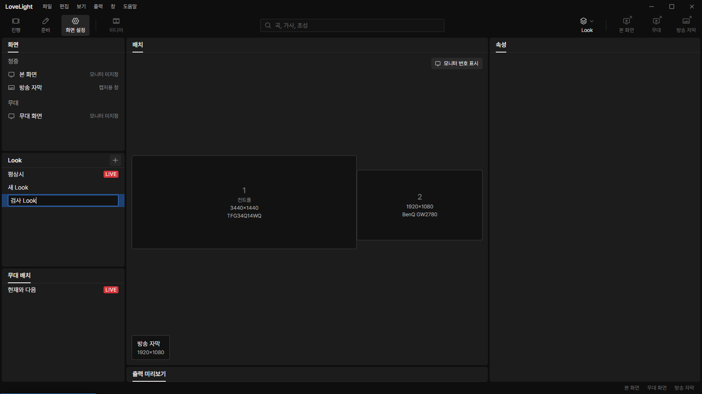
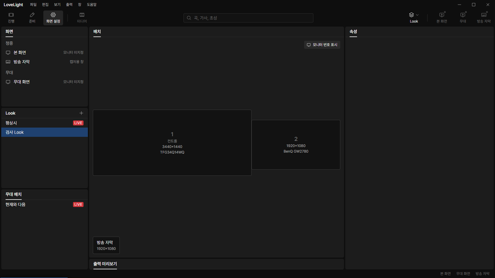
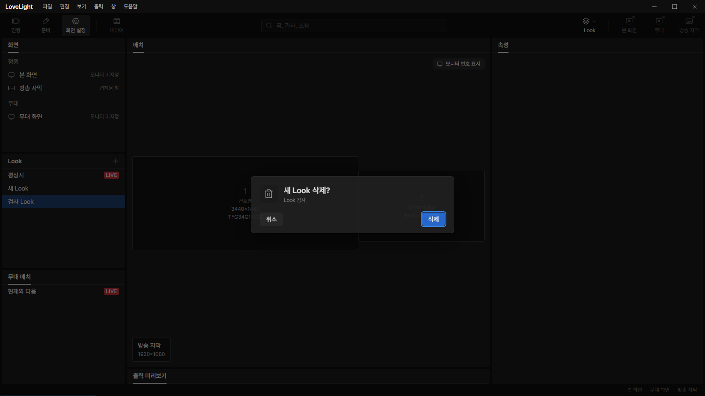
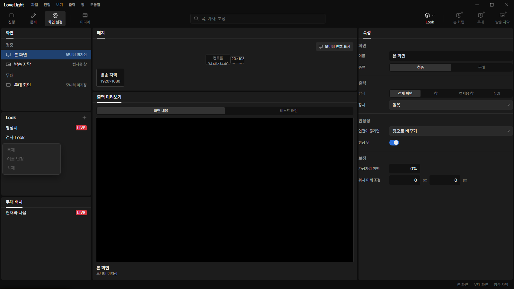

# Review request: `screens-8`

- Team member: `screens`
- Branch: `feat/screens/look-list-ui`
- Base commit (`main`): `8df43454`, rebased for round 2.
- Related brief: `docs/briefs/screens.md`, M3-O2 Look list UI.

## What changed and why

The Look list now supports adding a copy of the current Look, duplicating a
selected Look, inline rename, and deletion. Choosing a row changes only the
editor selection. It never sends an output command or changes the saved current
Look. The existing LIVE mark follows the live Look with the saved-current
fallback.

The plus button creates a Look. Right-click and the keyboard context-menu key
open lifecycle actions. Enter or blur commits an inline name; Escape cancels.
Invalid names leave the saved value and report a warning. Read-only documents
keep selection available and disable all edit commands with reason tooltips.
Creation stops at the model's 1,000-Look cap; imported longer lists remain
usable.

Deletion stays disabled until macro metadata is available. The model protects
the saved and live current Look and checks references against the latest queued
context. A referenced Look opens the existing confirmation dialog with the
referencing macro names. Confirming rechecks current-Look protection before the
queued save. Deleting the selected Look selects a surviving row.

The list mounts only its visible rows and overscan, preserving arrow and
Home/End navigation over the complete collection. Scrolling commits an active
name before recycling its row. A shared session per window API serializes
lifecycle edits across panels, adopts documents monotonically, reads the current
live selection at execution, and releases each panel's problem subscriber when
it unmounts.

Includes the screens-7 nit: normalize a generated candidate before checking
existing trimmed names, with a padded-name duplication regression.

## Changed files

- `screens/looks/LookPanel.tsx`: panel, actions, rename and deletion
  confirmation.
- `LookRows.tsx`, `LookList.module.css`: virtual list and keyboard navigation.
- `useLookListEditor.ts`: shared queued editor and current context.
- `lookListEdits.ts` and tests: screens-7 name-normalization nit.
- `LookPanel.test.tsx`: lifecycle, output isolation, focused commit, invalid
  names, read-only writes, delayed macro load and virtual-list navigation.
- `screens/LookLists.tsx`: retain the LookList props while delegating its body.
- `ScreensWorkspace.test.tsx`: supply the newly read macro document.
- `docs/reviews/screens-8.md`: this request.

### Changes outside my paths

- `src/renderer/src/shell/Workspace.tsx`: embed the Look-owned panel so its
  header can own its plus button. Only the Look case changes. StageLayoutList,
  ScreenEditor and the selection public APIs remain stable; lead notified.

## Checks run

Round 1 passed typecheck and all 178 tests in the 18 screens and shell workspace
files after rebasing. Round 2 adds the focused keyboard rename regression, which
fails against round 1 and passes with the handoff fix. The round 2 request line
records post-rebase checks and exact-head CI. No Electron or full local verify
was run.

## Remaining M3-O2 work

The center Look editor, per-screen layer cards and previews, and shared lyric
style lifecycle and controls follow in separate requests. M3-O3 belongs to
output.

## Checked in the app

Built this branch with `npm run build`. Syntax-checked the CDP launcher with
`node --check` before every Electron launch. Ran the built app with
`LLP_TEST_WINDOWS=offscreen`, `LLP_DEV_PORT=5192`, CDP port 9512 and an isolated
fixture profile under `D:\llp-dev\screens`. No window was shown. CDP drove real
mouse and keyboard events in a 1600 x 900 viewport.

- Added a Look, duplicated it with the keyboard menu, renamed the copy using
  ContextMenu/ArrowDown/Enter, then typed and committed its name. The field
  retained focus after the menu closed.
- Opened a macro-referenced deletion confirmation, canceled it, reopened it and
  confirmed deletion. The current Look's delete action stayed disabled.
- Switched between the main screen and the edited Look 20 round trips after four
  warmup trips. Forced-GC samples at 0/5/10/15/20 trips kept 185 elements, 349
  DOM nodes and 752 listeners. JS heap was 5.53 to 5.75 MB, a 0.22 MB spread.
- Closed the app cleanly, changed only the fixture file to a newer schema, and
  reopened it. The saved name remained. Add and menu edit actions were disabled
  and the settings revision did not change. Another 20 round trips kept 183
  elements, 311 nodes and 466 listeners; heap was 5.37 to 5.61 MB.
- Both exercised launches closed cleanly with exit 0 and no runtime exceptions.
  The two runs had steady DOM and listener counts and a heap spread below 5%.

## Verdicts (recorded by the lead at merge)

- Earlier rounds (Codex): see the findings and replies above.
- Round 2 (7b11435a): reviewer (Codex, codex3) Approve. Lead Approve; the Look
  list in 화면 설정 with rename, delete, and read-only states, checked in the
  app with screenshots. It was in progress before the feature freeze. The
  exact-head CI run passed, checked by the lead at merge. Rebased by the lead
  onto local `main` without conflicts; typecheck passes.

## Team member's reply

1. Deferred the rename handoff until the menu has unmounted. Selecting rename
   records the target; the parent's passive effect mounts its field after Menu's
   opener-focus cleanup. The field keeps focus and no unchanged save is sent.
   Added a regression that focuses a Look row, opens its keyboard context menu,
   chooses rename with ArrowDown/Enter, types a replacement and commits once. It
   fails against round 1 because the textbox disappears after focus restore.
   Post-rebase checks and exact-head CI are reported in the round 2 request.
