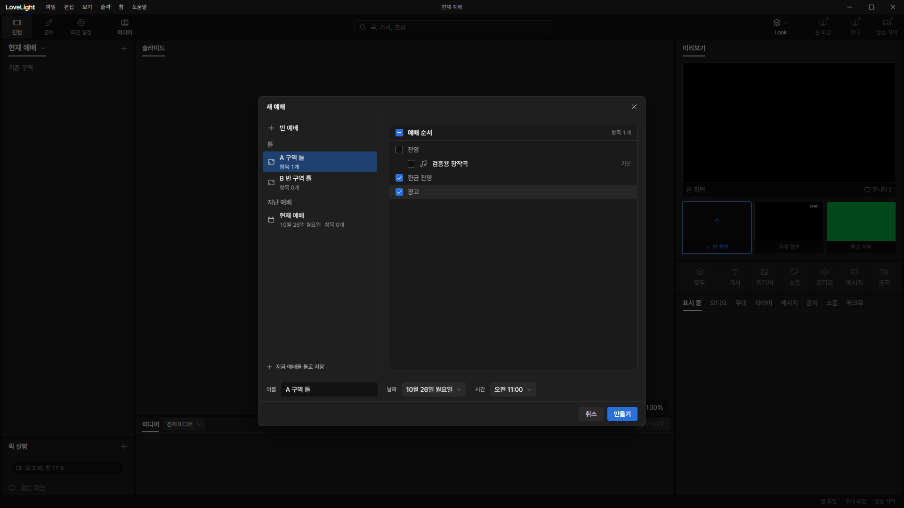
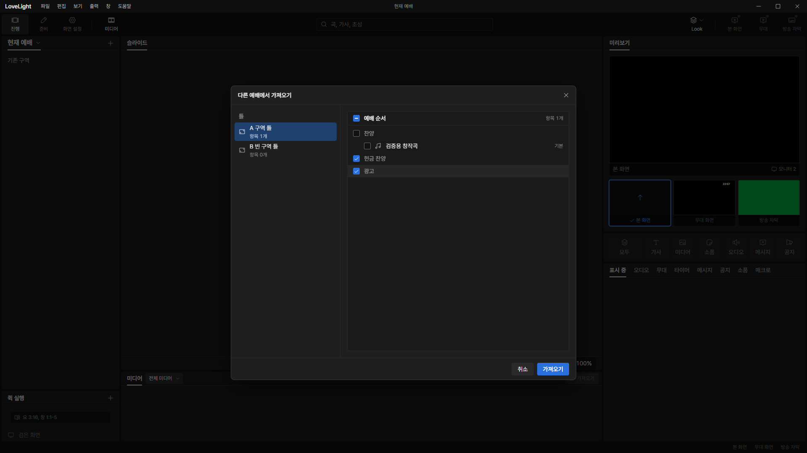

# Review request: `spec-58`

- Team member: `spec` (Codex)
- Branch: `fix/spec/source-tree-sections`, initially stacked on spec-57
- Base, range, and exact-head CI: see the request message
- Review round: 1
- Task: remove slots from the 새 예배 and 다른 예배에서 가져오기 trees

## What changed and why

The source trees no longer present a slot as a content item. Their sample
template uses consecutive empty sections, including a final empty section. Each
section remains a top-level checkable row, carries no slot icon/detail, and is
excluded from the content-item count. The existing selection logic already
supports empty sections, so it needs no new state or subscriptions.

Regression coverage checks their tree positions, independent mouse/keyboard
checks, creation with only empty sections, and importing only empty sections
without selecting the preceding section's passage. Existing rename and source
switching coverage continues to run.

## Validation

- Service-dialog tests: 81 passed. An initial run under concurrent compiler load
  exceeded a new test's default find timeout; the isolated test and the full
  directory rerun both passed.
- Typecheck and scoped ESLint passed.
- Build passed. Formatting and final diff checks are in the request message.

## Checked in the app

Built with `npm run build`, then launched the real Electron app through
electron-vite with `LLP_TEST_WINDOWS=offscreen`, dev port 5193, CDP port 9517,
and an isolated data folder inside this worktree. Ran `node --check` on the
driver and launch entry before starting Electron. Repeated after rebasing.

For each dialog, switched A to B and back 20 times, reopened/closed twice after
warm-up, and independently checked the two consecutive empty sections. Created a
service containing only those sections, then imported them again. Read the real
main-owned document to verify the resulting four section rows, their source
order, and fresh IDs. No renderer exceptions occurred. The app and its process
tree were stopped after the check.

At the closed checkpoints, elements stayed at 475, DOM nodes at 1607, and
listeners at 660. Collected renderer heap stayed bounded: 14.39, 14.69, 14.83 MB
for new service, then 14.88, 14.97, 15.02 MB for import. The small warm-up
growth decreased between batches; no DOM or listener accumulation occurred. Full
measurements are in [measurements.json](spec-58/measurements.json).

## Changes outside my paths

`src/renderer/src/prep/services/` is prep-owned. The lead assigned these trees
to this member for slot removal. No shared contract or normalization changes:
data handles legacy slots before the tree receives a document. UI owns the
QuickAdd menu and fill-path removal; service-order selection/drop is the next
separate request.
