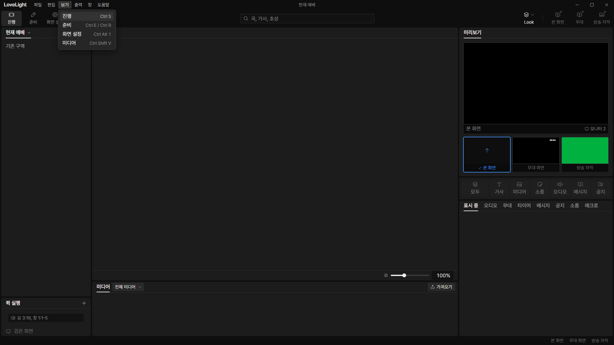
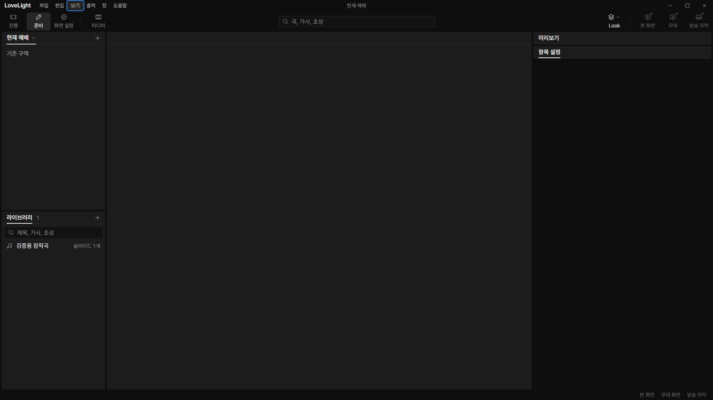
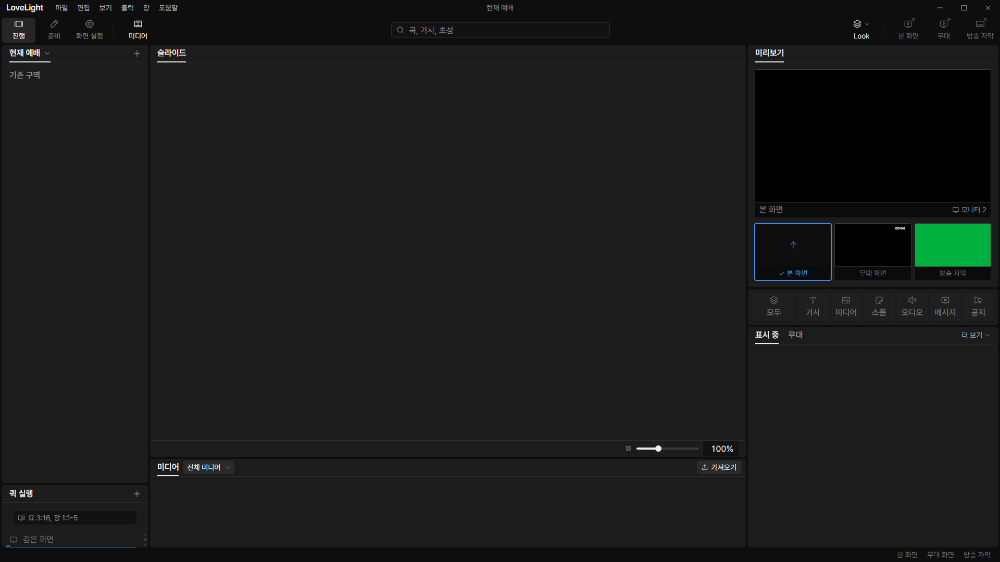

# Review request: `spec-60`

- Team member: `spec` (Codex)
- Branch: `fix/spec/shortcut-alignment`
- Base, range, and exact-head CI: see the request message
- Review round: 2
- Task: freeze-authorized ProPresenter shortcut audit and first alignment unit

## What changed and why

The decided workspace shortcuts had no handlers. Ctrl S opens 진행, Ctrl E or
Ctrl R opens 준비, Ctrl Alt 1 opens 화면 설정, and Ctrl Shift V toggles the
existing media view. The 보기 menu invokes those same actions and shows their
English shortcut hints. From 화면 설정, the media key opens the 진행 media bin.

Ctrl S yields to an imported editor's save action; Ctrl Shift V yields to plain
paste in fields. A shared hook applies exact physical modifier matching and
preserves popup, modal, shortcut-recorder, drag, IME, and held-key precedence.
Its single registration reads current callbacks and releases all listeners. F1
through F7 handling is unchanged and remains output's work.

The [audit](../plans/shortcut-audit-2026-10-26.md) inventories every implemented
keyboard handler and menu accelerator group against spec 10 and the current
Renewed Vision S1 article. It lists missing decided defaults, conflicts,
deliberate differences, and destinations that do not exist yet. Follow-up
requests connect existing actions rather than inventing substitute targets.

## Validation

Focused tests cover physical keys, exact modifiers, held repeats, IME lifecycle,
popup/modal/recorder/drag precedence, cleanup, current callbacks, imported-save
and plain-paste exceptions, plus integrated workspace and View-menu actions.
Final test counts, typecheck, scoped lint, formatting, build and CI results are
recorded with the submission.

## Checked in the app

Built with `npm run build`, then ran the real app with
`LLP_TEST_WINDOWS=offscreen`, the built renderer served on dev port 5193, CDP
9517, and an isolated worktree fixture. Ran `node --check` on the driver,
server, and main launch entry before Electron. This also avoids the dev
optimizer startup that stalled one earlier attempt after the rebase.

After warming all three workspaces, made 30 preparation/settings/show round
trips using both Ctrl E and Ctrl R. Opened/closed the View menu twice and
toggled media open/closed twice. Confirmed an open menu blocks workspace keys,
Ctrl R never reloads, and live layers remain identical. All app/dev processes
were stopped afterwards. During a real quick-list pointer drag past the
threshold, Ctrl E/R kept 진행 and its dragged list mounted. Escape and release
restored workspace switching. Live layers stayed unchanged throughout.

On the rebased round-2 tree, elements stayed at 399, DOM nodes at 1444, and
listeners at 387. Collected heap was 6.53, 6.71, 6.81, then 6.90 MB, bounded
within 0.38 MB during the repeated flow, with no DOM/listener accumulation. No
renderer exceptions occurred. [Measurements](spec-60/measurements.json).

## Changes outside my paths

The lead assigned shell/control implementation and the audit to this member. No
data contract, output clear handler, or another member's worktree changes.

## Team member's reply

1. The window shortcut guard now also tracks primary pointer movement across the
   4 px reorder threshold. This covers quick-list and arrangement drags without
   depending on native `dragstart`. Pointer release/cancellation, lost capture,
   Escape and blur release the guard; effect cleanup removes the listeners.
   Added a regression using the real `useQuickDrag` hook, proving Ctrl E/R leave
   its list mounted during reordering and work after release, plus
   cancellation-path coverage. Rebased onto local main and repeated the scoped
   and app checks before round 2.
