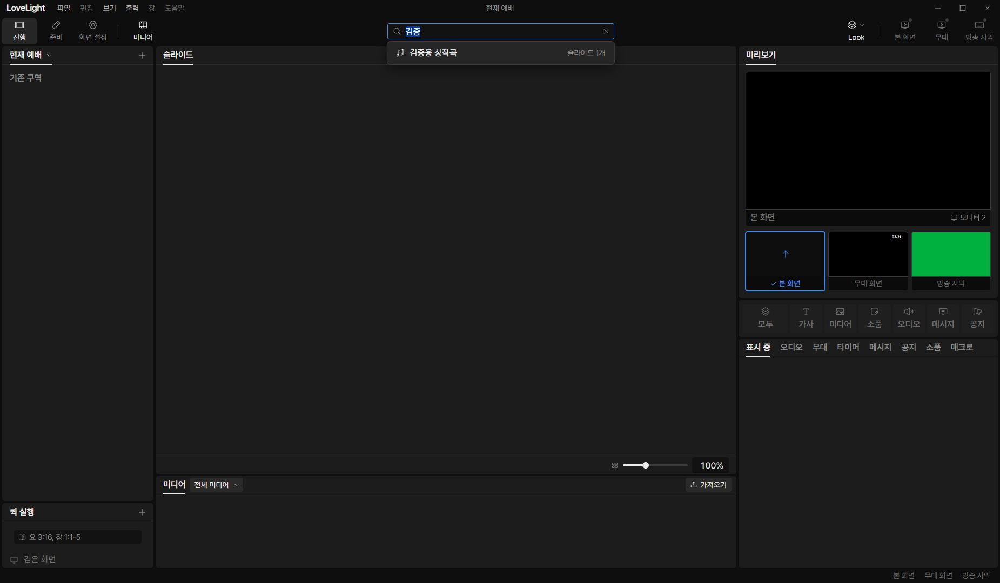
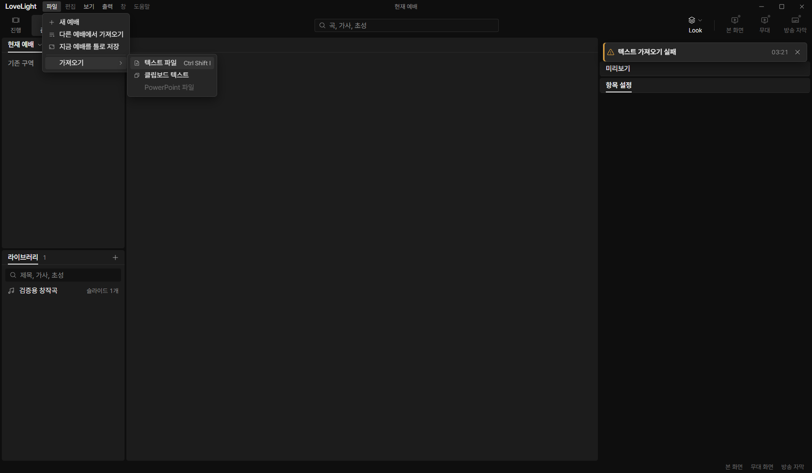

# Review request: `spec-61`

- Team member: `spec` (Codex)
- Branch: `fix/spec/search-import-keys`, initially stacked on spec-60
- Base, range, and exact-head CI: see the request message
- Review round: 2
- Task: decided S1 search and file-import defaults from the shortcut audit

## What changed and why

Ctrl F now focuses the toolbar search and selects its current query in 진행 and
준비. From 화면 설정, it opens 진행's working search. The focus request is
acknowledged once, so later workspace changes do not replay it.

Ctrl Shift I uses the same import action as File > 가져오기 > 텍스트 파일: open
준비, leave media view, and respect the editor's unsaved-import guard. The menu
displays the same English shortcut hint. Exact modifiers, IME, popup/drag
precedence and held-key suppression use spec-60's shared handler.

## Validation

All 107 focused tests pass, including ShowPanels, App and PrepMount on the
rebased main, ToolbarSearch, MenuBar, FileMenu and the import flow. They cover
search from each workspace, query selection, one file read after a held import
key, and existing import preview/edit/save guards. Typecheck, scoped lint,
build, formatting and final results are recorded with submission. CI pending.

## Checked in the app

Built with `npm run build`. Syntax-checked the driver, server and main entry,
then ran the real Electron app with `LLP_TEST_WINDOWS=offscreen`, built renderer
on dev port 5193, CDP 9517 and a fresh isolated fixture folder.

Verified Ctrl F from all workspaces, real library search results and selection
of the entire query. Repeated preparation/search and settings/search round trips
20 times after warm-up. Ran Ctrl Shift I twice from 화면 설정 and opened the
File import submenu to verify its shortcut hint. The native picker is refused by
main's offscreen guard and the text-import failure warning is shown;
accepted-file preview/edit is exercised by the integration tests. No native
picker was displayed. Live layers stayed identical and no renderer exceptions
occurred.

Repeated the app check after rebasing. Elements stayed at 401, DOM nodes at 1446
and listeners at 385. Collected heap was 6,831,020, 6,993,380 and 7,136,036
bytes, within about 298 KiB over the repeated flow. The driver stopped its
app/server processes. [Measurements](spec-61/measurements.json).

## Changes outside my paths

The lead assigned shell/control shortcut alignment to this member. No shared
contract, native-dialog policy, or F1 through F7 handling changes.

`prep/import/TextImportFlow.test.tsx` now settles its immediate mock read and
preview in async act. This removes a timed wait from the StrictMode regression;
import implementation behavior is unchanged.

## Team member's reply

Round 2: rebased onto current local main after the lead reported the failed
[original-head CI run](https://github.com/0913vision/llpresenter/actions/runs/40349139653).
The three integration suites named by the lead are included in the rerun.
Expanded related checks also caught two FileMenu assertions that still expected
the label without its newly added shortcut hint; they now check the label prefix
and assert the hint. The StrictMode import preview passed alone but exceeded its
timed wait in the combined run; explicit async act now settles its immediate
mock work before checking the preview. No production shortcut code changed in
this response. Rebuilt and repeated the actual app flow, and corrected the old
offscreen-picker description from cancellation to a reported refusal. Push is
followed immediately by the round 2 request with CI pending.
