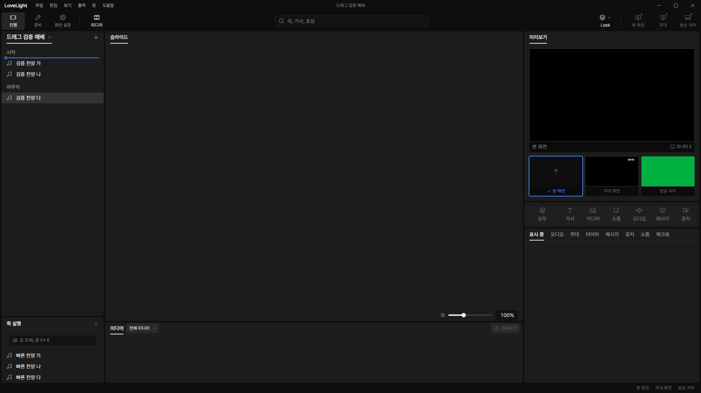
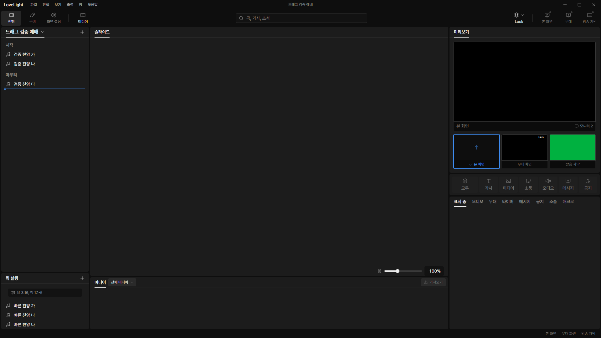
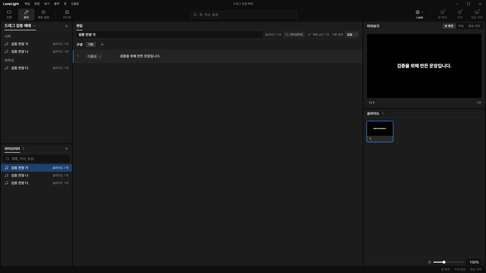
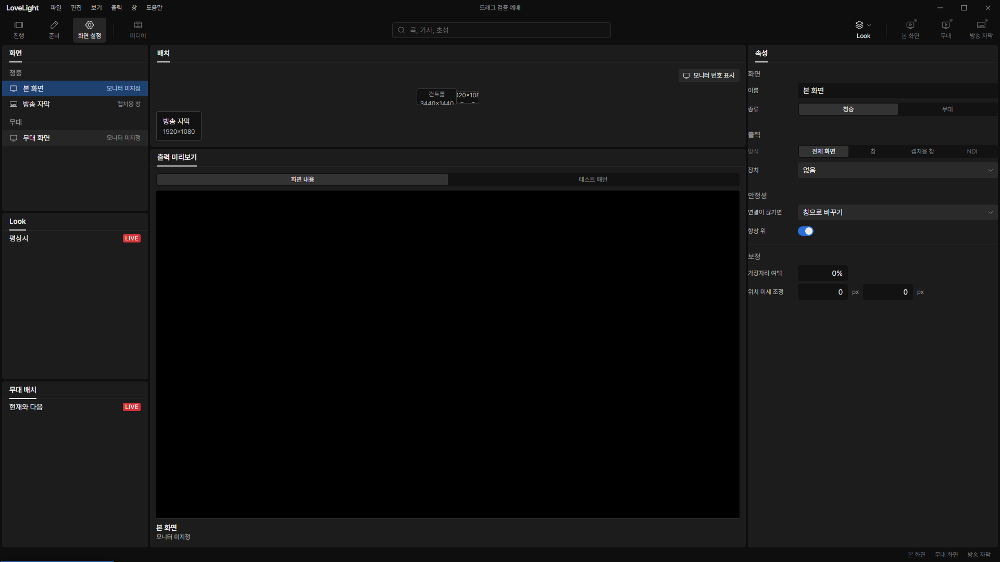
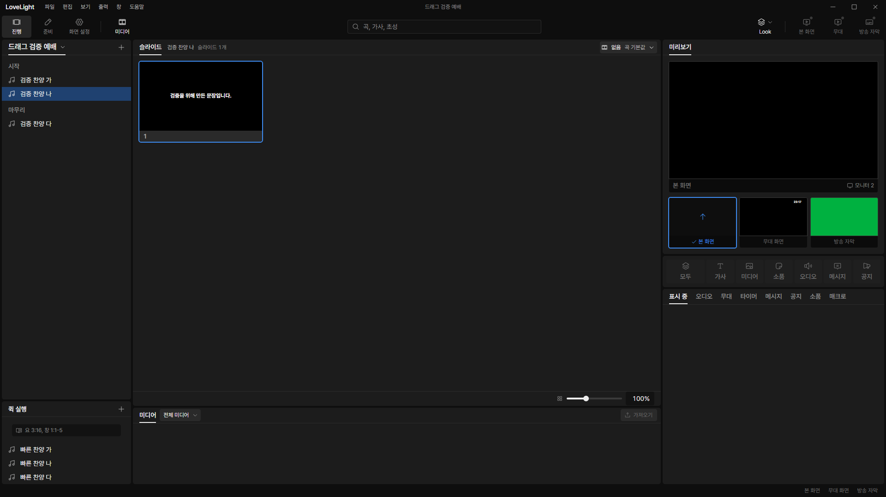
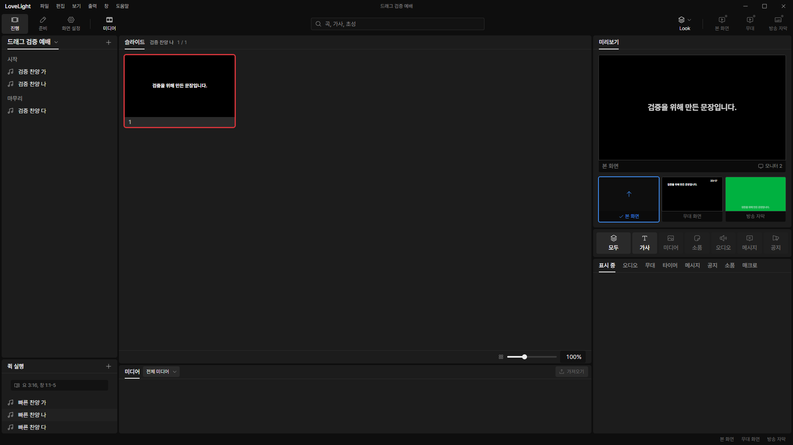

# Review request: `tools-13`

- Team member: tools
- Branch: `fix/tools/list-drag`, from local main.
- Base, final head, checks and CI status: in the report.
- Scope: today's user-check decision on midpoint placement and release clicks.

## What changed and why

Dropping in the service list's top padding previously appended the item. A
section dropped below another section's header also snapped back above that
section. The destination now respects the header midpoint and keeps each section
together. Song rows and quick rows use the same midpoint comparison.

A shared click guard prevents pointer clicks and double clicks after dragging
from the service, library and screen lists. The quick list also recognizes
pointer clicks whose detail is zero. A fresh pointer press resets the guard;
keyboard activation remains available. The existing quick-list drop bounds,
four-pixel threshold and cancellation rules stay in force.

## Changes outside my paths

- `src/renderer/src/show/useServiceOrderDrag.ts` and
  `ServiceOrderEditing.test.tsx`: service drop placement, release selection and
  header rename regressions.
- `src/renderer/src/ui/rowDrag.ts`, `useDragClickGuard.ts`: shared midpoint and
  release-click behavior used by the four existing row drag sources.
- `src/renderer/src/prep/library/LibraryList.tsx`, `LibraryPanel.test.tsx`:
  prevent selecting the dragged song on release.
- `src/renderer/src/screens/ScreenList.tsx`, `DisplayLayout.test.tsx`: prevent
  selecting the dragged screen on release.
- This review document and synthetic-fixture screenshots.

## Checks and quality

Regression tests cover top-padding drops, either side of an exact midpoint,
section movement, release clicks and double clicks, and the next deliberate
click. Existing quick tests cover outside releases, cancellation, revision
changes, read-only state and keyboard activation. The five affected test files
pass 104 tests. Typecheck after rebase, changed-file ESLint and build pass.
Final format checks and exact-head CI are in the report.

The shared guard holds one boolean ref. It adds no listener, timer, collection
or cache. Existing quick pointer listeners are removed after the gesture. No new
TSDoc comments are introduced; the exported-declaration audit is part of the
final request checks.

## Checked in the app

Built with `npm run build`; launched the installed Electron binary with
`LLP_TEST_WINDOWS=offscreen`, `LLP_DEV_PORT=5183`, CDP port 9513 and isolated
worktree app data. `node --check` passed for each script before execution. All
fixtures use invented titles and text. CDP sends real mouse, native drag and
keyboard events rather than invoking React callbacks.

- Quick and service rows: 70 drag pairs across the target's upper and lower
  halves, including whole-section moves. Every pair restored the original saved
  order; live output stayed unchanged by dragging.
- Selection: service rows 70 pairs, library and screen rows 20 pairs each.
  Canceled native library and screen drags kept the previous selection. A fresh
  deliberate quick click still outputs: 20 action pairs passed afterward.
- Open and close: service and library menus twice each, and two workspace
  unmount/remount cycles through 준비, 화면 설정 and 진행.
- Memory: the first 50 drag pairs filled the existing 100-entry service edit
  history. Across the next 20 pairs, the control document held 437 elements,
  1,508 DOM nodes, 519 event listeners and 30 document objects at every sample.
  After explicit garbage collection, used JS heap stayed within 7.61 to 7.68 MB,
  and embedder heap within 4.28 to 4.30 MB. Raw five-sample measurements are in
  [measurements.json](evidence/tools-13/measurements.json).

Quick-list insertion above a row:

Service row and whole-section insertion:

Library and screen selection retained after a canceled drag:

Final repeated drag state and a fresh deliberate quick action:

## Verdicts (recorded by the lead at merge)

- Round 1 (c6f7f669): reviewer (Codex) Approve. Lead Approve through the lead's
  merge check: the exact-head CI run passed, the branch rebased onto local
  `main` without conflicts, and typecheck passes. Earlier rounds' findings and
  replies are above.
