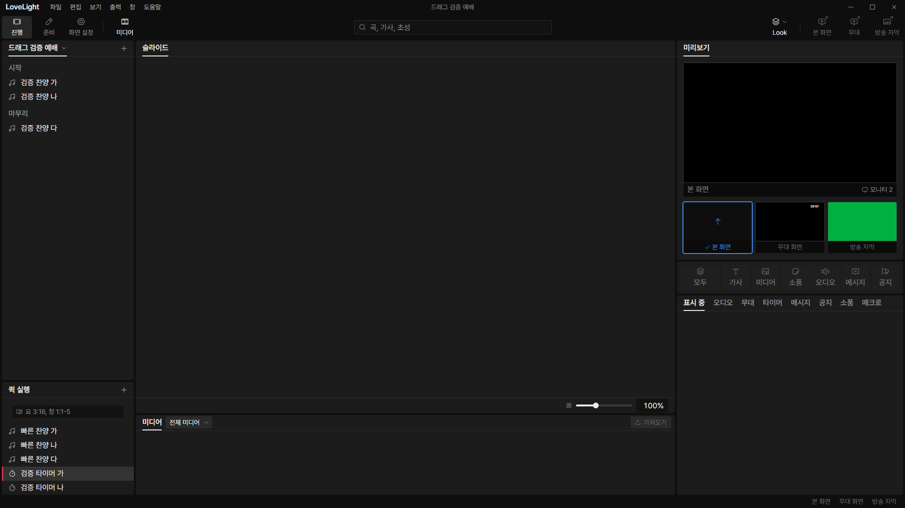
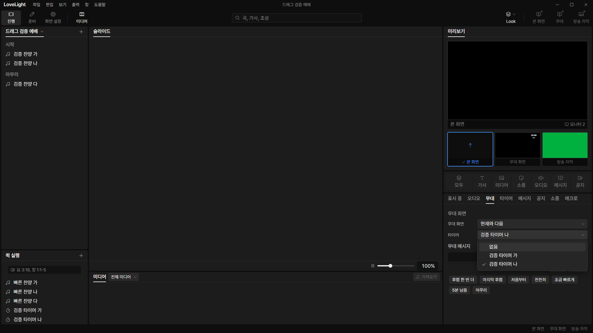

# Review request: `tools-15`

- Team member: tools
- Branch: `feat/tools/quick-timer-storage`, stacked on tools-14.
- Base, final head, checks and CI status: in the report.
- Scope: the storage step of the October 26 timer decision.

## What changed and why

The quick timer flow needs to create and rename a definition and its row as one
applied edit. Two additive `settings:edit` commands provide that operation:
`quick.timer.create` takes fresh checked IDs and whole seconds;
`quick.timer.rename` takes the quick row ID and a bounded timer name. Existing
whole-file edits continue to work.

Create gives each row a distinct countdown and unused numbered name. Replaying
the same create does not append another timer, including after a rename.
Collisions, invalid input, read-only or missing files, and additions at the
500-item quick/timer caps are refused before either document changes. Rename
preserves IDs, unknown fields and unrelated records. Legacy shared references
are refused by the new rename command until separated in the following step.

Both next documents are validated and serialized before installation. Both enter
the store before either notification. Per-file writes use the existing debounce,
failure reporting and retry queue; a write failure reports which files failed
and keeps the applied pair. This is an in-memory applied edit, with the existing
per-file atomic persistence rather than a disk transaction. The existing quick
item cap now has one shared definition.

The operator's duration dialog, reset/value row behavior and legacy separation
follow in small requests. This request provides the storage contract; it adds no
menu entry or timer editor.

## Changes outside my paths

- `src/shared/schema/quickTimerEdit*`, `settingsDocuments.ts`: additive checked
  commands, limits and valid/invalid boundary tests.
- `src/shared/schema/quick.ts`: shared existing quick-list cap.
- `src/main/store/quickTimerEdits*`, `settingsStore.ts`: paired preparation,
  installation, save results and regression tests for the existing save path.
- This review document and screenshots made with invented fixtures.

## Checks and quality

Typecheck, changed-file ESLint and build pass. Eight affected test files pass
203 tests, including settings IPC, preload, unknown fields, publication order,
idempotence, collisions, limits, read-only data and persistence retry. Final
format checks and exact-head CI are in the report. No TSDoc comments are added.
No new timer, listener, queue or cache is retained by these commands. New
definitions and quick rows are capped; existing accepted work stays in the
existing save queues on a failure.

## Checked in the app

Built with `npm run build`, then launched installed Electron offscreen with dev
port 5183, CDP port 9513 and worktree-isolated synthetic app data. Scripts
passed `node --check` before launch. CDP used the real preload API for the new
commands and real pointer events for the existing row and stage picker.

- Created two timers and replayed a create without adding another row. Real
  clicks started each timer independently: the other timer had no live run.
- Renamed a timer through the new command and verified its quick row and
  definition agreed. Picked each named timer through the real 무대 picker.
- Repeated rename and stage-selection pairs 50 times to warm the renderer, then
  measured another 20 pairs. Opened and closed the picker twice as an explicit
  cycle as well.
- All five measured samples held 463 elements, 1,537 DOM nodes, 533 event
  listeners and 28 document objects. After garbage collection, used JS heap
  stayed within 5.85 to 5.94 MB; embedder heap stayed within 3.92 to 4.10 MB.
  The commands retain no per-operation collection.

Only one independent timer running:

Renamed rows and the selected stage timer:

Both definitions listed by their names:

