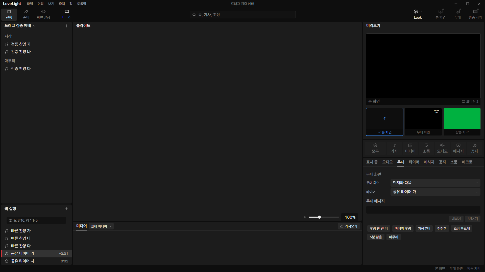
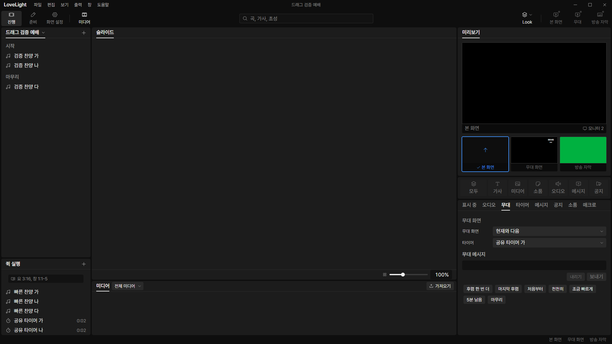

# Review request: `tools-16`

- Team member: tools
- Branch: `feat/tools/quick-timer-controls`, rebased onto main after tools-15.
- Base, final head, checks and CI status: in the report.
- Scope: the October 26 user-check timer decision, row behavior and isolation.

## What changed and why

Running quick timers now reset on another click, with their configured value
shown again. Each row displays its own value, including a minus past zero.
Paused timers can resume; the timer tab's separate pause behavior is preserved.
Legacy clocks show their time with no start/reset action. Missing definitions
are disabled with a tooltip.

The additive `quick.timers.separate` edit splits legacy shared references in one
applied operation. The first row keeps its timer ID; later rows get copies of
its configuration and unknown fields. Row IDs, names and order stay intact, as
do stage and prop references to the original ID. The operation is idempotent and
refuses an over-cap or read-only change before installation. Secondary shared
rows cannot start while separation is pending or refused. Failures have an
explicit retry and resolve their warning when the rows become usable.

One clock per control-window API samples main's monotonic clock and shares one
250ms interval among ticking values. The final subscriber releases that
interval. Stopped rows draw their configured value without a clock interval. The
new duration-add dialog and timer tab follow separately.

The October 27 overrun choice, dated countdown-to and stopwatch elapsed mode
follow in the next specification/code series. This row fix retains the current
timer-definition defaults.

## Changes outside my paths

- Shared ID and settings schemas: checked timer ID creation and the additive
  separation command, with contract coverage.
- Main settings/timer preparation and tests: preserve the original definition,
  clone later references and use the existing paired save/failure mechanism.
- `src/renderer/src/ui/ListRow.tsx`: allow a React value in `ListActionRow.meta`
  so only timer text subscribes to the clock.
- This review document and synthetic-fixture screenshots.

## Checks and quality

Six affected test files pass 81 tests after rebase. Coverage includes deferred
separation blocking, close-gate flushing, synchronous API failures, retry and
warning resolution, read-only/missing data, clock cleanup/restart, overrun,
reset and the existing quick field/edit flows. Typecheck, ESLint and build pass.
Final formatting and exact-head CI are in the report. No TSDoc is added.

## Checked in the app

Built and ran installed Electron with `LLP_TEST_WINDOWS=offscreen`, tools dev
port 5183, CDP port 9513 and isolated invented fixtures. Each script passed
`node --check` before execution. CDP drove real row clicks, menus and workspace
switches, and used the preload API to introduce a legacy shared reference.

- Introduced shared quick references, confirmed automatic separation and kept
  the original stage timer selected. Repeated with the original timer already
  running: its start timestamp survived and the copied timer stayed stopped.
- Ran one 2-second timer past zero to `-0:01` while the other stayed at `0:02`.
  A second real click removed its run and restored `0:02`.
- After 50 start/reset pairs for each row, measured 20 more pairs. Opened and
  closed the add menu twice and remounted the quick panel twice by switching
  workspaces. All five samples held 467 elements, 1,546 DOM nodes, 547 event
  listeners and 29 document objects. GC used heap stayed within 6.13 to 6.29 MB;
  the final 15 pairs stayed within 6.23 to 6.29 MB.

Independent overrun and the original stage selection:

Second click restores the configured value:

After repeated start/reset and workspace switches:

