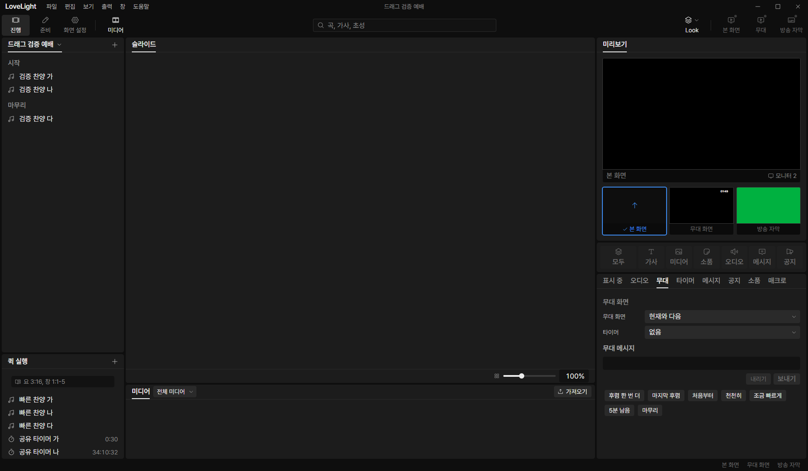

# Review request: `tools-18`

- Team member: tools
- Branch: `feat/tools/timer-modes`, stacked on tools-17.
- Base, final head and exact-head CI: in the report.
- Scope: October 27 timer date targets and stopwatch start values.

## What changed and why

Countdown-to accepts an optional calendar date alongside its existing local
time. The shared formatter uses that date across midnight, wall-clock
corrections and pauses. Legacy undated countdown-to and time-of-day elapsed
definitions keep their existing meaning.

The additive `elapsed` kind counts monotonic elapsed duration from a nonnegative
`start` value. Pausing holds its value, starting resumes it, and reset restores
its configured start. Its start is bounded by the existing safe timer seconds
limit. Real calendar dates and finite, bounded start values are validated at
both settings IPC boundaries and file loading. Unknown fields survive
serialization. Existing quick timer create imports retain their limit export.

This request establishes complete value and live-command behavior for these two
modes. The editor controls follow in the timer tab request. Stop-at-zero and its
overrun option follow together in a separate engine request.

## Changes outside my paths

- `src/shared/schema/primitives.ts`, `timers.ts`, `quickTimerEdit.ts` and
  `timers.test.ts`: additive validated definitions, shared duration limit and
  compatibility tests, under data's shared contract conventions.
- `src/shared/timerClock.ts` and its tests: the formatter used by quick rows,
  stage output and timer fields. Date resolution is shared with the upcoming
  stop-at-zero engine.
- `src/main/live/timers.test.ts`: real store start, pause, resume and reset
  coverage with the new definitions. No main command changes are needed.
- This review document and its screenshots.

## Checks and quality

Four focused files, 73 tests passed, including leap dates, invalid dates,
missing/negative/nonfinite/oversized start values, unknown field round trips,
midnight, pauses, resets and wall-clock correction. Typecheck, changed-file
ESLint, formatting and build passed. No new TSDoc comments; modified TSDoc sits
on exported declarations. Removed an existing private documentation comment in
the touched test.

## Checked in the app

Built and ran installed Electron with `LLP_TEST_WINDOWS=offscreen`, tools port
5183 and isolated synthetic data. `node --check` passed before starting Electron
and before running the CDP script. Fixtures were updated through the real
validated settings API. Controls were driven through CDP mouse events, and
fixtures were restored afterwards.

- Tomorrow at noon displayed more than 24 hours remaining, preserving its
  explicit date rather than anchoring to today.
- Elapsed started at `0:30`, counted to `0:31`, held while paused, resumed to
  `0:32`, and reset to `0:30` through the quick row.
- After 40 warmup pairs, repeated start/reset on both rows 20 times and
  opened/closed the menu and workspace twice. Element count 467, DOM nodes
  1,545, listeners 547 and documents 29 stayed fixed. GC heap was 6.14 to 6.29
  MB, with the last 15 pairs at 6.24 to 6.29 MB. No accumulating DOM or
  subscriptions were observed.

## Team member's reply

No findings yet.

## Verdicts (recorded by the lead at merge)

- Final round (b6d0cb60): reviewer (Codex) Approve. Lead Approve after checking
  the main-process part of the change (see "What changed and why"); the
  exact-head CI run passed, checked by the lead at merge. Rebased by the lead
  onto local `main` without conflicts; typecheck passes. Earlier rounds'
  findings and replies are above.
