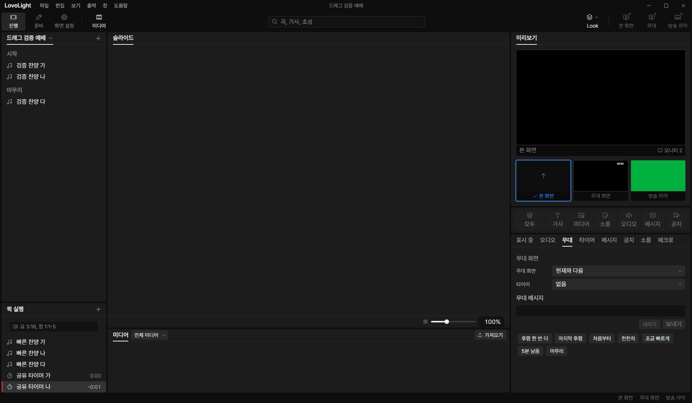

# Review request: `tools-19`

- Team member: tools
- Branch: `feat/tools/timer-overrun`, stacked on tools-18.
- Base, head and exact-head CI status: in the report.
- Scope: October 27 countdown overrun choice, engine and output values.

## What changed and why

Countdown and countdown-to definitions accept optional `overrun`. Missing or
true preserves counting past zero with a minus. False clamps the shared value at
zero and completes the live run in main. Completion is a validated optional
marker on a paused run, so it clears the running appearance, holds zero through
wall-clock corrections and starts a duration timer fresh next time. An ordinary
operator pause still resumes its counted time. Reset returns the configured
value.

One main timeout checks running stop-at-zero timers every 250 ms. It exists only
while needed and is released with the live lifecycle. Duration uses the
monotonic clock; dated targets use local wall time. Settings changes cancel or
enable completion without restarting the run. Stale candidates cannot pause a
newly restarted run. Disposal stops an in-progress pass. Errors are logged
without an accumulating retry loop. Editor controls follow in the quick add and
timer tab requests.

## Changes outside my paths

- `src/shared/schema/timers.ts`, `timerState.ts` and their tests: additive
  optional overrun and completion contracts, with valid and invalid cases.
- `src/shared/timerClock.ts` and its tests: shared countdown remaining time,
  clamped values and completed values for every renderer.
- `src/main/live/timerCompletion.ts` and its tests: bounded main lifecycle.
- `src/main/live/slices/timers.ts`: distinguish completion from pause and
  restart completed runs. Existing start, pause and reset commands suffice.
- `src/main/live/overlays.ts` and its test: attach the timer follower to the
  existing settings owner and dispose it. The listener assertion accounts for
  this second, released store subscription.
- This review and screenshots.

## Checks and quality

Six focused files, 94 tests passed. Coverage includes simultaneous continue and
stop timers, ordinary pause/resume, restart/reset, wall-clock changes, settings
changes/removal, stale notifications, disposal during completion, read failure
logging and 20 repeated main lifecycle cycles with one timeout. Typecheck,
changed-file ESLint, formatting and build passed. No new TSDoc comments; the
changed documentation comment is on an exported declaration.

## Checked in the app

Built and ran installed Electron offscreen with tools port 5183, CDP 9513 and
the isolated synthetic fixture. Checked scripts with `node --check` before
launch. Used real settings IPC for configuration and CDP mouse events for timer
controls. Restored the fixture afterwards.

- An expired dated target completed and held `0:00`.
- Two one-second timers started independently. Stop-at-zero held `0:00` and
  cleared its pressed state while continue remained running at `-0:01`.
- Clicking the completed row started fresh at `0:01`; clicking the running row
  reset it. Repeated these flows after 30 warmup cycles, then measured 20
  cycles. Opened/closed the menu and workspace twice.
- Final build repetition kept 467 elements, 1,545 DOM nodes, 547 listeners and
  29 documents fixed. GC heap was 6.17 to 6.33 MB; the last 15 cycles stayed at
  6.27 to 6.33 MB, with the last five increasing by 5 KB. No accumulating DOM or
  subscriptions were observed.

## Team member's reply

No findings yet.

## Verdicts (recorded by the lead at merge)

- Final round (4ba246c5): reviewer (Codex) Approve; second review (Gemini 4
  Argon, gem1) Approve, no findings, on the live timer state. Lead Approve; each
  countdown has the overrun choice of ProPresenter (user decision of October
  27). The exact-head CI run passed, checked by the lead at merge. Rebased by
  the lead onto local `main` without conflicts; typecheck passes.
