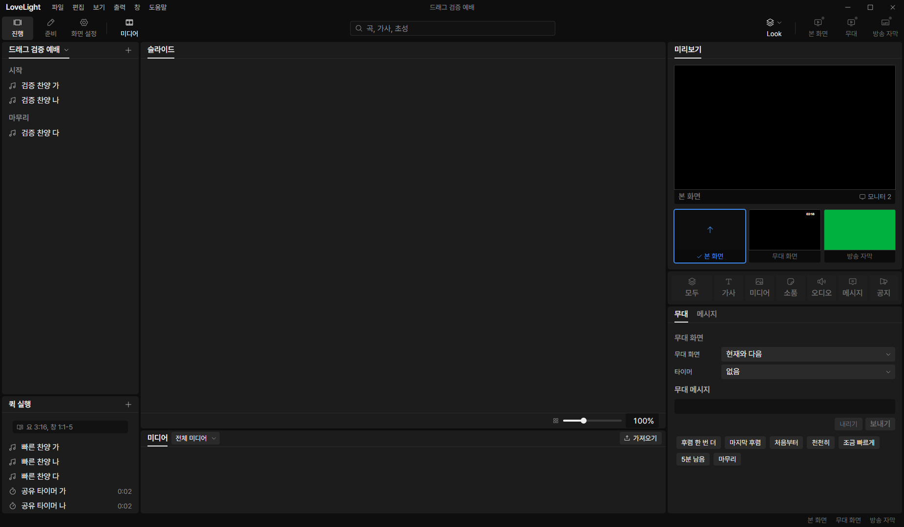
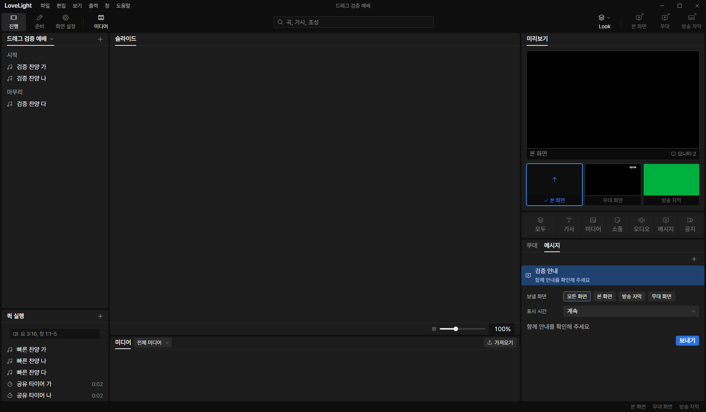
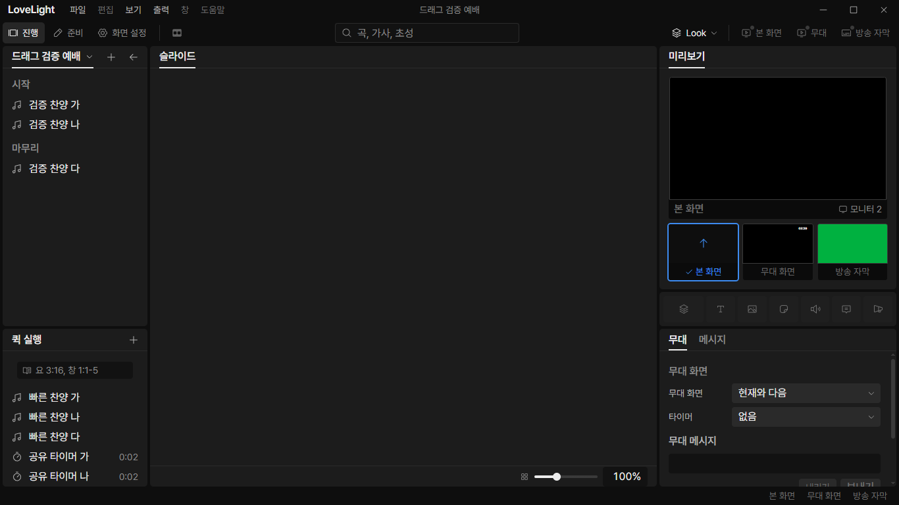
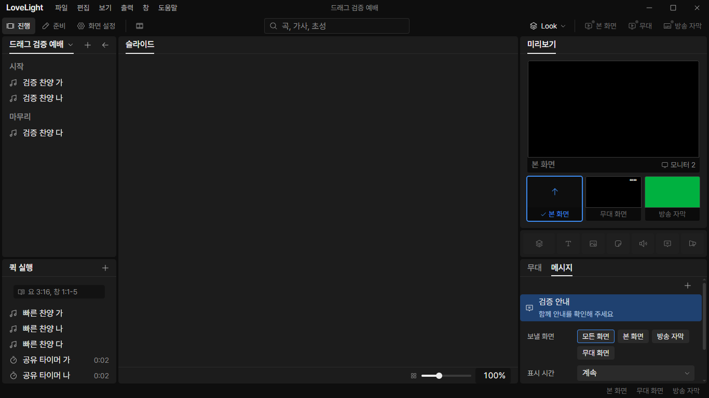

# Review request: `tools-20`

- Team member: tools
- Branch: `fix/tools/hide-empty-tabs`, from local main.
- Base, head and exact-head CI: in the report.
- Scope: M3-UX-01 from `docs/qa/m3-ux-pass.md` on `docs/qa/m3-ux`.

## What changed and why

Only working 무대 and 메시지 tabs are visible, at every supported window size.
The six empty shells and their empty overflow menu are hidden until their
controls exist. The session starts on 무대. An earlier session value pointing to
a hidden tab also renders and selects 무대, rather than an empty panel. The
intended future tab identities and ordering are retained. 타이머 will return
with its working panel.

Both available tabs fit the minimum right-column width, so the unused eight-tab
overflow measurement and ResizeObserver are removed. Working tab selection still
survives window size and workspace changes. Settings subscriptions are released
when switching panels or leaving the workspace.

The test API supplies validated empty documents for the now-mounted default
panel, preserving explicit failing-source overrides. This prevents unrelated
missing-fixture warnings from obscuring notification and file-error tests.

## Changes outside my paths

- `src/renderer/src/show/ShowToolsPanel.tsx`, `showTools.ts` and tests: frame
  and available tab list required by this UX fix.
- `src/renderer/src/state/showToolTab.ts`: initial working selection.
- `src/renderer/src/control/NarrowLayoutMount.test.tsx`: narrow navigation,
  focus retention and workspace persistence using available tabs.
- `src/shared/testing/fakeLlpApi.ts` and its test: valid empty settings for the
  mounted default panel. No production IPC or file contract changes.
- `src/renderer/src/render/screenIdentity.test.ts`: explicitly inject a failed
  read instead of depending on the default fake API rejecting screen reads.
- This review and screenshots.

## Checks and quality

Focused tests cover all six hidden previous selections, three window classes,
arrow navigation, nonempty controls, subscription cleanup and remounting. App
and notification regressions are included: 19 focused files, 186 tests passed.
Typecheck after rebasing onto main, changed-file ESLint, formatting and build
passed. CI is in the report. TSDoc audit: the changed comment is on exported
`ShowToolsPanel`; no private documentation comments are added.

## Checked in the app

Built and ran installed Electron with `LLP_TEST_WINDOWS=offscreen`, tools port
5183, CDP 9513 and the isolated invented fixture. `node --check` passed before
launching Electron and running the CDP script. Real mouse input selected the
working tabs. Added one invented message through real settings IPC to exercise
both panels with content, then restored the fixture. Normal and 1366 by 768
narrow viewports each had 30 warmup and 20 measured back-and-forth pairs.
Opened/closed the workspace twice and verified the selected message tab remained
selected.

The final build kept counts fixed for each panel and size:

| Viewport/panel  | Elements | DOM nodes | Listeners | Documents | GC heap         |
| --------------- | -------- | --------- | --------- | --------- | --------------- |
| Normal, stage   | 460      | 1,529     | 398       | 28        | 5.55 to 5.66 MB |
| Normal, message | 459      | 1,522     | 394       | 28        | 5.54 to 5.64 MB |
| Narrow, stage   | 438      | 1,492     | 395       | 27        | 5.77 to 5.80 MB |
| Narrow, message | 437      | 1,485     | 391       | 27        | 5.76 to 5.78 MB |

The final ten narrow pairs changed each heap by less than 5 KB. No DOM or
subscription accumulation was observed.

## Team member's reply

CI follow-up: run 40367927960 failed because the screen-identity error test
implicitly used the former missing-document default. Reproduced locally:
`screenIdentity.test.ts` had one failure at line 127. The test now injects its
read error explicitly and verifies the exact error is forwarded once, while
retaining the late-resolution cleanup check. No production change is needed.
Rebased onto current local main and included ShowPanels, App and PrepMount in
the local regression checks. Updated results are in the round 2 report.
