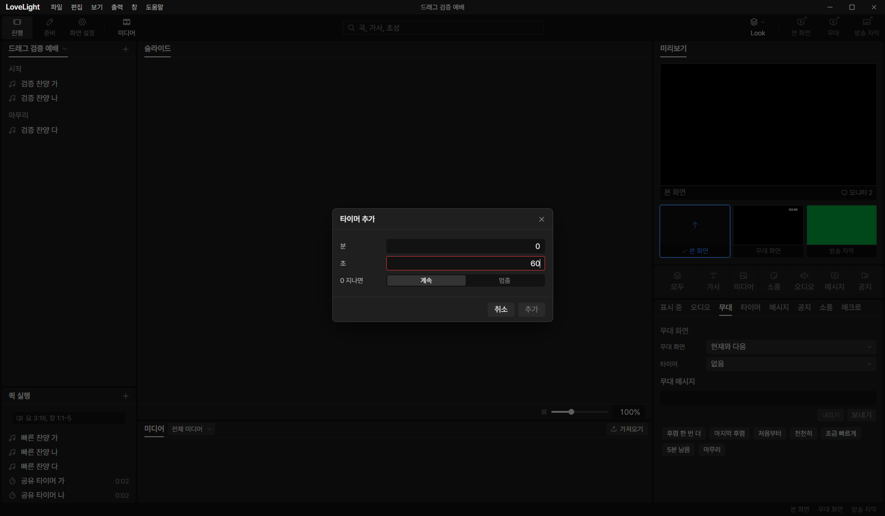
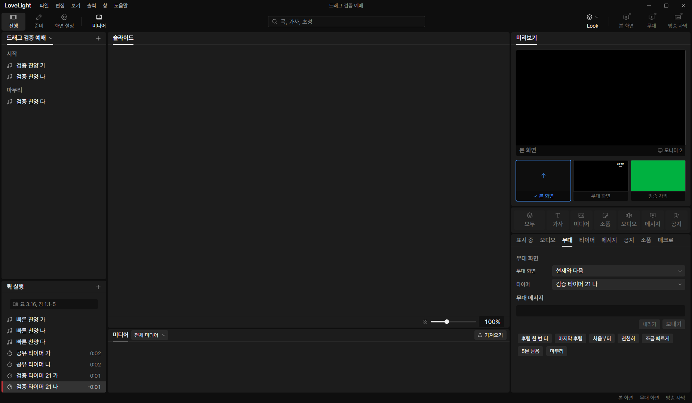

# Review request: `tools-21`

- Team member: tools
- Branch: `feat/tools/quick-timer-dialog`, from local main with tools-19.
- Base, head and CI status: in the report.
- Scope: the October 26/27 quick timer creation and rename decisions.

## What changed and why

The quick add menu opens a duration dialog instead of offering existing timers.
Whole minutes and seconds are validated together, with inline rings and tooltip
reasons. Zero, negative, fractional, malformed and oversized durations cannot be
added. Cancel creates nothing. Each accepted addition uses fresh checked IDs and
the paired main command to create its definition and quick row together, with
the next available numbered name.

The dialog offers 계속 or 멈춤 for the countdown's overrun behavior. This
extends the create command additively with optional Boolean `overrun`; an
omitted value retains the continue default. Idempotent retries compare the
effective overrun choice as well as IDs and duration.

Renaming a timer row uses the paired timer rename command, keeping its
definition and stage picker name in sync. Other quick edits retain their
existing path. Creation, rename reads and writes remain in the shared close
gate. Stable dialog IDs and applied-but-unsaved handling prevent a retry from
creating a duplicate. Persistence warnings are retained.

## Changes outside my paths

- `src/shared/schema/quickTimerEdit.ts` and its tests: additive optional overrun
  field, with valid and invalid boundary cases.
- `src/main/store/quickTimerEdits.ts` and tests: persist the choice and compare
  its effective value on an idempotent retry. Existing atomic pair, name,
  read-only and capacity rules remain in place.
- This review and screenshots.

`TimerDurationFields` is shared within the tools area so the timer editor can
use the same parsing and fields. There are no new UI styles or dependencies.

## Checks and quality

Five focused files, 92 tests passed. Cases cover duration boundaries, default
and explicit overrun retries, dialog focus from the menu, cancellation, stable
identities after refusal, locked submission, paired rename, deferred rename
reads during close, and an applied addition with a disk warning. Typecheck,
changed-file ESLint, formatting and build passed. No new TSDoc comments are
added.

## Checked in the app

Built and ran installed Electron with `LLP_TEST_WINDOWS=offscreen`, tools port
5183, CDP 9513 and isolated invented data. Checked the launcher and CDP scripts
with `node --check` before running them. Used real CDP mouse and keyboard input
for the menu, dialog, row commands and stage selection.

- Opened and cancelled twice, including Enter on zero. No row or definition was
  created. Seconds `60` showed the error ring and blocked adding.
- Created two one-second timers with different IDs. Stop-at-zero completed;
  restarting used the full duration. Continue remained running past zero.
- Renamed the rows and verified matching definition names. Selected the new name
  in the real stage picker and verified the exact newly created ID. Used
  distinct fixture names to avoid selecting an older same-name timer.
- After 15 warmup cycles, repeated add, rename, start and reset 20 times.
  Restored the original quick and timer snapshots through real settings IPC
  after each measured cycle. All fixtures were restored after the check.
- Element count 472, DOM nodes 1,550, listeners 692 and documents 29 stayed
  fixed. GC heap was 5.86 to 6.09 MB; the last five cycles changed it by 12 KB.
  No DOM or subscription accumulation was observed.

## Team member's reply

No findings yet.

## Verdicts (recorded by the lead at merge)

- Final round (7f02e9ab): reviewer (Codex) Approve. Lead Approve after reading
  the store change (the overrun choice is kept when a quick timer is created).
  The exact-head CI run passed, checked by the lead at merge. Rebased by the
  lead onto local `main` without conflicts; typecheck passes. Earlier rounds'
  findings and replies are above.
