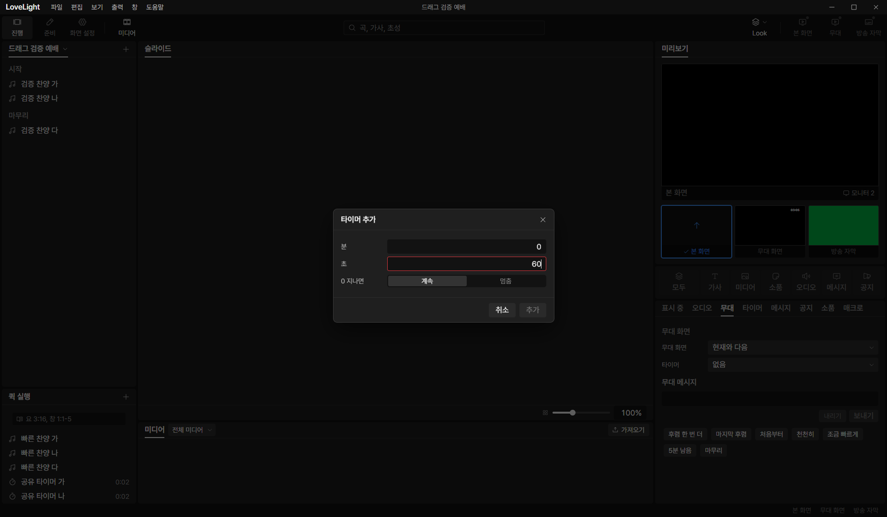
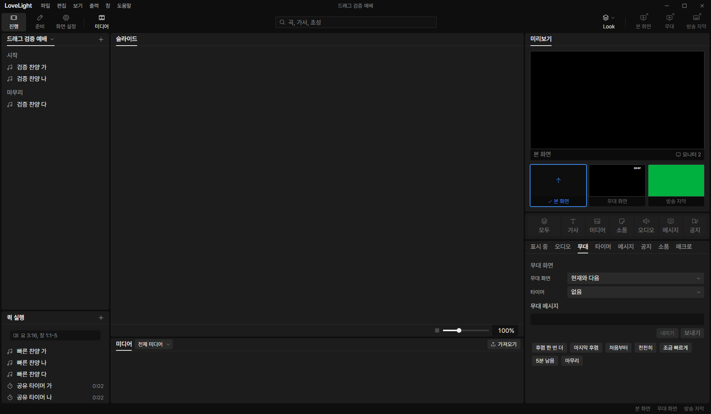

# Review request: `tools-22`

- Team member: tools
- Branch: `feat/tools/timer-tab`, stacked on tools-21.
- Base, head and CI status: in the report.
- Scope: shared creation and dialog behavior for the working timer tab.

## What changed and why

The standalone countdown writer creates a definition without adding a quick row.
It reads the latest document, preserves unknown fields, checks capacity and edit
access, and retries a stale revision twice at most. The whole read, retry and
write operation participates in the window close gate. An identical
ID/configuration is already applied; an occupied ID with different settings is
rejected. An applied disk warning is returned without retrying the write.

The quick and standalone flows share the unused numbered-name rule and
500-definition limit. Existing imports of the limit remain compatible. The
existing quick add dialog now delegates its duration and overrun form to a
shared countdown dialog, keeping checked IDs and paired writes in its quick
wrapper. Its operator behavior is unchanged.

The timer panel, virtual rows and runtime controls are the next request. This
keeps the shared writer and dialog reuse separately reviewable.

## Changes outside my paths

- `src/shared/timerNames.ts` and test: common unused numbered-name rule.
- `src/shared/schema/timers.ts` and `quickTimerEdit.ts`: move and reexport the
  existing definition limit. No IPC or persisted shape changes.
- `src/main/store/quickTimerEdits.ts`: use the shared name rule with the same
  combined definition/quick-row names as before.
- This review and screenshots.

## Checks and quality

Focused tests cover close during a deferred read, stale retries, idempotence, ID
collisions, read-only/capacity refusal, invalid durations, applied disk warnings
and the unchanged quick dialog flow. Counts, typecheck, lint, formatting, build
and CI status are in the report. No new TSDoc comments.

## Checked in the app

Built and ran installed Electron offscreen with tools port 5183, CDP 9513 and
the isolated invented fixture. Checked both launcher and CDP script with
`node --check` before running them. Used real mouse and keyboard input on the
shared dialog through quick add.

Opened/cancelled twice, verified invalid seconds block adding, then created
separate stop/continue timers, renamed them and selected the exact new ID by its
distinct name in the stage picker. After warmup, repeated add, rename, start and
reset 20 times and restored the original settings after each cycle. Element
count 472, DOM nodes 1,550, listeners 692 and documents 29 stayed fixed. GC heap
was 6.33 to 6.60 MB across the measured cycles, a 4.2 percent range; the last
five changed it by 42 KB. Releasing CDP object groups did not materially change
the reading. No DOM or subscription accumulation was observed.

## Team member's reply

No findings yet.

## Verdicts (recorded by the lead at merge)

- Final round (feced3ea): reviewer (Codex) Approve. Lead Approve; the
  main-process change only moves the timer name rule into a shared helper (read
  by the lead). The exact-head CI run passed, checked by the lead at merge.
  Rebased by the lead onto local `main` without conflicts; typecheck passes.
  Earlier rounds' findings and replies are above.
