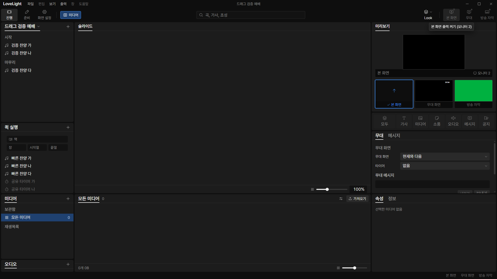
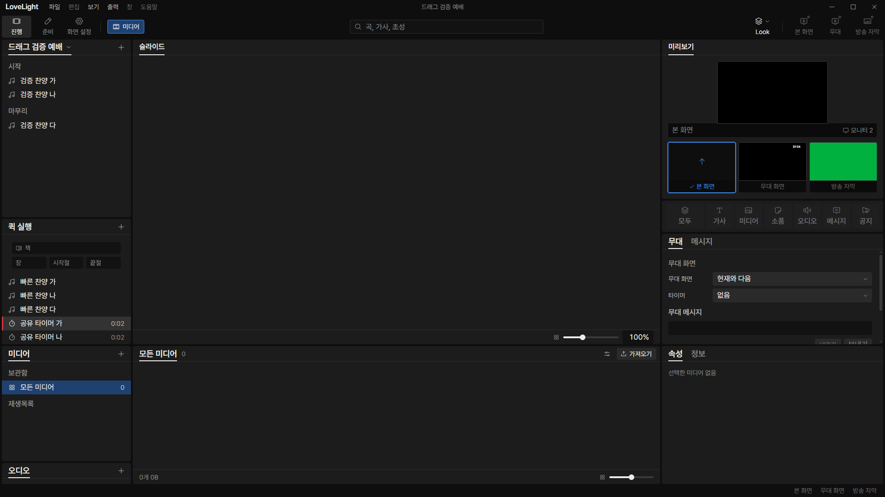
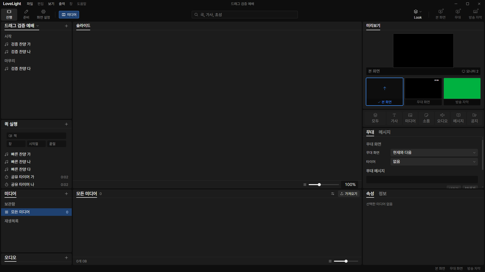

# Review request: `tools-27`

- Team member: tools
- Branch: `fix/tools/orphan-timer-runs`, independent of the timer-panel stack.
- Base, head and CI status: in the report.
- Scope: release deleted timer runs and reclaim their live slots.

## What changed and why

Removing definitions cleared the selected stage timer but left their running or
paused records in live state. Those invisible records kept counting against the
200-live-timer limit, so a later timer could not start even with an empty
library. The regression reproduced both stale running/paused records and all 200
occupied slots after definition removal.

The existing settings follower now resets only IDs absent from the new timer
document and clears a removed stage selection. It preserves retained runs,
including name-only edits. Commands use the existing bounded batch helper; the
current maximum is 200 resets plus the stage clear. No new listener, clock, IPC
command or saved field. The old completion test now expects the removed run to
be absent while still checking that its completion timeout is cancelled.

This is a small prerequisite for timer-definition deletion. It does not wait on
the panel, creation-mode or rename requests.

## Changes outside my paths

- `src/main/live/overlayRefresh.ts` and `overlays.ts`: reconcile removed timer
  runs through existing live commands.
- `timerRemoval.test.ts` and `timerCompletion.test.ts`: removal, capacity,
  retained-run and lifecycle regressions.
- Spec 04: definition removal frees the runtime slot.
- This review and screenshots.

## Checks and quality

Five focused files, 45 tests passed, with typecheck, lint and build. Tests cover
running/paused removal, retained runs, name-only and unrelated settings changes,
the full live cap, a fresh start after removal, cancelled scheduling and
released subscriptions. Formatting, rebase checks and CI status are in the
report. The changed TSDoc comment is on an exported declaration.

## Checked in the app

Built and ran installed Electron offscreen with tools port 5183, CDP 9513 and
invented isolated fixtures. Checked launcher and driver with `node --check`
before Electron. Seeded the full 200-run boundary through IPC, selected the
stage timer through real CDP input, removed definitions through the existing
settings API, then restored the fixture and started/reset a timer through its
real quick row. No system clipboard or user data was used.

Repeated three measured sets of 20 cycles after warmup and reopened the
workspace twice per set. Elements 516, DOM nodes 1,617, listeners 698 and
documents 29 stayed fixed. The first two sets used repeated full-state IPC reads
for assertions; their GC heap ranges were 6.61 to 6.96 MB and 7.31 to 7.45 MB.
Because the early reading rose, changed only the driver to follow ordinary
live-state pushes. The final 20-cycle set measured 7.13 to 7.24 MB, below the
earlier peak; its last five cycles changed it by 12 KB. No DOM or subscription
accumulation was observed. Restored original timer definitions and stage
selection after every set.

## Team member's reply

No findings yet.

## Verdicts (recorded by the lead at merge)

- Final round (0813dd89): reviewer (Codex) Approve. Lead Approve; the lead read
  the live overlay diff (when a 타이머 definition is removed, its run is reset
  and the stage choice cleared in one batch, so orphan runs no longer keep live
  slots). The exact-head CI run passed, checked by the lead at merge. Rebased by
  the lead onto local `main` without conflicts; typecheck passes. Earlier
  rounds' findings and replies are above.
