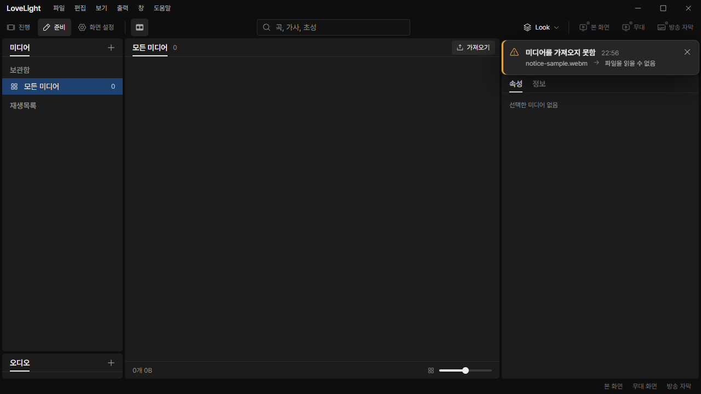
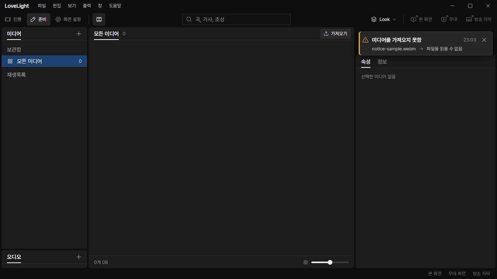
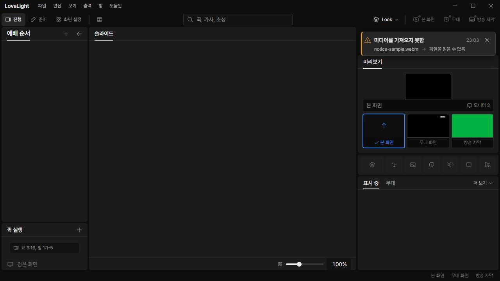

# Review request: `ui-50`

- Team member: `ui` (Codex)
- Branch: `fix/ui/notice-check3`
- Base, range, commit and exact-head CI: see the request message
- Task: M3-C3-5, the shared notification treatment

## What changed and why

The media import failure card touched the panel corners, used a heavy dialog
shadow and faded in while changing the right column's layout. Its detail arrow
sat in an inline wrapper with baseline space below the icon.

All notices now share an inset card using the panel corner radius and popover
shadow. The leading icon, title and close control share a 26px line. The time
aligns to the trailing edge; metadata wraps inside the card. The arrow wrapper
uses flex alignment, so its 12px box has no baseline gap. Arrival, replacement
and dismissal are immediate. Existing information lifetime, pause, replacement,
three-card cap and warning space reservation remain covered by tests.

Design-system README, CSS, generated bundle and both galleries describe the same
treatment. Compared with adjacent panels and menus: `bg-raised` remains the
floating surface, `radius-lg` matches panel corners, and `shadow-popover` avoids
the heavier dialog treatment. No workspace-specific notice was added.

M3-C3-7 moved to output by the lead's decision. This request does not change
ScreenPreview or OutputRenderer.

## Changes outside my paths

- Design-owned Notification README/preview, source CSS, generated bundle and
  project README: placement, alignment, wrapping and immediate motion policy.
- `docs/reviews/assets/ui-50/`: offscreen real-app screenshots and measurements.
- `docs/reviews/ui-50.md`: this review record.

## Checked in the app

Built the app with `npm run build`. Ran the actual built main, preload and
renderer with `LLP_TEST_WINDOWS=offscreen`, an isolated worktree-local user-data
folder and the renderer served on the ui port, 5186. The audit wrapper passed
`node --check` before Electron was started hidden. CDP attached to the actual
control window and used `Input.dispatchMouseEvent`, `Runtime.evaluate`,
`Page.captureScreenshot` and `HeapProfiler.collectGarbage`.

Opened 준비, enabled 미디어 and delivered a controlled failed-copy progress
event on the real preload channel. This reproduces the backend I/O fault without
opening a native file dialog; the production MediaLibrary, session,
NotificationStack and workspace layout handled it. This does not claim to test
the native picker or file-copy implementation.

- Switched 정보/속성 back and forth 20 times while the warning was displayed.
- Closed/reopened the media view and dismissed/reported the warning 20 times.
- Repeated notice dismissal/reporting 20 more times, plus two additional
  open/close cycles. Switched back to 진행 and checked the same card above the
  preview. Also checked 1920x1080.
- At 1280x720, the card is 344x60 at (924,82), within its 360px outer column.
  The arrow and wrapper are both 12px high and centered on the 16px detail line.
  Computed card animation is `none`; there is no horizontal document overflow.
- DOM count remained 154 at all three matched media-view checkpoints. After
  warmup, collected JS heap was 5,791,412 then 5,901,956 bytes (0.11 MiB
  difference); backing storage stayed 1,665,761 bytes. No accumulating cards,
  elements or unbounded growth was observed in these repetitions. This is a
  short regression exercise, not a long-running soak.

Before, actual app at 1280x720:

After, same media failure and minimum window:

After, the same shared card next to the Show preview and panels:

[Wide window screenshot](assets/ui-50/after-wide.png).

## Checks run

- Notification, mounted output-notice and component-gallery tests: 33 passed.
- Typecheck, targeted ESLint, formatting and `git diff --check`: passed.
- Build and real-app checks above: passed.
- CI pending (API 403). The lead confirms exact-head CI before merge.

## Team member's reply

Pending review.
