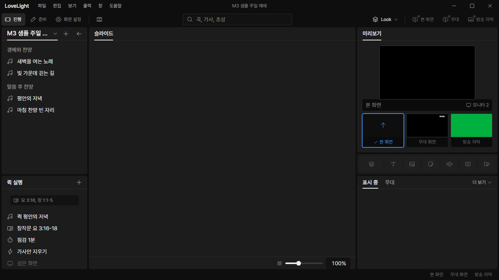
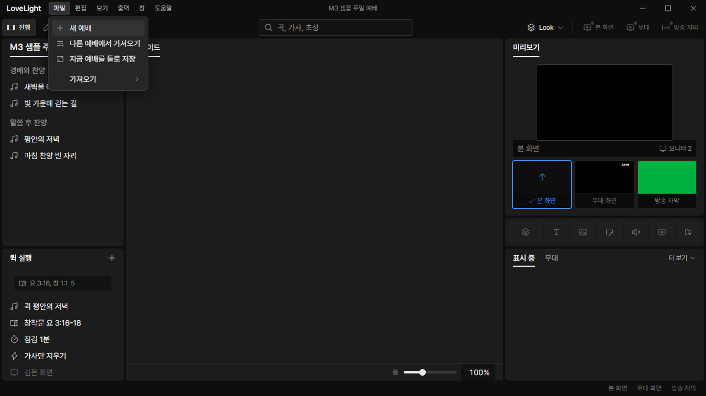
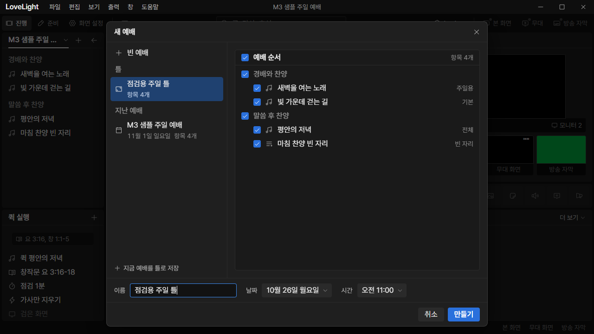
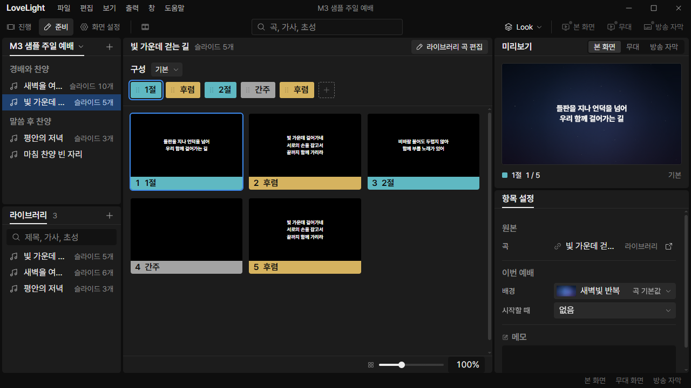

# Review request: `ui-51`

- Team member: `ui` (Codex)
- Branch: `feat/ui/type-scale`
- Base, range, commit and exact-head CI: see the request message
- Task: one-step larger general UI type scale after the M3 live check

## What changed and why

The operator found general text too small. The design-system token source,
README and Typography gallery now propose the following scale. The app follows
the generated tokens; the font family and weights stay the same.

| Style                                                    | Before, size/line height | After, size/line height |
| -------------------------------------------------------- | ------------------------ | ----------------------- |
| Heading                                                  | 18/24                    | 20/28                   |
| Title                                                    | 14/20                    | 16/22                   |
| Body and strong body, including list rows and menu items | 14/20                    | 16/22                   |
| Label                                                    | 12/16                    | 14/20                   |
| Strong label, band and strong caption                    | 14/20                    | 16/22                   |
| Caption and toolbar label                                | 12/16                    | 14/20                   |
| LIVE micro                                               | 12/16                    | 12/16                   |
| Output and thumbnail lyrics                              | Output-relative          | Unchanged               |

Single-line rows remain 30px, menu rows 28px and controls 26/30px. Two-line rows
grow from 44 to 52px and count badges/keycaps from 18 to 22px. Source preview
CSS uses the named type tokens instead of older 11/13px literals, so the
existing state galleries follow the scale too. Button, ListRow, Menu and
Notification measurements are updated alongside the new Typography card.

The real-app exercise exposed 15px of outer vertical scrolling in Prep after
selecting a song: the embedded panel wrapper did not constrain its child's
height. Making it a flex column lets the panel body scroll within its assigned
height. With the larger text, the actual 1280x720 app now fits exactly in both
directions. Long service names still ellipsize with their existing tooltips.

## Changes outside my paths

- Design-owned token JSON/generated CSS, project README, component READMEs,
  preview CSS/generated bundle and Typography gallery: the proposed scale.
- `styles/tokens.css` and `styles/designSystemAssets.node.test.ts`: copied app
  tokens and the chosen scale/line-fit contract, preserving output-relative
  text.
- Shell-owned `Workspace.module.css` and layout regression: constrain embedded
  panels so the larger type fits the minimum window.
- Review screenshots/measurements in `docs/reviews/assets/ui-51/` and this file.

## Checked in the app

Ran `npm run build`, then the actual built main, preload and renderer with
`LLP_TEST_WINDOWS=offscreen`. The renderer was served on ui's port 5186 and
Electron was launched hidden. The audit script passed `node --check` before
launch. The isolated worktree-local profile copied the tracked M3 sample, which
contains invented song text and no enabled outputs. Native dialogs were not
used.

CDP drove pointer input, screenshots, DOM measurements and collected-heap
measurements in the real control window:

- At 1280x720, opened File, opened/cancelled New Service, and checked title,
  labels, date/time controls and two-line source rows. Opened/closed File twice.
- Switched between the first two service songs and between Prep and Show 20
  times, then repeated another 20 cycles. Each matched checkpoint ended on the
  second song in Show. Checked the selected song's Prep properties afterward.
- Computed body/list-row text is 16/22, and service rows remain 30px tall.
- DOM count remains 449 at the matched checkpoints. The collected heap and
  backing-store readings are recorded in [metrics](assets/ui-51/metrics.json).
  The post-warmup difference stays below 1 MiB, with no accumulating elements.
- Prep's outer client/scroll sizes are both 1280x720 after the wrapper fix:
  [layout measurement](assets/ui-51/prep-layout.json). No outer horizontal or
  vertical scroll is needed. The properties panel scrolls internally.
- Viewed the resulting screenshots. They show the actual Korean UI, including
  service rows, menu items, dialog source rows, labels and the editor controls.

Before:

After:

## Checks run

- Token/assets, Menu, ListRow, gallery and Workspace layout tests: passed.
- Typecheck, targeted ESLint, formatting and `git diff --check`: passed.
- Build and the real-app CDP exercise above: passed.
- CI pending (API 403). Lead confirms exact-head CI before merge.

## Team member's reply

Pending review.

## Verdicts (recorded by the lead at merge)

- Round 1 (97b383e7): reviewer (Codex) Approve. Lead Approve through the lead's
  merge check: the exact-head CI run passed, the branch rebased onto local
  `main` without conflicts, and typecheck passes. Earlier rounds' findings and
  replies are above.
