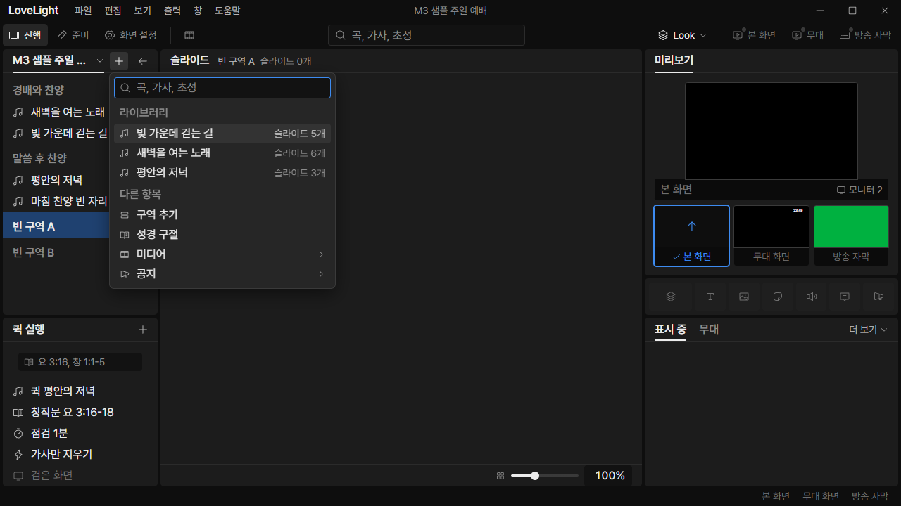
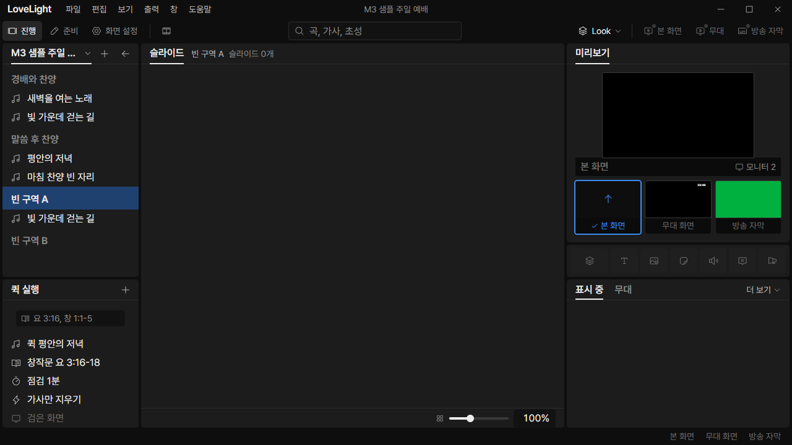

# Review request: `ui-52`

- Team member: `ui` (Codex)
- Branch: `fix/ui/remove-slot-actions`
- Base, range, commit and exact-head CI: see the request message
- Task: remove slot creation/filling and add into the selected section

## What changed and why

Under the user's slot-removal decision and spec-58, 항목 추가 no longer offers
빈 자리 or its submenus. Song and Bible choices always insert new items at the
end of the selected section, before the next section. An item selection uses
that item's section; no selection appends to the service. Existing
`quickAddBefore` already implements that boundary rule.

Sections now participate in the service list's pointer, Tab and arrow selection,
including empty, consecutive and final sections. `ListGroup` opts in with
`value`, reusing the shared ListRow option/rename behavior. Passive group labels
elsewhere retain their behavior. A document update keeps the selected section
when its id remains. Adding content keeps the header and its unknown fields.

Removed `fillSlotWithSong`, `fillSlotWithPassage`, all callers and the special
drag-and-drop fill destination. Dropped library songs insert at the pointer's
normal boundary instead. Deleted obsolete fill regressions and added empty
section insertion, selection, update and drop coverage. No command targets live
output from section selection or service edits.

The rebase retains tools-13's midpoint and drag-release click guard. Geometry
now reads the actual option face for selectable headers; the preserved tests
cover list-top drops and moving whole sections across the midpoint.

Coordination: spec-58 is on local main (`a5bba3d7`). Data owns legacy
slot-to-header normalization and its read/write contracts. This request does not
change the stored format or duplicate normalization. A legacy slot arriving as a
section uses the same selectable-header path. Existing slot rendering remains
available until those normalized documents arrive; there is no creation or fill
action.

## Changes outside my paths

- Prep-owned QuickAdd/menu models and tests: remove slot choices and fill
  branches; verify song and Bible insertion into a selected empty section.
- Show-owned ServiceOrderList, drag handling and editing tests: select sections
  and use normal song insertion on drop, preserving rename, undo and output.
- State-owned serviceOrderEdits and tests: remove the obsolete fill APIs.
- State-owned show selection and service tests: retain selected header ids
  through updates and clear them when deleted.
- Design-owned ListRow README/preview/source CSS/generated bundle: selectable
  sections alongside passive groups. UI gallery demonstrates the new state.
- This review file and `docs/reviews/assets/ui-52/` evidence.

## Checked in the app

Built with `npm run build`. Ran the actual main/preload/renderer offscreen with
`LLP_TEST_WINDOWS=offscreen`, ui's port 5186 and an isolated worktree-local copy
of the tracked M3 sample. The audit passed `node --check` before Electron was
started hidden. CDP drove pointer/key/text input and captured the real window.

- Added two consecutive empty sections, renamed them, selected the first and
  opened 항목 추가. Confirmed the menu has no 빈 자리 entry.
- Inserted the library song 빛 가운데 걷는 길 through that menu. Read the
  accepted document through the real API: first header, new song, second header,
  with the first section still selected. Both section rows remain.
- Switched the two sections back and forth 20 times, then another 20 times.
  Opened/closed the quick-add menu twice. No outputs were enabled.
- Matched checkpoints retain 430 DOM elements and 9 options. Collected JS heap
  after warmup was 5,788,568 then 5,951,816 bytes; backing storage was 1,685,579
  then 1,685,585 bytes. No horizontal outer scroll or accumulated rows were
  observed. These are short regression repetitions, not a long-running soak.

[Selected final empty section](assets/ui-52/empty-section.png),
[measured DOM/heap and accepted order](assets/ui-52/metrics.json).

The retained legacy slot visible in the old sample is existing data, not a menu
command. Data's normalization converts it to a section on read.

## Checks run

- QuickAdd/menu/position, service editing/state, ListRow and gallery tests:
  passed. Final counts are in the request message.
- Typecheck, targeted ESLint, formatting and `git diff --check`: passed.
- Build and real-app CDP checks above: passed.
- CI pending (API 403). Lead confirms exact-head CI before merge.

## Team member's reply

Pending review.
