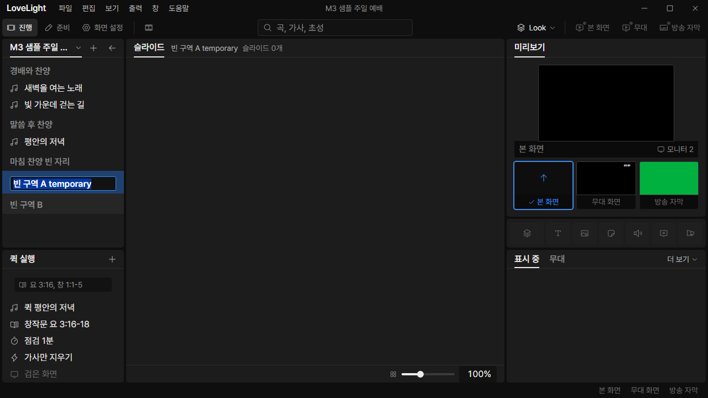

# Review request: `ui-52`

- Team member: `ui` (Codex)
- Branch: `fix/ui/remove-slot-actions`
- Base, range, commit and exact-head CI: see the request message
- Task: remove slot creation/filling and add into the selected section

## What changed and why

Under the user's slot-removal decision and spec-58, 항목 추가 no longer offers
빈 자리 or its submenus. Song and Bible choices always insert new items at the
end of the selected section, before the next section. An item selection uses
that item's section; no selection appends to the service. Existing
`quickAddBefore` already implements that boundary rule.

Sections now participate in the service list's pointer, Tab and arrow selection,
including empty, consecutive and final sections. `ListGroup` opts in with
`value`, reusing the shared ListRow option/rename behavior. Passive group labels
elsewhere retain their behavior. A document update keeps the selected section
when its id remains. Adding content keeps the header and its unknown fields.

Removed `fillSlotWithSong`, `fillSlotWithPassage`, all callers and the special
drag-and-drop fill destination. Dropped library songs insert at the pointer's
normal boundary instead. Deleted obsolete fill regressions and added empty
section insertion, selection, update and drop coverage. No command targets live
output from section selection or service edits.

The rebase retains tools-13's midpoint and drag-release click guard. Geometry
now reads the actual option face for selectable headers; the preserved tests
cover list-top drops and moving whole sections across the midpoint.

Coordination: spec-58 (`a5bba3d7`) and data-71 normalization (`3ca885ad`) are on
local main. This request uses data's reader instead of duplicating
normalization. The migrated-section regression is retained, and the app exercise
confirms the old sample slot arrives as a selectable header with its title
preserved.

## Changes outside my paths

- Prep-owned QuickAdd/menu models and tests: remove slot choices and fill
  branches; verify song and Bible insertion into a selected empty section.
- Show-owned ServiceOrderList, drag handling and editing tests: select sections
  and use normal song insertion on drop, preserving rename, undo and output.
- Round 3, `show/ShowPanels.test.tsx`: align the existing panel integration
  assertions with selectable sections, including the first Tab stop and
  Home/arrow focus and selection, with no output.
- State-owned serviceOrderEdits and tests: remove the obsolete fill APIs.
- State-owned show selection and service tests: retain selected header ids
  through updates and clear them when deleted.
- Design-owned ListRow README/preview/source CSS/generated bundle: selectable
  sections alongside passive groups. UI gallery demonstrates the new state.
- This review file and `docs/reviews/assets/ui-52/` evidence.

## Checked in the app

Built with `npm run build`. Ran the actual main/preload/renderer offscreen with
`LLP_TEST_WINDOWS=offscreen`, ui's port 5186 and an isolated worktree-local copy
of the tracked M3 sample. The audit passed `node --check` before Electron was
started hidden. CDP drove pointer/key/text input and captured the real window.

- Added two consecutive empty sections, renamed them, selected the first and
  opened 항목 추가. Confirmed the menu has no 빈 자리 entry.
- Round 2: focused a section, opened its native context menu, chose 이름 바꾸기
  and waited past menu cleanup. The field stayed focused with its text selected;
  typed a new name and saved with Enter before continuing the flow.
- Inserted the library song 빛 가운데 걷는 길 through that menu. Read the
  accepted document through the real API: first header, new song, second header,
  with the first section still selected. Both section rows remain.
- Switched the two sections back and forth 20 times, then another 20 times.
  Opened/closed the quick-add menu twice. No outputs were enabled.
- Round 3: repeated the app exercise after rebasing onto local main. Home
  focused the first section; Down focused the next row. Rename and insertion
  still passed. The updated screenshots show this rebased build.
- Matched checkpoints retain 431 DOM elements and 9 options. Collected JS heap
  after warmup was 5,948,804 then 6,083,832 bytes; backing storage stayed at
  1,702,593 bytes. No horizontal outer scroll or accumulated rows were observed.
  These are short regression repetitions, not a long-running soak.

[Selected final empty section](assets/ui-52/empty-section.png),
[measured DOM/heap and accepted order](assets/ui-52/metrics.json).

The old sample name containing 빈 자리 is preserved as a section title by data's
normalization. It is not a slot or a menu command.

## Checks run

- QuickAdd/menu/position, service editing/state, ListRow and gallery tests:
  passed. Final counts are in the request message.
- Typecheck, targeted ESLint, formatting and `git diff --check`: passed.
- Build and real-app CDP checks above: passed.
- CI pending (API 403). Lead confirms exact-head CI before merge.

## Team member's reply

Round 2: Reproduced the focused-section context-menu failure with a regression
that fails before the fix. The rename request now captures its service and
section, waits for menu cleanup/focus restoration, then opens the field. The
pending handoff is released on cleanup and checked against the current editable
service and section before it runs. The regression focuses the section before
opening its menu, keeps focus in the field and commits the edited name once.

Round 3: Rebased onto local main and reproduced all three reported failures in
`ShowPanels.test.tsx` (29 passed, 3 failed). They still expected passive section
text and the first media item as the Tab/Home target. Updated them to verify
selectable sections, a single Tab stop on the selected section/item, and focus
and selection through sections and items with Home/Down/Up/End. The assertions
also verify that section selection and navigation send no output. No production
behavior changed in this repair. The three affected suites now pass 90 tests;
typecheck, targeted lint and build pass. Repeated the actual app checks above.

## Verdicts (recorded by the lead at merge)

- Round 3 (a9f2135e): reviewer (Codex) Approve. Lead Approve through the lead's
  merge check: the exact-head CI run passed, the branch rebased onto local
  `main` without conflicts, and typecheck passes. Earlier rounds' findings and
  replies are above.
