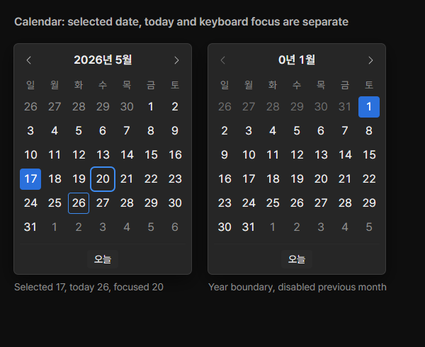

# Review request: `ui-53`

- Team member: `ui` (Codex)
- Branch: `feat/ui/calendar-design`, stacked on ui-52
- Base, range, commit and exact-head CI: see the request message
- Task: calendar design system and civil-date model, before the UI integration

## What changed and why

Date fields need a calendar rather than a short list of dates. This first
request defines its component README, reference gallery, states and tokens. The
following request builds the React popover and connects the date fields. No
operator-visible control switches to a calendar in this request.

The 250px popover holds seven 30px day columns with 4px gaps and 8px insets. The
grid always has six Sunday-first weeks. Selection uses the accent fill, today an
inset ring and keyboard focus a separate outer ring. Adjacent dates remain
selectable; cells outside years 0000 through 9999 are disabled. The README
covers month/year navigation, day/week keys, commit, dismissal, focus, viewport
placement, accessibility and motion using existing design tokens.

The unused civil-date module is the model for that UI. It validates ISO dates,
builds bounded month grids and moves days/months without local-time/DST drift or
JavaScript's year-1900 constructor behavior. Tests cover all twelve months,
invalid dates, leap years, short months, year boundaries and Korean labels.

Small documentation nits from the previous requests: the root editor text
measurements now match the chosen larger type scale, and the ListRow card's
height includes its added selectable-section specimen.

## Changes outside my paths

- Design-owned Calendar README/reference card/source CSS, token JSON/generated
  CSS/bundle and project README: the design and geometry/motion contract.
- `styles/tokens.css`: the same additive tokens copied for the upcoming UI.
- ListRow reference-card height and root editor typography note: documentation
  corrections to match the approved components.
- This review document and `docs/reviews/assets/ui-53/` evidence.

## Checked in the app

Built the actual app with `npm run build`, then ran its main/preload/renderer
offscreen on ui's port 5186 with an isolated copy of the M3 sample. The launcher
and reference-card script passed `node --check` before Electron was started
hidden. The design-only stage intentionally leaves the existing date list in
place; this is not a claim that the calendar integration is finished.

CDP opened New Service and exercised its current date field through 20 round
trips and another 20 repetitions, then opened/closed the list twice. Matched
DOM/collected-heap results are in [measurements](assets/ui-53/metrics.json).
Cancelled without creating a service. This checks that the additive tokens do
not disturb the current operator flow.

In the same offscreen process, rendered the new design-system reference card at
1x with CDP. It has two 250px cards, 84 day cells, two selections and six
disabled out-of-range cells; day width is 30px. Inspected the screenshot for
selected/today/focus distinction, disabled bounds, spacing and text fit.

[Actual date field before integration](assets/ui-53/app-before-integration.png).
The next request will repeat the real-app exercise against the connected
calendar, including keyboard navigation and focus return inside New Service.

Round 2 retains the original app/reference evidence above. This round rebases
the approved implementation onto current local main without changing its own
production code. The requested common and owned tests pass 97 cases.

## Checks run

- Civil-date and design-system asset tests: 48 passed.
- Typecheck, targeted ESLint, formatting, `git diff --check` and build: passed.
- CDP app/reference checks above: passed.
- CI pending. The dispatcher confirms the exact-head run before merge.

## Team member's reply

Round 2: Rebased onto local main `4e3cdb41`, dropping the old ui-52 parent.
ShowPanels, App, PrepMount, calendar dates and asset tests pass 97 cases;
typecheck passes. The approved implementation is unchanged.
