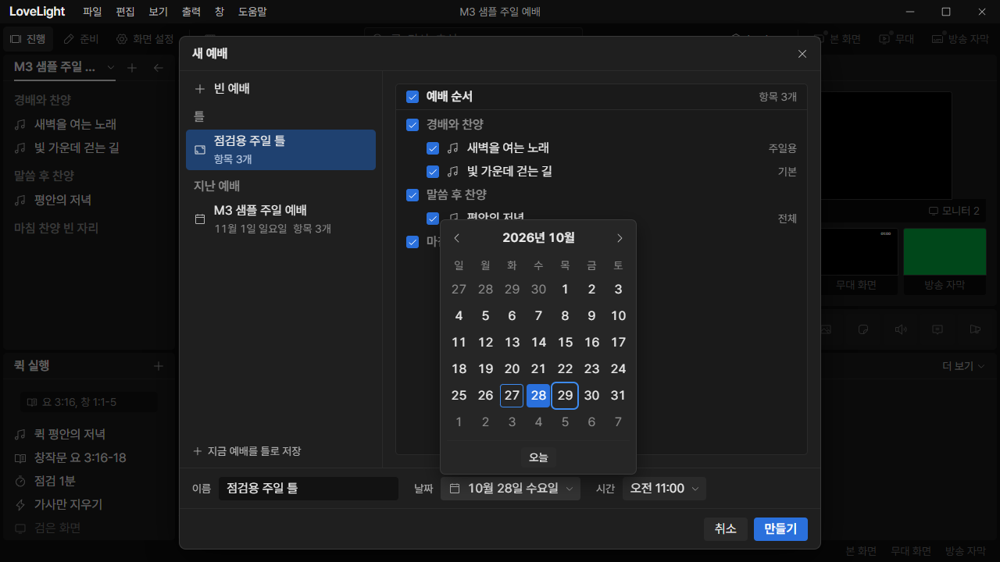
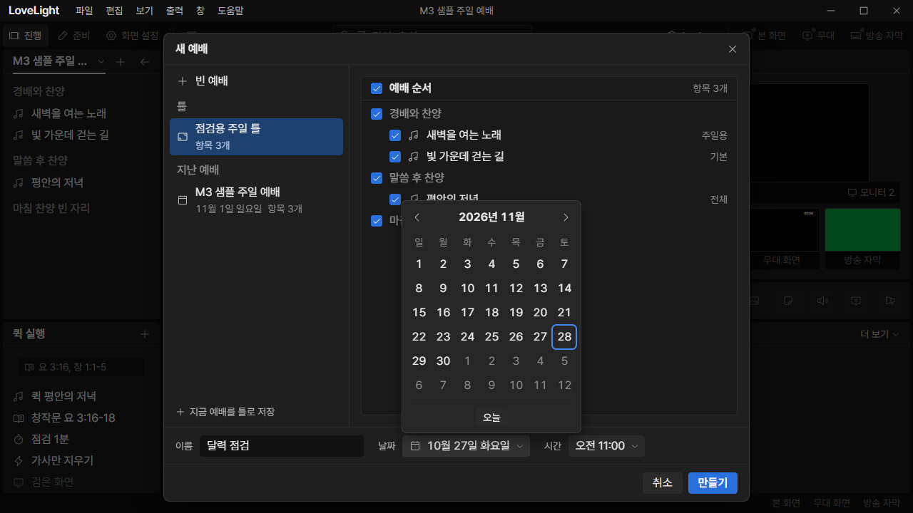
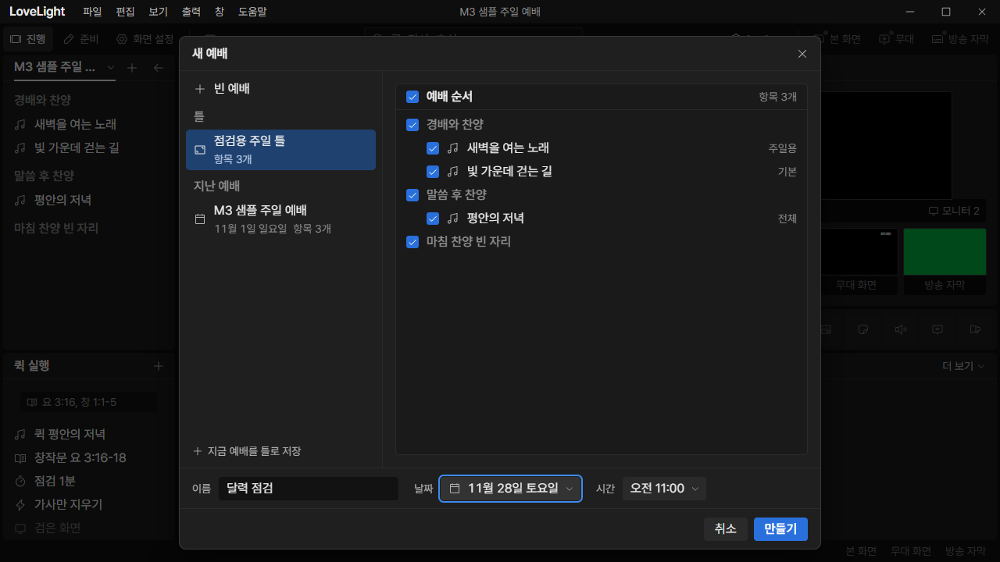

# Review request: `ui-54`

- Team member: `ui` (Codex)
- Branch: `feat/ui/calendar-popover`, stacked on approved ui-53
- Base, range, commit and exact-head CI: see the request message
- Task: connect the calendar design to the New Service date field

## What changed and why

New Service now opens the shared calendar instead of a list limited to nearby
dates. `DateSelect` keeps an ISO civil date as its controlled value. The
calendar ports ui-53's geometry, states and tokens without adding product copy.

Day/week/month/year keyboard navigation moves focus without committing. Native
Enter/Space or a day click commits; Today commits the local date. Tab cycles
through month navigation, one day and Today. Escape closes only the calendar and
returns focus to the field. Outside pointer dismissal keeps the clicked control
usable. Placement flips above the field when needed and releases all
outside/resize/scroll listeners and observers on close.

The old date-list builder is removed. Existing date labels use the bounded
civil-date model, including years below 0100. Time choices are unchanged.

## Changes outside my paths

- `prep/services/NewServiceDialog.tsx` and its test: replace the temporary date
  list and verify navigation does not prematurely create a service.
- `prep/services/serviceDates.ts` and its test: remove the obsolete list builder
  and share the date-label model.
- This document and `docs/reviews/assets/ui-54/`: native app evidence.

## Checked in the app

Built the real main/preload/renderer, then launched Electron hidden with
`LLP_TEST_WINDOWS=offscreen`, an isolated sample profile and ui port 5186.
`node --check` passed on the launcher before Electron started. CDP drove New
Service at 1280x720, the minimum window size.

- Checked Tab order and Escape dismissing only the calendar, with focus return.
- Changed dates back and forth 20 times, repeated another 20, then opened and
  closed the calendar twice. Outside dismissal focused the name input.
- Navigated into the following month and committed November 28. Enter on the day
  did not submit New Service. Create then saved exactly one service with date
  `2026-11-28T11:00`.
- Matched closed-popup checkpoints held 507 DOM elements, one parent dialog and
  zero date grids. Collected JS heap was 5.48 / 5.81 / 5.87 MB; the second
  repetition added 64 KB, with backing storage unchanged at 1,701,613 bytes.
  This is a short repetition check, not a long-running soak. No uncaught
  exceptions or horizontal overflow occurred.

The popover measured 250x325px and flipped above its field within the viewport.
Compared the screenshot with ui-53's reference: day size, selected fill,
separate today/focus rings, chevrons, adjacent-month text and field text fit.
[Measurements](assets/ui-54/metrics.json).

[Created service](assets/ui-54/created-service.png).

## Checks run

- Calendar, New Service, date formatting and UI gallery: 40 tests passed.
- Typecheck, targeted ESLint, formatting, `git diff --check` and build: passed.
- Offscreen native app exercise above: passed.
- CI pending (API 403). Lead confirms exact-head CI before merge.

## Team member's reply

Pending review.
