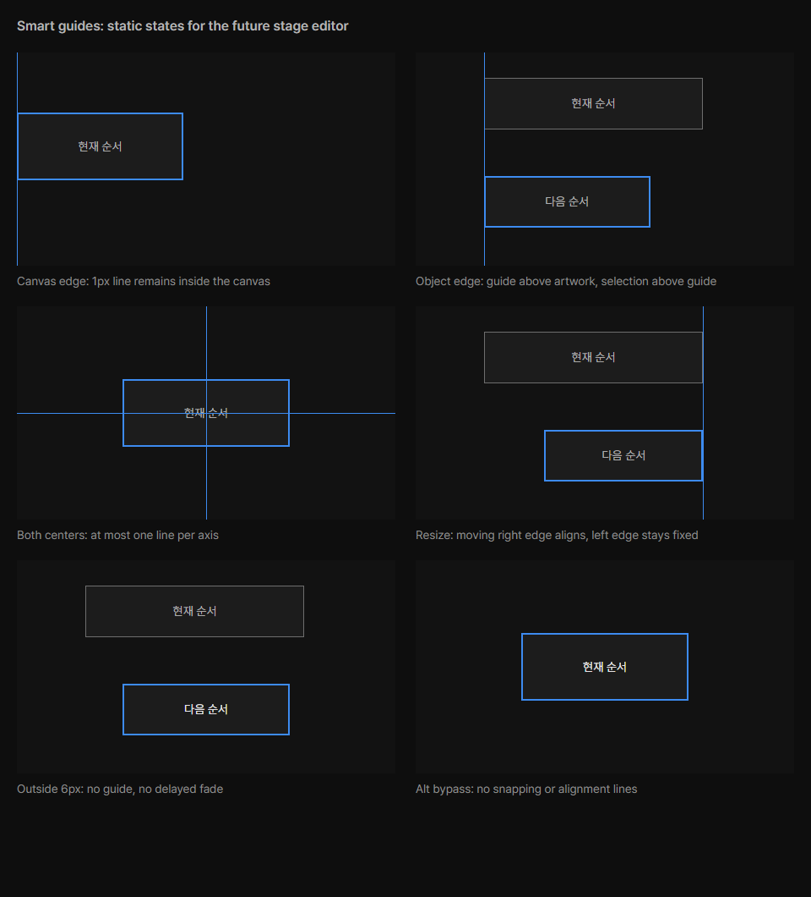

# Review request: `ui-55`

- Team member: `ui` (Codex)
- Branch: `feat/ui/smart-guide-design`, stacked on approved ui-54 round 2
- Base, range, commit and exact-head CI: see the request message
- Task: smart guide tokens, README and design gallery before M3-O3

## What changed and why

The stage layout editor needs shared values for alignment feedback. `guide`
aliases the existing `accent` color, `size-guide-line` is 1 CSS pixel and
`size-guide-snap` is 6 viewport CSS pixels. At zoom 50/100/200%, that threshold
is 12/6/3 document units; line width remains constant in an unscaled overlay.

The README defines canvas/element edges and centers, independent axes, nearest
stable matching, moving-edge resize, clipping, Alt bypass and precedence over
the separate 20px document grid. At most two lines appear, with no animation,
hit targets, saved state or output content. The reference card shows canvas
edge, object edge, both centers, resize, outside-range and Alt states.

This request prepares the design contract. It does not implement a stage editor
or claim that dragging, resizing and snapping already work. M3-O3 owns that
behavior and its real-app verification, using these tokens.

## Changes outside my paths

- Design-owned SmartGuides README/card, source CSS/generated bundle, project
  README and token source/generated CSS: requested design-first contract.
- `styles/tokens.css`: copy the same additive tokens for the editor consumer.
- `styles/designSystemAssets.node.test.ts`: check that token source and both
  generated/renderer CSS copies agree.
- This document and `docs/reviews/assets/ui-55/`: offscreen evidence.

## Checked in the app

Built the real app, then ran its main/preload/renderer hidden with
`LLP_TEST_WINDOWS=offscreen`, an isolated sample profile and ui port 5186. The
launcher passed `node --check` before Electron started. The operator flow is
unchanged in this preparatory request.

CDP exercised the current New Service date selection through 20 round trips,
then another 20, and opened/closed the popup twice at 1280x720. Cancelled
without creating a service. Matched checkpoints held 507 DOM elements, with
collected JS heap 5.61 / 5.93 / 5.99 MB. The second repetition added 64 KB;
backing storage stayed at 1,714,496 bytes. No horizontal overflow or uncaught
exceptions occurred. This checks the additive tokens against the current app; it
is not an editor snapping test or a long-running soak.

In the same offscreen process, opened and closed the design reference window
twice. Each card set has six scenes, five visible lines and two hidden overlays.
CDP verified 1px strokes, the accent color, 6px threshold token, disabled
pointer hit testing, no motion and no horizontal overflow. Repeated show/hide 20
times per opening: 61 elements stayed constant, collected heap stayed near 1.11
MB and backing storage stayed at 126,161 bytes. These are static reference
states, not simulated editor gestures.

Inspected the reference screenshot for edge/center positions, clipping, line
weight, selection layering and the two states with no guides.
[Measurements](assets/ui-55/metrics.json).

[Current app date flow after the additive tokens](assets/ui-55/app-current-calendar.png).

## Checks run

Round 2 retains the app/reference evidence above. This round only rebases the
approved implementation onto the updated parent stack; its production code is
unchanged. The common and owned checks are recorded below.

- Design asset/token contract tests: 19 passed.
- Typecheck, targeted ESLint, formatting, `git diff --check` and build: passed.
- Offscreen app/reference exercise above: passed.
- CI pending. The dispatcher confirms the exact-head run before merge.

## Team member's reply

Round 2: Rebased onto ui-54 round 3 (`6db4a587`), retaining the current-main
fixes from ui-53. ShowPanels, App, PrepMount and the design asset tests pass 68
cases; typecheck passes. The approved implementation is unchanged.
