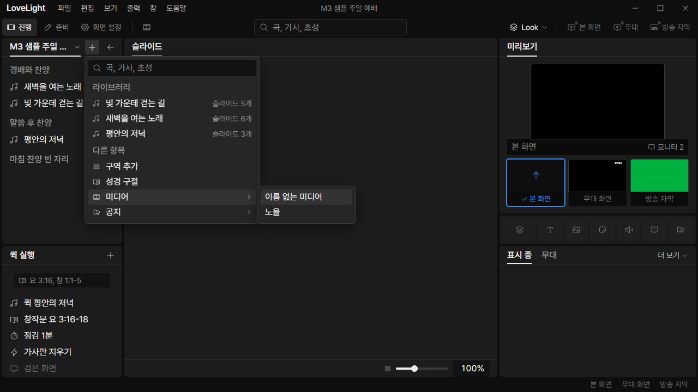

# Review request: `ui-56`

- Team member: `ui` (Codex)
- Branch: `refactor/ui/quick-add-media-helpers`, stacked on approved ui-55
- Base, range, commit and exact-head CI: see the request message
- Task: the media helper deduplication follow-up in `.llp/restart.md`

## What changed and why

Quick Add now uses `backgroundMedia` and `mediaName` from the existing
background choice module. This removes its duplicate audio filter and
unnamed-media fallback. Menu ordering, labels and inserted media references stay
the same. The regression covers an unnamed video alongside a named image and an
audio record, then chooses the video and verifies its insertion target.

## Changes outside my paths

- `prep/service/quickAddItems.ts` and its test: the small authorized follow-up.
- This document and `docs/reviews/assets/ui-56/`: native app evidence.
- No changes to the existing Show helpers or stored data contracts.

## Checked in the app

Built and ran the actual app hidden with `LLP_TEST_WINDOWS=offscreen`, an
isolated copy of the M3 sample and ui port 5186. The launcher passed
`node --check` before Electron started. In the copied profile only, made the
video's name empty and added an audio record to exercise both shared helpers.

CDP opened 항목 추가 > 미디어 at 1280x720, verified the choices were
`이름 없는 미디어` then `노을`, and verified audio was absent. Moved between the
two choices 20 times, repeated another 20, and closed/reopened the menus twice.
Then chose the unnamed video and verified exactly one new service item with that
video's original media reference. No output command was issued.

Matched open-submenu checkpoints held 464 elements and two menus. Collected JS
heap was 5.15 / 5.30 / 5.36 MB; the second repetition added 58 KB, with backing
storage fixed at 1,713,246 bytes. No horizontal overflow or uncaught exceptions
occurred. Inspected the screenshots for unchanged menu placement, label fit and
selection. [Measurements](assets/ui-56/metrics.json).

[Service after inserting the media reference](assets/ui-56/inserted-media.png).

## Checks run

Round 2 retains the native evidence above. Only the parent stack changed during
this rebase; the approved implementation is unchanged.

- Quick Add, media entry and background choice tests: 25 passed.
- Typecheck, targeted ESLint, formatting, `git diff --check` and build: passed.
- Offscreen native flow above: passed.
- CI pending. The dispatcher confirms the exact-head run before merge.

## Team member's reply

Round 2: Rebased onto ui-55 round 2 (`6f0bdde8`), including the current-main
test fixes. ShowPanels, App, PrepMount, Quick Add and background choice tests
pass 74 cases; typecheck passes. No production change was needed.
