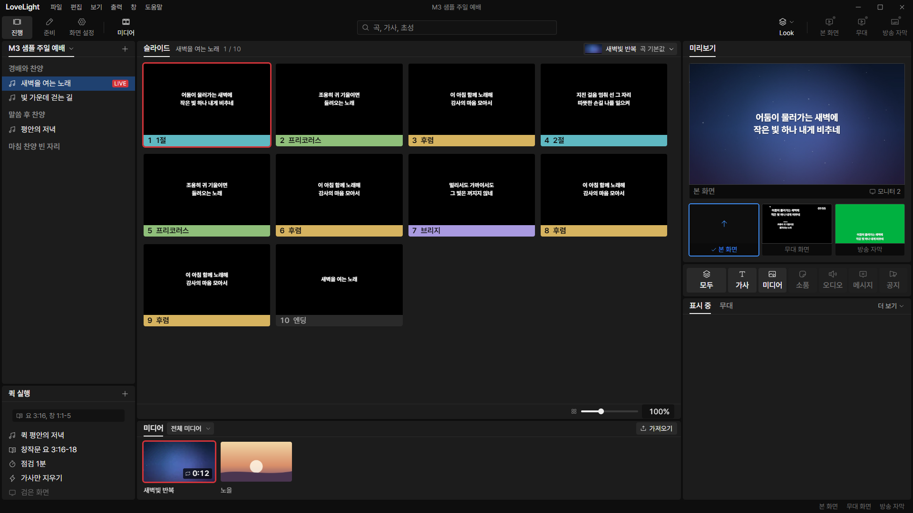
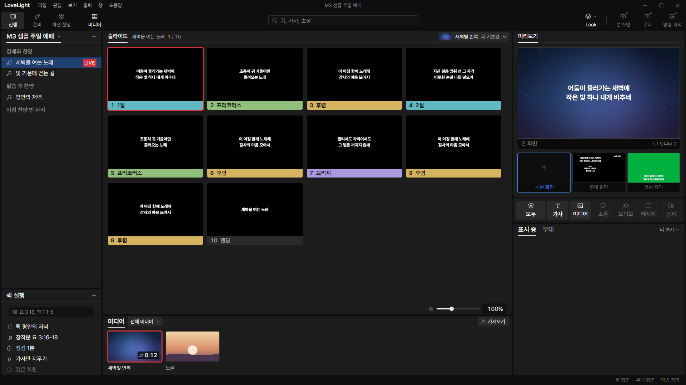
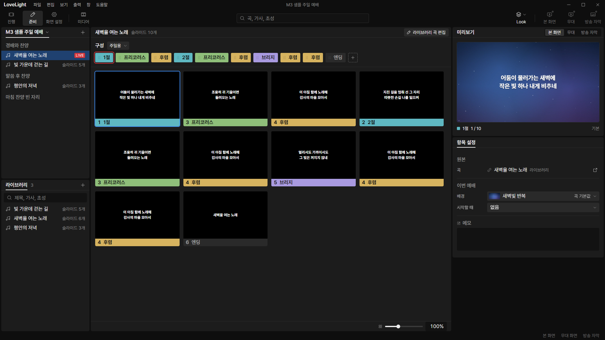
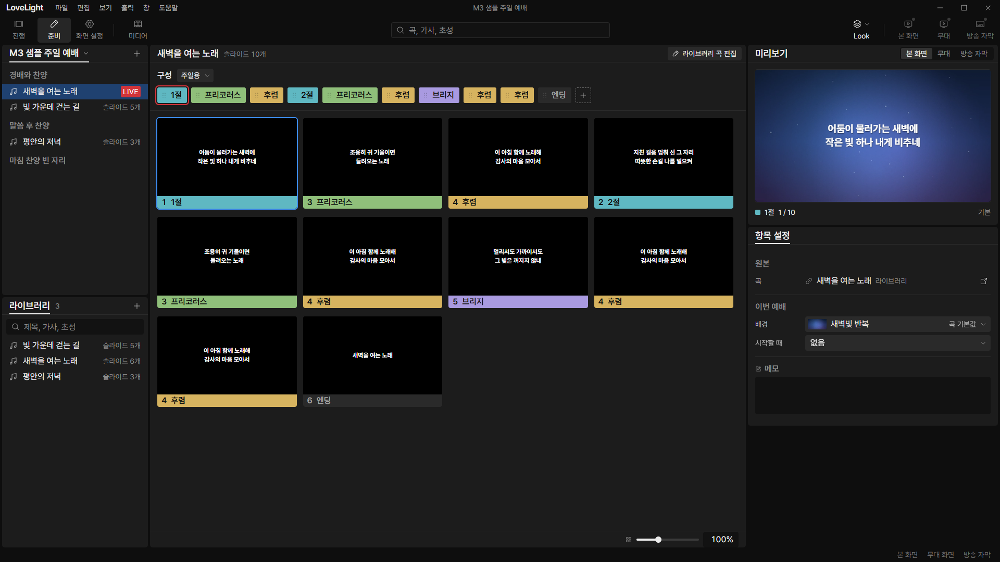
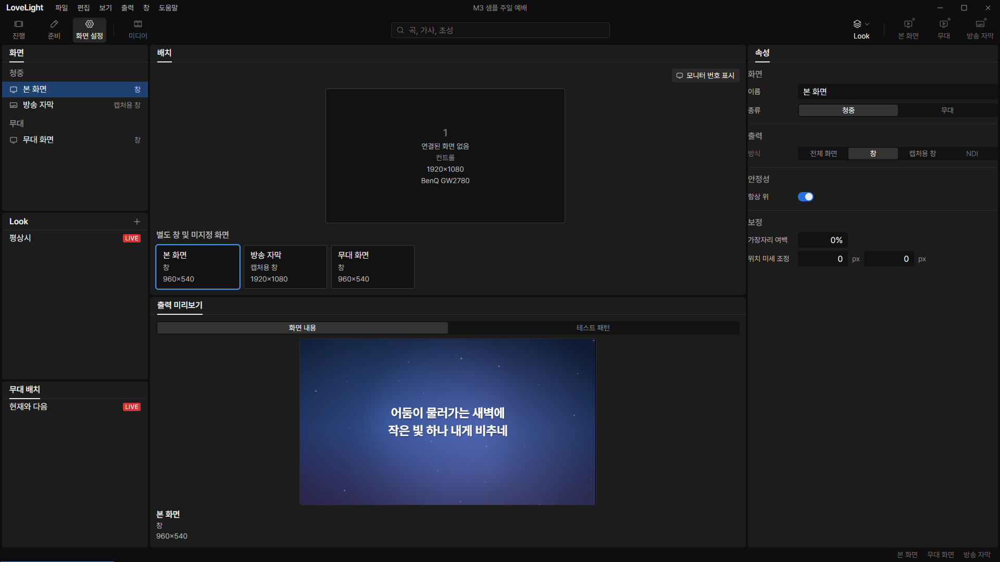

# Review request: `ui-57`

- Team member: `ui` (Codex)
- Branch: `feat/ui/readable-type`, based on local main
- Base, range, commit and exact-head CI: see the request message
- Task: October 27 user decision, readable type at 1920x1080

## What changed and why

The new user decision replaces the earlier one-step proposal. UI text has a 14px
floor, including LIVE, tooltips, captions and toolbar labels. Titles are 18px,
headings 22px, body/list text 16px. The design token source, root and Typography
READMEs, component measurements and reference/gallery specimens were updated
first; the renderer follows the generated tokens.

The baseline already includes ui-51, so body and labels are larger than the
older live-check build. These are the actual before/after measurements:

| Role                                          | Before size/line height | After size/line height |
| --------------------------------------------- | ----------------------- | ---------------------- |
| Heading                                       | 20/28                   | 22/30                  |
| Title, panel tabs and service-order name      | 16/22                   | 18/26                  |
| Body/list rows and strong body                | 16/22                   | 16/22                  |
| Labels, captions, toolbar labels and tooltips | 14/20                   | 14/20                  |
| Strong labels, bands and strong captions      | 16/22                   | 16/22                  |
| LIVE micro                                    | 12/16                   | 14/20                  |
| LIVE badge height                             | 16                      | 22                     |
| Output and thumbnail lyrics                   | Output-relative         | Unchanged              |

The former fixed 16px service-name exception is removed. Panel tabs use the
title token. Standard rows, controls and count/keycap sizes still fit their
lines. The component READMEs' older 11/13px annotations now describe the real
named tokens. The Typography card also fixes its input specimen's missing shared
input class.

## Changes outside my paths

- Design-owned token JSON/generated CSS, source panel CSS/generated bundle,
  root/component READMEs and Typography card: requested design-first scale.
- `styles/tokens.css` and `styles/designSystemAssets.node.test.ts`: renderer
  copy, exact scale, 14px minimum and badge/row fit checks.
- `show/ServiceOrderHeader.module.css`: use the shared 18px title token instead
  of the old fixed exception.
- `show/ServiceOrderHeader.layout.test.ts`: replace the obsolete fixed 16px
  expectation with the user-approved shared title scale, retaining truncation
  and shrink coverage.
- This document and `docs/reviews/assets/ui-57/`: native evidence.

## Checked in the app

Built the real main/preload/renderer, then launched hidden Electron with
`LLP_TEST_WINDOWS=offscreen`, isolated copies of the M3 sample and ui port 5186.
The launcher passed `node --check` before each launch. CDP set the real control
window's content to 1920x1080, selected a service song and activated its first
slide with outputs disabled, then exercised all three workspaces. Captured the
same views before changing tokens and after rebuilding the app.

At both 1920x1080 and 1280x720, the root client and scroll sizes match. Scanned
visible UI text in 진행, 준비 and 화면 설정: no font below 14px and no hidden
line box taller than its container after the change. Before, LIVE was the only
sub-14px UI text found. Output-renderer content and thumbnail lyrics were
excluded from the UI floor. Inspected all six resulting views for title/badge
fit, controls and scrolling; long names keep their tooltip/ellipsis and panels
retain internal vertical scrolling at the minimum size.

CDP switched two service selections and 준비/진행 20 times, then repeated
another 20. Opened/closed File twice. Matched checkpoints held 527 elements;
collected JS heap was 6.65 / 7.36 / 7.64 MB, with a 285 KB increase in the
second repetition and backing storage stable around 1.704 MB. No uncaught
exceptions occurred. This is a short repetition check, not a long-running soak.

The offscreen reference card measured heading 22/30, title 18/26, body 16/22,
labels/captions/tooltips/micro 14/20, and a 22px LIVE badge. Inspected its
screenshot against the app.
[Before measurements](assets/ui-57/before-metrics.json),
[after measurements](assets/ui-57/after-metrics.json).

### 진행, 1920x1080

### 준비, 1920x1080

### 화면 설정, 1920x1080

Minimum-size captures: [진행](assets/ui-57/after-show-minimum.png),
[준비](assets/ui-57/after-prep-minimum.png),
[화면 설정](assets/ui-57/after-screens-minimum.png).

[Design reference](assets/ui-57/after-typography-design.png).

## Checks run

Round 2 retains the before/after app evidence above. The rebase preserves the
approved type-scale implementation and the calendar tokens now on main.

Round 3 retains that evidence and changes only the obsolete layout test after
rebasing onto current main. The approved type-scale implementation is unchanged.
The layout, token, component, gallery and header tests pass 56 cases; typecheck
passes.

- Token/assets, Panel, StatusMarks, gallery and ServiceOrderHeader: 53 tests
  passed.
- Typecheck, targeted ESLint, formatting, `git diff --check` and build: passed.
- Offscreen real app and design reference checks above: passed.
- CI pending. The dispatcher confirms the exact-head run before merge.

## Team member's reply

Round 3: Read the failed ui-58/ui-59 job logs. Both fail only the inherited
ServiceOrderHeader layout test, which still requires the superseded 16px font.
Reproduced the same assertion locally (one failure, one pass) before updating it
to require the shared title token. The existing asset tests verify that this
token is 18/26, and the layout test retains its ellipsis/shrink assertions.
Rebased onto local main `4945d6fe`; no production change was needed.

Round 2: Rebased onto local main `8aeed6b5`. ShowPanels, App, PrepMount and the
owned token, component, gallery and header tests pass 104 cases; typecheck
passes. No production change was needed.
