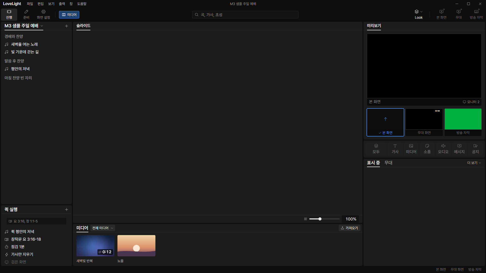
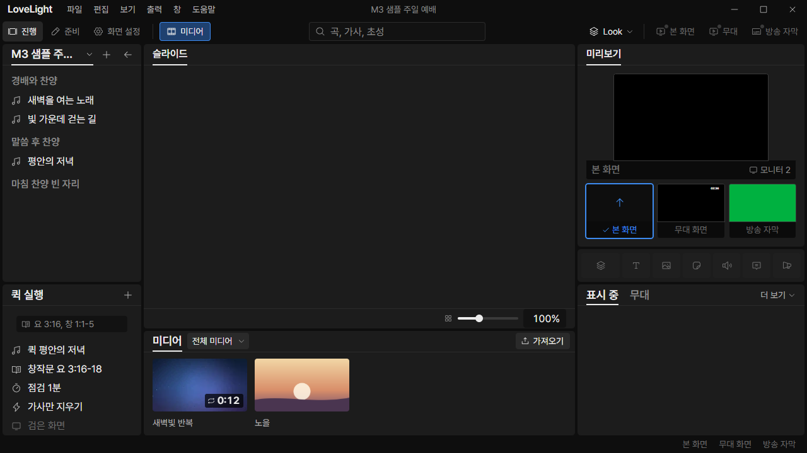
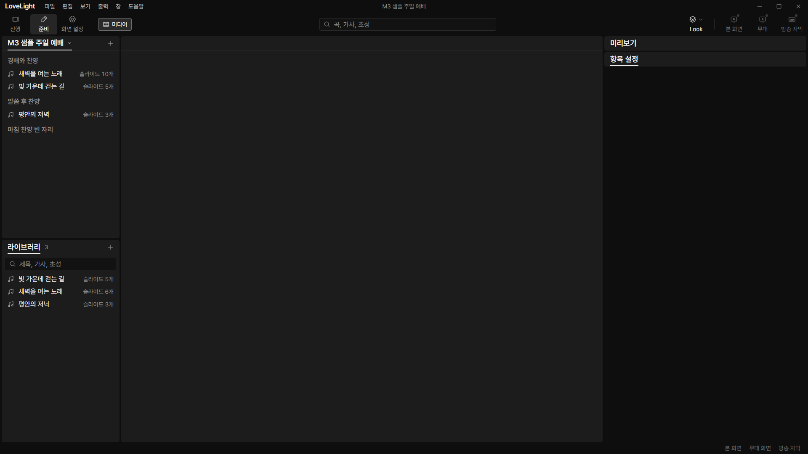
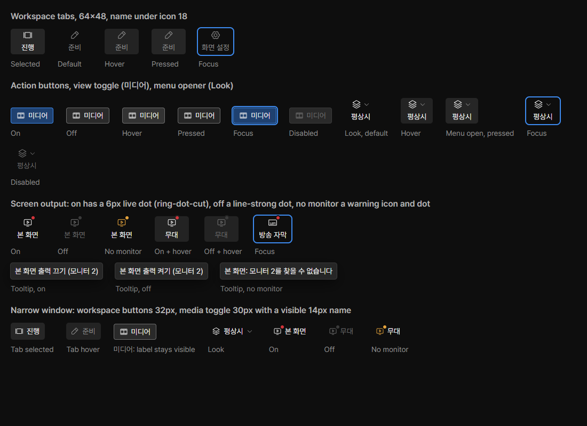

# Review request: `ui-58`

- Team member: `ui` (Codex)
- Branch: `style/ui/media-toolbar-toggle`, stacked on approved ui-57
- Base, range, commit and exact-head CI: see the request message
- Task: user decision, distinguish the media-bin toggle from workspace tabs

## What changed and why

The media toggle now has a 30px horizontal control shape at every window size,
with a 16px film icon and a visible 14px 미디어 label. Off has a control surface
and gray border; on has a blue selection surface and accent border. Workspace
tabs retain their existing shape and gray selection. The narrow form also keeps
the media label visible. Tooltips say 미디어 열기 or 미디어 닫기.

Defined the anatomy and on/off/hover/pressed/focus/disabled states in the design
README/reference gallery first, then ported them into ToolbarButton and its
React gallery. The generic action/menu/output forms retain their own variants.
The ui-57 nit is included: Tooltip's table now calculates 30px single-line, 52px
two-line and 20px wrapping increments from its 14/20 text.

## Coordination with data

Inspected data-74, `feat/data/shared-media-bin` at `86898d50`. That request owns
the shared bottom mount, remembered visibility and retention of normal Prep
panels. It leaves Toolbar's `mediaOpen` / `onMediaOpenChange` interface intact.
This request keeps those props and ToolbarButton's `pressed` /
`onPressedChange`; no new command, provider or visibility state is introduced.
It changes the trigger's appearance and tooltip, not the bin mount. The app
captures below use the existing mount on this review stack; data-74 verifies the
combined bottom-bin flow in its own request.

## Changes outside my paths

- Design-owned Toolbar/ToolbarButton READMEs/cards, source CSS/generated bundle:
  requested visual distinction and states.
- Design-owned Tooltip README: the approved ui-57 measurement nit.
- `shell/Toolbar.tsx` and its test: visible media name in the compact toolbar,
  action-specific tooltip and callback/workspace separation regression.
- This document and `docs/reviews/assets/ui-58/`: app evidence.

## Checked in the app

Built the real app and launched hidden Electron with
`LLP_TEST_WINDOWS=offscreen`, an isolated sample profile and ui port 5186. The
launcher passed `node --check` before Electron started. CDP exercised the actual
control window at 1920x1080 and 1280x720.

- In both 진행 and 준비, opened/closed media, checked the selected workspace
  stayed unchanged and captured on/off states. The toggle is 80.31x30px in all
  cases, with a 16px icon and visible 14px label, outside the workspace tablist.
- Verified the gray off border/control surface and blue on border/selection
  surface. In 화면 설정, checked disabled appearance and that clicking does not
  activate it. No horizontal page overflow occurred.
- Repeated open/close 20 times and another 20, then used keyboard Space twice to
  toggle. Opened/closed File twice. Matched checkpoints hold 424 elements;
  collected heap is 6.32 / 6.60 / 6.68 MB, with backing storage fixed at
  1,703,138 bytes. No uncaught exceptions occurred. This is a short repetition
  check, not a long-running soak.
- Rendered the design reference in a second offscreen window. All seven media
  specimens, including the compact form, measure 30px high with visible names.
  Inspected both app sizes and the reference for distinction from workspace
  tabs, label fit, on/off borders and focus/disabled treatment.

[Measurements](assets/ui-58/metrics.json).

Other app captures: [진행 off](assets/ui-58/wide-show-off.png),
[준비 on](assets/ui-58/wide-prep-on.png),
[disabled](assets/ui-58/wide-disabled.png),
[minimum 준비](assets/ui-58/minimum-prep-off.png).

## Checks run

- ToolbarButton, shell Toolbar and gallery: 34 tests passed.
- Typecheck, targeted ESLint, formatting, `git diff --check` and build: passed.
- Actual offscreen app and reference checks above: passed.
- CI pending (API 403). Lead confirms exact-head CI before merge.

## Team member's reply

Pending review.
