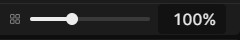
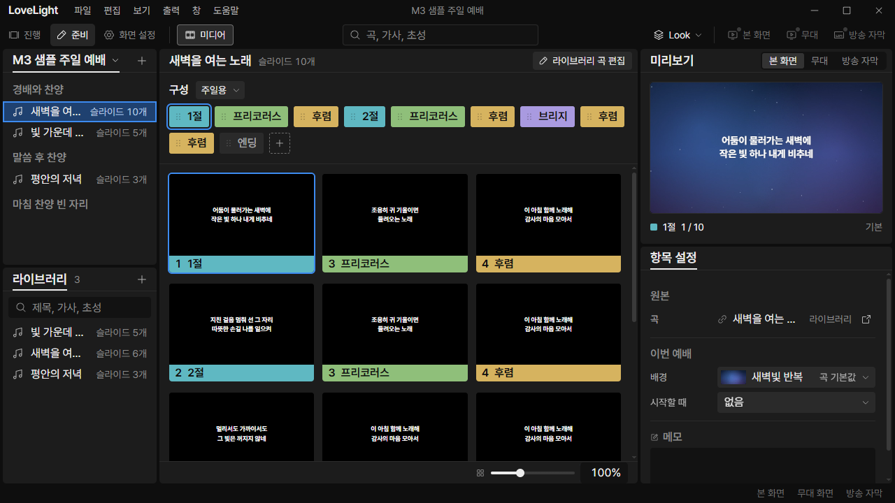
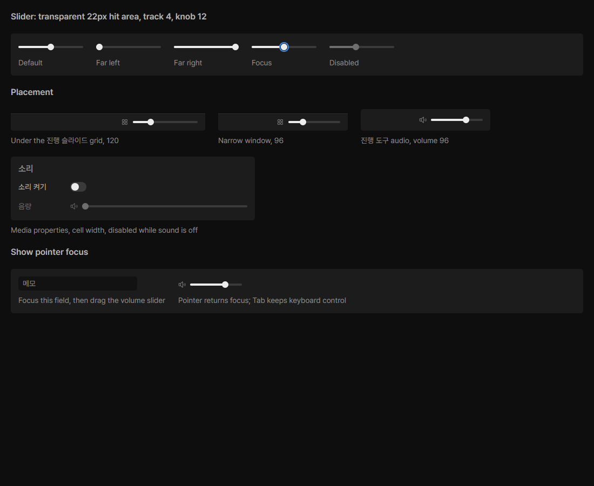

# Review request: `ui-59`

- Team member: `ui` (Codex)
- Branch: `fix/ui/slider-target-size`
- Base, range, commit and exact-head CI: see the request message
- QA row: **M3-UX-07**, global minimum target versus Slider's old 16px height

## What changed and why

Slider's transparent input is now 22px high. The painted track stays 4px and the
knob 12px; regular/compact widths remain 120/96px. Fluid sliders also retain a
22px minimum width. This reconciles the global 22x22 target rule with the
component, without enlarging the visible control or its 32px footer.

Updated the design token, Slider/root READMEs and gallery first. The reference
CSS now reads the same size tokens as the renderer instead of hard-coding 16px.
The renderer follows that token and minimum width; pointer/keyboard handlers are
unchanged. This is our target-size rule, not a claim about PP dimensions.

## Changes outside my paths

- Design-owned token JSON/generated CSS, Slider/root READMEs, card, source CSS
  and generated bundle: resolve the conflicting measurements.
- `styles/tokens.css` and `styles/designSystemAssets.node.test.ts`: renderer
  copy and shared target/track/knob contract regression.
- This document and `docs/reviews/assets/ui-59/`: native evidence.

## Checked in the app

Rebased onto local main, rebuilt the actual app, then launched hidden Electron
with `LLP_TEST_WINDOWS=offscreen`, an isolated sample profile and ui port 5186.
The launcher passed `node --check` before Electron started. CDP exercised 진행
and 준비 at 1920x1080 and 1280x720.

- Actual slider height is 22px in all four cases. Width is 120px, except the
  narrow 진행 variant at 96px. The root client and scroll dimensions match.
- Clicked 1px inside the new top and bottom edges, outside the old centered 16px
  bounds. Starting at 100%, those clicks reached 83/167% (82/168% for the
  compact width). Ordinary thumb dragging also changed the value.
- 진행 returned focus to the previously focused service row after all pointer
  interactions. 준비 focused the slider normally. Restored the scale to 100%.
- Repeated top/bottom clicks and restoration 20 times, then another 20. Opened
  and closed File twice. Matched checkpoints held 521 elements; collected heap
  was 6.78 / 6.93 / 7.01 MB, with backing storage fixed at 1,714,021 bytes and
  no uncaught exceptions. This is a short repetition check, not a long soak.
- The offscreen design card has ten sliders, all 22px high; track/knob tokens
  remain 4/12px. Inspected the card, app views and footer detail for unchanged
  visual size and placement. [Measurements](assets/ui-59/metrics.json).

Other captures: [진행](assets/ui-59/wide-show.png),
[준비](assets/ui-59/wide-prep.png),
[minimum 진행](assets/ui-59/minimum-show.png).

## Checks run

Round 2 retains the native app/reference evidence above. This round rebases the
approved slider target fix onto the updated ui-58 stack without changing its
production code.

- Token/assets, Slider, ThumbnailSizeControl and gallery: 63 tests passed after
  the rebase.
- Typecheck, targeted ESLint, formatting, `git diff --check` and build: passed.
- Offscreen app/reference checks above: passed.
- CI pending. The dispatcher confirms the exact-head run before merge.

## Team member's reply

Round 2: Rebased onto ui-58 round 2 (`be46bed1`), including the current-main
test fixes. ShowPanels, App, PrepMount, token/assets, Slider,
ThumbnailSizeControl and gallery tests pass 114 cases; typecheck passes. No
production change was needed.
